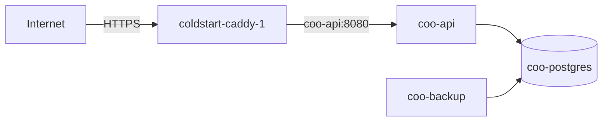

# Deploying the Coo backend

The backend runs on the Hetzner host behind the Caddy that already serves Coldstart, PurePrep and CoreChoice
(Spec 008). Caddy handles TLS; Coo's stack runs `coo-api`, `coo-postgres` and `coo-backup`.

## The host

- `lechdigital-prod` (in `~/.ssh/config`, also still `coldstart-prod`): Hetzner cx23, **167.233.145.128**, 4 GB.
- Coo lives at `/opt/coo`, as the compose project `coo`.
- `coo-api` joins the shared `coldstart_default` network, so Caddy can reach it by container name.
- PostgreSQL is only on the private `coo_internal` network.
- DNS: `api.coo.lechdigital.nl` → A → `167.233.145.128` (created 2026-10-01).



## Every deploy

**From GitHub (preferred, once lechdigital-infra's setup is done):** Actions → **Deploy (production)** → Run workflow.
It runs every test (the CI workflow), then lechdigital-infra's `deploy-app.yml` builds the image on GitHub, streams it to
the server, starts it as `coo-api:<commit>` and waits until `/health` reports the commit. Nothing deploys on a push; the
button is the approval. The workflow must be on `main` for the button to appear. The server and the edge Caddy are
described in [lechdigital-infra](https://github.com/Lech-Digital/lechdigital-infra).

**From the Mac (fallback):**

```sh
./deploy/deploy-prod.sh --confirm
```

The script:

1. refuses when the backend has uncommitted changes, because `/health` reports the commit;
2. runs every test, including the PostgreSQL ones, so **Docker Desktop must be running**;
3. creates `/opt/coo/.env` on the first deploy (database password generated on the server, never printed) and adds the
   sign-in settings when they are missing (see below);
4. rsyncs the backend source and builds the image on the server;
5. waits until `https://api.coo.lechdigital.nl/health` reports the new commit. On failure it prints the API's last
   30 log lines.

The database volume survives every deploy. Migrations run when the API starts, before it takes a request.

## Sign-in settings (Spec 010 §4.3)

`coo-api` needs two values from `/opt/coo/.env`, and **refuses to start without them** (as it does without the
database password):

| `.env` | Becomes | What |
|---|---|---|
| `AUTH_GOOGLE_WEB_CLIENT_ID` | `Auth__GoogleWebClientId` | The Web client of Google Cloud project `coo-app-510411` (`docs/google-sign-in-setup.md` §6): the `aud` every Google ID token must carry. Not a secret. |
| `AUTH_SIGNING_KEY_K1` | `Auth__SigningKeys__k1` | The HMAC key that signs access tokens: 32 random bytes, base64. |

`deploy-prod.sh` adds both when they are missing: the client ID from the script, the key with `openssl rand -base64 32`
**on the server**, never printed. Check that they are there (names only):

    ssh coldstart-prod "grep -o '^AUTH_[A-Z0-9_]*=' /opt/coo/.env"

**Rotating the signing key** without signing anyone out (ADR 0003 §4): add `AUTH_SIGNING_KEY_K2` to `.env` (generated on
the server as above), add `Auth__SigningKeys__k2: ${AUTH_SIGNING_KEY_K2}` and `Auth__ActiveSigningKeyId: k2` to the
compose file, and deploy. After at least 15 minutes (the access-token lifetime), remove `k1` from both and deploy again.
Refresh tokens are not signed, so they survive any rotation.

**If every sign-in fails with `auth.google-token-invalid`:** the API logs `Google ID token refused (<reason>)`. An
`HttpRequestException` means the container cannot reach `www.googleapis.com` (fail closed, ADR 0003 §5); an
`InvalidJwtException` naming the audience means the client ID in `.env` is not the one the app was built with.


## Sync (Spec 011)

No new settings. The `Sync` migration runs at start-up like the others: it adds `baby_profiles`, `household_settings`,
`duplicate_dismissals`, `applied_changes`, `sync_conflicts`, `consents` and `memberships.revoked_at`.

- Every `/api/sync/*` request checks the caller's membership of the household and their consent to the current wording
  (`care-data-v1`). A `403` with `sync.consent-required` means the person has not agreed yet; it is not an outage.
- `SyncHistoryCleanupJob` deletes `applied_changes` and `sync_conflicts` rows older than 30 days, daily, 20 minutes after
  start-up. It logs `Sync history: N old rows deleted`, or `Sync history clean-up failed: <type>`.
- Consents are evidence (GDPR Art. 7(1)): never delete `consents` rows by hand; account deletion removes them.

Check after a deploy (read-only):

    ssh coldstart-prod "docker exec coo-postgres psql -U coo -d coo -tAc \"SELECT count(*) FROM information_schema.tables WHERE table_name IN ('applied_changes','consents','baby_profiles')\""

Expected: `3`.

## Members and invitations (Spec 011b)

The `MembersAndInvitations` migration runs at start-up: it adds `invitations` (only a keyed hash of the code is stored, see "Invitation codes").

- `SyncHistoryCleanupJob` also deletes every invitation whose expiry has passed (used and withdrawn ones included), so
  no invitation outlives its 72 hours by more than a day. Its log line counts them with the sync rows.
- Preview and accept are limited per user (10 an hour) and per client address (30 an hour); creating invitations to 20
  per user a day (`Invitations:*` settings override them). In memory: a restart resets them.
- Codes travel in request bodies; `/i/{code}` carries one in its path, so **no request lines are logged**
  (`Microsoft.AspNetCore: Warning`) and the Caddy block for `api.coo.lechdigital.nl` has **no `log` directive**. Keep it
  that way.

### Invitation codes

A code has only 40 bits, so its stored hash is an HMAC-SHA256 under a pepper that is **not in the database**.
`coo-api` refuses to start in Production without `Invitations__CodePepper`, from `/opt/coo/.env`:

| `.env` | Becomes | What |
|---|---|---|
| `INVITATIONS_CODE_PEPPER` | `Invitations__CodePepper` | 32 random bytes in base64 (`openssl rand -base64 32`). A secret: generated on the server, never printed. |

`deploy-prod.sh` generates it once when missing. **Changing or losing it makes every open invitation invalid** (the
hashes no longer match): the first deploy that adds it invalidates the invitations created before it, which is accepted
while the app is unreleased. Members are not affected; people just need a new code. Back it up with the rest of `.env`.

The `Invitations:*` limits (`PerUserPerHour`, `PerAddressPerHour`, `CreatePerUserPerDay`) must be positive whole numbers
or the API refuses to start.

### App Links

`coo-api` refuses to start without `AppLinks__Sha256CertFingerprints__0`, from `/opt/coo/.env`:

| `.env` | Becomes | What |
|---|---|---|
| `APPLINKS_SHA256_DEBUG` | `AppLinks__Sha256CertFingerprints__0` | The SHA-256 of the key that signs the installed APK: the debug key until Increment 18, when the Play app-signing key's is added as `__1`. Not a secret. |

`deploy-prod.sh` adds it when missing (override with `COO_APPLINKS_SHA256_DEBUG`). The value comes from:

    keytool -list -v -keystore "$HOME/Library/Application Support/Xamarin/Mono for Android/debug.keystore" \
      -alias androiddebugkey -storepass android -keypass android | grep SHA256

**Before the Play release:** a Play-installed app is signed with Google's app-signing key, not the debug key. Add that
key's SHA-256 (Play Console, Setup, App signing) as `AppLinks__Sha256CertFingerprints__1` in
`deploy/docker-compose.prod.yml` (from a new `.env` line) and deploy, or invitation links will open the browser page
instead of Coo on Play installs.

Check after a deploy:

    curl -s https://api.coo.lechdigital.nl/.well-known/assetlinks.json
    ssh coldstart-prod "docker exec coo-postgres psql -U coo -d coo -tAc \"SELECT count(*) FROM information_schema.tables WHERE table_name = 'invitations'\""

Expected: the JSON lists `com.lechdigital.coo` with the fingerprint; `1`.

## Billing (ADR 0004)

- `GOOGLE_PLAY_CREDENTIALS_JSON` in `/opt/coo/.env`: the `coo-play-billing@coo-app-510411` service account's key, as one
  line (`jq -c . coo-play-billing.json`). **The API refuses to start without it**, and compose refuses before it touches
  the running container. In Play Console → Users and permissions, the account needs **View financial data** (to read
  purchases) and **Manage orders and subscriptions** (to acknowledge them; without it Google refunds every purchase after
  three days).
- `BILLING_RTDN_TOKEN`: the `?token=` of the Pub/Sub push subscription. Set up once:
  1. Google Cloud (project `coo-app-510411`) → Pub/Sub → topic `play-billing`; grant
     `google-play-developer-notifications@system.gserviceaccount.com` the **Pub/Sub Publisher** role on it.
  2. A **push** subscription on it to `https://api.coo.lechdigital.nl/api/billing/rtdn?token=<BILLING_RTDN_TOKEN>`.
  3. Play Console → CooApp → Monetisation setup → Real-time developer notifications: topic
     `projects/coo-app-510411/topics/play-billing`, "Subscriptions, voided purchases and all one-time products"; then
     **Send test notification** and look for a 200 in the Pub/Sub subscription's metrics.

  Without it the webhook answers 401 and the API logs a warning at start; the hourly recheck (`PurchaseRecheckJob`)
  still re-reads every purchase that is about to run out, ran out lately, is new or was not checked for a day, so
  renewals and refunds arrive within an hour or a day instead of seconds.
- `BILLING_COMPLIMENTARY_EMAILS`: accounts whose families get Premium without buying (the Play reviewers' account).

## First deployment: the Caddy block (once)

On the very first deploy, `deploy-prod.sh` ends with `DEPLOY FAILED`: its health check goes through Caddy, which has
no route yet. Check the containers with `ssh coldstart-prod 'docker ps'`, add the block below, and the next deploy
passes.

Caddy is `coldstart-caddy-1`, its config `/opt/coldstart/Caddyfile`. Append:

```
# Coo backend (separate /opt/coo stack, joined on this network).
# Upstream is the CONTAINER name, per the collision note at the top of this file.
api.coo.lechdigital.nl {
	reverse_proxy coo-api:8080
}
```

**The upstream is the container name `coo-api`, never a compose service name** (CoreChoice `DEPLOY.md` explains the
collision that once made Coldstart serve PurePrep's API).

Back up, validate, then **reload, never restart**: this Caddy is the only way in for every site on the host.

```sh
ssh coldstart-prod 'cp /opt/coldstart/Caddyfile /opt/coldstart/Caddyfile.bak-$(date +%F)
docker exec coldstart-caddy-1 caddy validate --config /etc/caddy/Caddyfile &&
docker exec coldstart-caddy-1 caddy reload --config /etc/caddy/Caddyfile'
```

Then confirm the neighbours are untouched:

```sh
for u in https://getcoldstart.nl https://api.pureprep.lechdigital.nl/health https://api.corechoice.lechdigital.nl/health https://api.coo.lechdigital.nl/health; do
  curl -s -o /dev/null -w "$u %{http_code}\n" -m 15 "$u"
done
```

## Backups

- `coo-backup` writes `pg_dump -Fc` to `/opt/coo/backups`: the first 10 minutes after start, then every 24 hours.
  Dumps are kept 14 days.
- Hetzner's server backups (daily images of the whole server, kept 7 days) take them off the machine.
- **Restore drill:** `./deploy/restore-drill.sh` restores the newest dump into a scratch database and compares row
  counts with the live one. `--fresh` takes a dump first, which is how the first drill is run.
- **A real restore,** if it is ever needed:

  ```sh
  ssh coldstart-prod 'cd /opt/coo && docker compose --env-file .env -f deploy/docker-compose.prod.yml stop coo-api'
  ssh coldstart-prod 'docker exec coo-backup pg_restore -h coo-postgres -U coo -d coo --clean --if-exists /backups/<dump>'
  ssh coldstart-prod 'cd /opt/coo && docker compose --env-file .env -f deploy/docker-compose.prod.yml start coo-api'
  ```

## The integrity scan

It runs inside the API every day; failures are logged by row ID. On demand:

```sh
ssh coldstart-prod 'docker exec coo-api dotnet Coo.Api.dll verify'
```

The exit code is 0 when every row decodes, and 1 when any row does not.

## Logs

```sh
ssh coldstart-prod 'cd /opt/coo && docker compose --env-file .env -f deploy/docker-compose.prod.yml logs --tail 50 coo-api'
ssh coldstart-prod 'docker logs --tail 5 coo-backup'
```
