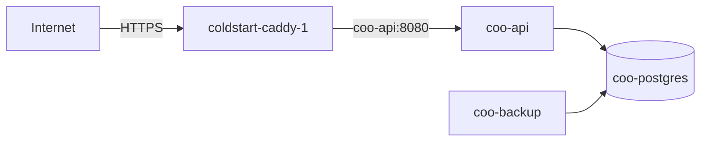

# Deploying the Coo backend

The backend runs on the Hetzner host behind the Caddy that already serves Coldstart, PurePrep and CoreChoice
(Spec 008). Caddy handles TLS; Coo's stack runs `coo-api`, `coo-postgres` and `coo-backup`.

## The host

- `coldstart-prod` (in `~/.ssh/config`): Hetzner, **167.233.145.128**, 4 GB.
- Coo lives at `/opt/coo`, as the compose project `coo`.
- `coo-api` joins the shared `coldstart_default` network, so Caddy can reach it by container name.
- PostgreSQL is only on the private `coo_internal` network.
- DNS: `api.coo.lechdigital.nl` → A → `167.233.145.128` (created 2026-10-01).



## Every deploy

```sh
./deploy/deploy-prod.sh --confirm
```

The script:

1. refuses when the backend has uncommitted changes, because `/health` reports the commit;
2. runs every test, including the PostgreSQL ones, so **Docker Desktop must be running**;
3. on the first deploy, creates `/opt/coo/.env` with a database password generated on the server and never printed;
4. rsyncs the backend source and builds the image on the server;
5. waits until `https://api.coo.lechdigital.nl/health` reports the new commit. On failure it prints the API's last
   30 log lines.

The database volume survives every deploy. Migrations run when the API starts, before it takes a request.

## First deployment: the Caddy block (once)

Caddy is `coldstart-caddy-1`, its config `/opt/coldstart/Caddyfile`. Append:

```
# Coo backend (separate /opt/coo stack, joined on this network).
# Upstream is the CONTAINER name, per the collision note at the top of this file.
api.coo.lechdigital.nl {
	reverse_proxy coo-api:8080
}
```

**The upstream is the container name `coo-api`, never a compose service name** (CoreChoice `DEPLOY.md` explains the
collision that once made Coldstart serve PurePrep's API).

Back up, validate, then **reload, never restart**: this Caddy is the only way in for every site on the host.

```sh
ssh coldstart-prod 'cp /opt/coldstart/Caddyfile /opt/coldstart/Caddyfile.bak-$(date +%F)
docker exec coldstart-caddy-1 caddy validate --config /etc/caddy/Caddyfile &&
docker exec coldstart-caddy-1 caddy reload --config /etc/caddy/Caddyfile'
```

Then confirm the neighbours are untouched:

```sh
for u in https://getcoldstart.nl https://api.pureprep.lechdigital.nl/health https://api.corechoice.lechdigital.nl/health https://api.coo.lechdigital.nl/health; do
  curl -s -o /dev/null -w "$u %{http_code}\n" -m 15 "$u"
done
```

## Backups

- `coo-backup` writes `pg_dump -Fc` to `/opt/coo/backups`: the first 10 minutes after start, then every 24 hours.
  Dumps are kept 14 days.
- Hetzner's server backups (daily images of the whole server, kept 7 days) take them off the machine.
- **Restore drill:** `./deploy/restore-drill.sh` restores the newest dump into a scratch database and compares row
  counts with the live one. `--fresh` takes a dump first, which is how the first drill is run.
- **A real restore,** if it is ever needed:

  ```sh
  ssh coldstart-prod 'cd /opt/coo && docker compose --env-file .env -f deploy/docker-compose.prod.yml stop coo-api'
  ssh coldstart-prod 'docker exec coo-backup pg_restore -h coo-postgres -U coo -d coo --clean --if-exists /backups/<dump>'
  ssh coldstart-prod 'cd /opt/coo && docker compose --env-file .env -f deploy/docker-compose.prod.yml start coo-api'
  ```

## The integrity scan

It runs inside the API every day; failures are logged by row ID. On demand:

```sh
ssh coldstart-prod 'docker exec coo-api dotnet Coo.Api.dll verify'
```

The exit code is 0 when every row decodes, and 1 when any row does not.

## Logs

```sh
ssh coldstart-prod 'cd /opt/coo && docker compose --env-file .env -f deploy/docker-compose.prod.yml logs --tail 50 coo-api'
ssh coldstart-prod 'docker logs --tail 5 coo-backup'
```
