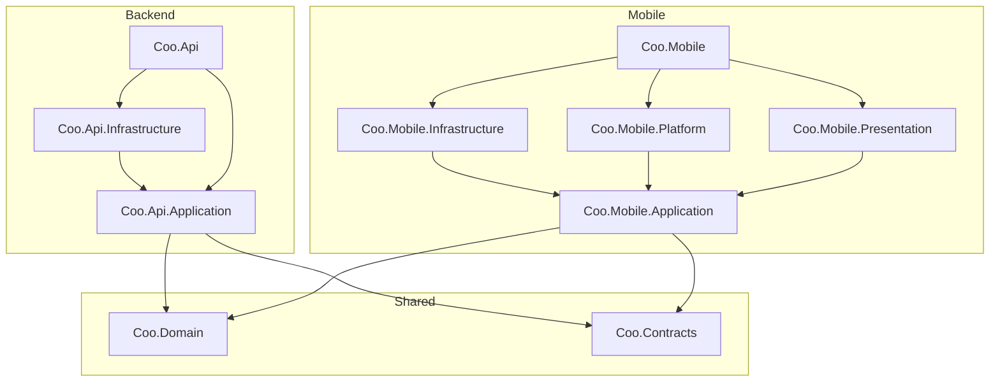

# 1. Solution structure and layering

Date: 2026-09-29

Status: Accepted

Amended by: ADR 0010 §1 (the `CareLog` folder is organised by entry kind)

## Context

Coo is an offline-first, family-synced baby care tracker: a .NET MAUI app with a local SQLite
database, and an ASP.NET Core 10 backend with PostgreSQL, deployed as a Docker container on Hetzner.
Both sides follow Clean Architecture with DDD. We need a solution skeleton that is agreed before any
feature spec is written, because every later spec names the projects it touches.

The design is shaped by these forces:

- **Offline-first.** The phone is the source of truth for the person holding it. Domain rules
  (for example "a sleep cannot end before it starts") must be enforced on the device with no network,
  and must mean exactly the same thing on the server.
- **Old clients live for months.** Installed app versions lag the server. What travels over the wire
  must be versioned independently of how the domain is modelled internally.
- **Android first.** iOS is a possible later target, not a current one. The maintainer machine has
  only the `maui-android` workload, in a user-local SDK at `~/dotnet-maui`.
- **Proven local toolchain.** Two apps by the same maintainer, PurePrep and CoreChoice, are live on
  Google Play from this machine. Their `BUILD.md` and `DEPLOY.md` record failure modes that a new
  solution must not reproduce:
  - Multi-targeting `net10.0-ios` without the iOS workload breaks restore (`NETSDK1147`).
  - Passing `-p:TargetFrameworks=...` leaks into referenced `net10.0` libraries (`NETSDK1005`).
  - `dotnet test` at the repo root tries to build the MAUI project and fails on the global SDK.
  - A server schema managed by `EnsureCreated` plus hand-written idempotent SQL fails at runtime
    when a column is added only to the entity.
  - On the shared Hetzner host (one Caddy, one `coldstart_default` network), a generic compose
    service name or an implicit compose project name collides with neighbouring stacks.
- **Coding standards.** The Domain has zero project dependencies (CS-HEX-01). Ports live in
  Application (CS-HEX-02). DI is wired only in the composition root (CS-HEX-03). Implementation
  classes are `internal` (CS-MOD-01).

## Decision

### 1. Layout

```
CooApp/                                   # repository root
├── Coo.slnx                              # everything, including the MAUI host
├── Coo.Tests.slnf                        # solution filter: all projects except MAUI-bound ones
├── global.json                           # pins the .NET 10 SDK band
├── Directory.Build.props                 # Nullable, TreatWarningsAsErrors, LangVersion, analyzers
├── Directory.Packages.props              # central package management
├── NuGet.config                          # <clear/> + nuget.org only
├── .editorconfig
├── BUILD.md                              # verified local build recipe (same shape as siblings)
├── DEPLOY.md                             # verified deploy recipe
│
├── docs/
│   ├── adrs/                             # NNNN-kebab-case-title.md
│   └── specs/                            # SDD feature specs, one folder per feature
│
├── src/
│   ├── Shared/
│   │   ├── Coo.Domain/                   # net10.0 — zero dependencies
│   │   │   ├── Common/                   # Entity, AggregateRoot, DomainEvent, typed IDs, Result
│   │   │   ├── Households/               # Household (aggregate), Caregiver, CaregiverRole, BabyProfile
│   │   │   ├── CareLog/                  # Feeding, DiaperChange, SleepSession, PumpingSession + VOs
│   │   │   ├── Entitlements/             # Entitlement, Plan (Trial/Monthly/Yearly/Lifetime), FeatureGate
│   │   │   └── Insights/                 # SleepPredictor — pure domain service, device + server
│   │   └── Coo.Contracts/                # net10.0 — zero dependencies; versioned wire DTOs
│   │       ├── Sync/  CareLog/  Households/  Billing/  AiParsing/
│   │
│   ├── Backend/
│   │   ├── Coo.Api.Application/          # use cases + ports; Contracts ⇄ Domain mapping (ACL)
│   │   ├── Coo.Api.Infrastructure/       # EF Core + Npgsql, Play validation, LLM, PDF, push
│   │   └── Coo.Api/                      # ASP.NET Core host = composition root
│   │                                     # Minimal API endpoints, SignalR hub, store webhooks
│   │
│   └── Mobile/
│       ├── Coo.Mobile.Application/       # net10.0 — use cases + ports, no MAUI references
│       ├── Coo.Mobile.Infrastructure/    # net10.0 — EF Core SQLite, outbox, HTTP sync, SignalR client
│       ├── Coo.Mobile.Platform/          # net10.0-android — billing, speech, notifications
│       ├── Coo.Mobile.Presentation/      # net10.0 — ViewModels (CommunityToolkit.Mvvm)
│       └── Coo.Mobile/                   # MAUI host = composition root; Views, Resources, Platforms
│
├── wearables/                            # outside the .NET solution
│   └── wearos/                           # native Kotlin + Compose for Wear OS (watchOS later)
│
├── tests/
│   ├── Coo.Domain.Tests/
│   ├── Coo.Architecture.Tests/           # enforces the dependency rules below
│   ├── Coo.Api.Application.Tests/
│   ├── Coo.Api.Infrastructure.Tests/     # Testcontainers PostgreSQL
│   ├── Coo.Api.IntegrationTests/         # WebApplicationFactory
│   ├── Coo.Mobile.Application.Tests/
│   ├── Coo.Mobile.Infrastructure.Tests/  # real SQLite
│   ├── Coo.Mobile.Presentation.Tests/
│   └── Coo.Ai.Evals/                     # real-model evals, on demand, not in CI (ADR 0005)
│
└── deploy/
    ├── docker-compose.prod.yml
    ├── .env.example
    └── verify-play-access.py             # same pre-deploy gate as the sibling apps
```

The Dockerfile lives at the repository root, as in the sibling apps, and `COPY`s explicit project
paths only — never `COPY . .` — so that secrets under the build context cannot reach an image layer.

### 2. Dependency rules



- `Coo.Domain` and `Coo.Contracts` reference no project and no package outside the BCL.
- `Coo.Domain` does not reference `Coo.Contracts`. Mapping between them happens only in the two
  Application layers.
- Nothing under `Backend/` references anything under `Mobile/`, and nothing under `Mobile/`
  references anything under `Backend/`.
- Infrastructure and Platform projects expose one public `AddXxx(this IServiceCollection)`
  extension. Everything else in them is `internal`.
- Only the two host projects (`Coo.Api`, `Coo.Mobile`) compose the object graph.
- Time is injected (ADR 0004 §10). `Coo.Domain` receives `now` as a parameter. Every other
  project reads time only through the injected `TimeProvider`.
- `Coo.Architecture.Tests` asserts every rule above and runs in CI. A rule that is not tested is
  not a rule.

### 3. Target frameworks

- Every project is `net10.0`, except `Coo.Mobile.Platform` and `Coo.Mobile`, which single-target
  `net10.0-android`.
- `net10.0-ios` is added only when iOS becomes a real target. It is added in the same change that
  installs the iOS workload and updates `BUILD.md`, not before.
- ViewModels, sync orchestration and SQLite persistence all sit in `net10.0` projects. Their tests
  therefore need no MAUI workload, and `dotnet test Coo.Tests.slnf` runs on the global SDK and on a
  Linux CI runner.

### 4. Persistence choices that affect structure

- **On-device:** EF Core SQLite in `Coo.Mobile.Infrastructure`. Both sibling apps ship it in
  trimmed Release builds on Play, so it is the proven path on this toolchain. The schema is managed
  by EF Core migrations applied at startup (`Migrate()`), not `EnsureCreated`.
- **Server:** EF Core with Npgsql in `Coo.Api.Infrastructure`. The schema is managed by EF Core
  migrations. `EnsureCreated` is never used in any environment.

### 5. Deployment shape

The backend joins the existing shared host (`coldstart-prod`) behind its Caddy, following
`CoreChoice/DEPLOY.md`, with these structural rules:

- The compose file sets `name: coo` explicitly.
- Service and container names are product-prefixed: `coo-api` and `coo-postgres`. The Caddy
  upstream is the container name.
- PostgreSQL runs in the same stack on a private `coo_internal` network only. `coo-api` joins both
  `coo_internal` and `coldstart_default`. The database is never reachable from Caddy's network.
- Production refuses to start without a readable Google Play service-account key. This carries over
  PurePrep ADR 0001 (fail-closed purchase validation).

### 6. Naming

- Product: **Coo**. Play Store listing title: **Coo — Baby Log & Sleep**.
- .NET root namespace and project prefix: `Coo`.
- Android application ID: `com.lechdigital.coo`.

### Deferred to their own ADRs

This ADR fixes where code lives, not how each concern works. The following are separate decisions:

1. Sync protocol: outbox, cursors, conflict resolution, and the role of SignalR.
2. Identity and authentication.
3. Billing library and household entitlement lifecycle, including Play Real-Time Developer
   Notifications.
4. AI parsing contract and provider.

## Consequences

### Positive

- Domain invariants and the sleep predictor are compiled once and run identically on the phone
  (offline) and the server.
- `Coo.Contracts` can evolve by versioning while the domain is refactored freely, so old app
  versions in the wild keep syncing.
- Most of the codebase, including sync and ViewModels, is testable without the MAUI workload. The
  sibling apps' "tests at the root fail with `NETSDK1147`" problem is designed out by
  `Coo.Tests.slnf`.
- Android single-targeting avoids the known iOS restore failure on the maintainer machine.
- Architecture rules are enforced by tests rather than by convention, so they cannot drift from the
  document that describes them.
- The deployment rules prevent the shared-host collisions already experienced with Coldstart and
  PurePrep.

### Negative

- Ten source projects (five mobile, three backend, two shared) plus nine test projects.
  That is more ceremony than the sibling apps' three-project layout, paid in exchange for enforced
  boundaries and faster tests.
- Sharing `Coo.Domain` couples the mobile and backend release cadence for domain changes. A change
  to an invariant must stay compatible with devices still running the previous version.
- The Wear OS app lives outside the .NET solution, in Kotlin. It cannot share `Coo.Domain` and must
  talk to the backend (or to the phone) only through `Coo.Contracts`-shaped JSON.
- PostgreSQL adds a stateful container to a 4 GB host that already runs three stacks. It needs
  explicit memory limits and its own backup routine, which the SQLite-based siblings never needed.
- Adding iOS later means multi-targeting `Coo.Mobile.Platform` and `Coo.Mobile`, and writing iOS
  adapters behind the existing ports. The ports are designed for that, but the work is real.
