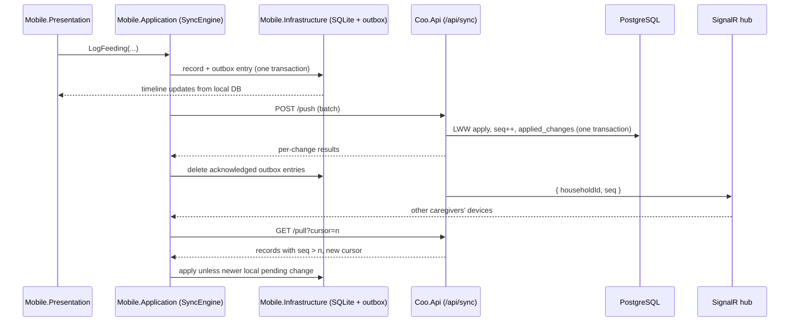

# 2. Offline-first sync protocol

Date: 2026-09-29

Status: Accepted

Amended by: ADR 0010 §3 (the synced entity types are `CareEntry`, `BabyProfile`, `HouseholdSettings` and `DuplicateDismissal`)

Amended by: Spec 011 ruling 20 (a phone that already holds records pulls from cursor 0 with `bootstrapHead=0`; §6's skip applies only to an empty phone)

## Context

Coo is used by several caregivers of one baby: typically two parents and a nanny. Each of them
logs feedings, diaper changes, sleep and pumping on their own phone, often at night and often
with poor or no connectivity. ADR 0001 made the phone's SQLite database the source of truth for the
person holding it, and deferred how devices converge to this ADR.

The requirements are:

- **Logging never waits for the network.** A tap at 3 AM must save and appear on the timeline
  immediately, online or not.
- **Caregivers see each other's entries in near real time** when they are online.
- **A logged event is never lost.** Not to a crash, a dropped connection, a retry, an app kill, or a
  conflict. This is the product's equivalent of CoreChoice's "a coin is never lost to our own
  failure", and it is held to the same standard: every path that could drop an entry has a test.
- **Offline edits converge.** A nanny whose phone was offline for four hours must not overwrite a
  parent's later correction when she reconnects, and must not lose her own entries either.
- **Old app versions keep syncing.** Installed versions lag the server by months (ADR 0001).

Several properties of the domain make this simpler than general-purpose sync:

- Most records are created once and rarely edited. Edits are corrections (a wrong amount, a
  forgotten end time) or the completion of an ongoing session: a sleep started by one caregiver
  and ended by another.
- The data volume per household is small: a busy household logs perhaps 30 events a day, around
  10,000 a year.
- Records belong to exactly one household, and a household is small, so contention is per
  household and low.

Clock skew between phones is real. Device clocks can be minutes off, and a nanny's phone can be set
to the wrong time zone. Conflict resolution cannot trust raw device time. A record's "occurred at"
time is user data, and it is never used to decide which write wins.

## Decision

### 1. Identity: client-generated UUIDv7

Every synced record gets its ID on the device that creates it: `Guid.CreateVersion7()`. The server
never assigns record IDs. Creating a record is therefore idempotent end to end: a retried upload of
the same record cannot create a duplicate.

### 2. Local write path: record and outbox in one transaction

Every mutation writes the record's new state and an outbox entry in the same SQLite transaction.
The UI reads only from the local database, never from the network.

An outbox entry is deleted only after the server has acknowledged that change with a final result
(section 5). An app kill between the write and the upload leaves the entry in the outbox, and the
next sync cycle sends it.

### 3. Change model: state-based, last-writer-wins per record

We sync the **current state of each record**, not a log of operations, and not event sourcing.

A change is an envelope defined in `Coo.Contracts/Sync`:

| Field | Meaning |
|---|---|
| `changeId` | UUIDv7; the idempotency key for this upload |
| `householdId` | The household the record belongs to |
| `entityType` | For example `Feeding`, `DiaperChange`, `SleepSession`, `PumpingSession`, `BabyProfile` |
| `entityId` | The record's UUIDv7 |
| `operation` | `Upsert` or `Delete` |
| `version` | Hybrid logical clock stamp (section 4) taken when the edit was made |
| `deviceId` | The originating device |
| `schemaVersion` | Contract version of the payload |
| `payload` | The full record state (absent for `Delete`) |

Conflicts are resolved **per record, by last writer wins on `version`**. The write with the higher
version stamp wins, on the server and on every device, whatever order the writes arrive in.
Because the rule is deterministic, all devices converge on the same state.

Deletes are **tombstones**: soft deletes that carry a version like any other write. A delete wins
over any edit with a lower version, so an offline device cannot resurrect a deleted entry. It loses
to any edit with a higher version, so a later correction survives a stale delete. Tombstones are
retained indefinitely. At this data volume that costs little storage, and a new device does not
download them (section 6).

The losing side of a conflict is not thrown away silently. The server records it in a
`sync_conflicts` table with both versions, for diagnostics. Surfacing conflicts in the UI is out of
scope for v1.

### 4. The version stamp: a hybrid logical clock

`version` is a hybrid logical clock (HLC) stamp: `(wallClockMs, counter, deviceId)`, compared in
that order. `deviceId` makes every stamp unique and every comparison total. HLC was chosen over:

- **Raw device time.** A phone with a fast clock would win every conflict for as long as its clock
  was wrong.
- **Server arrival order.** A four-hours-offline edit would overwrite every correction made
  meanwhile, which is exactly the nanny case in the context above.

HLC keeps "most recent real-world edit wins" while bounding the damage from skew. Every device
advances its clock past any stamp it receives from the server, and the server advances its clock
past any stamp it receives from a device. Clocks therefore stay causally consistent: an edit made
after seeing another edit always carries a higher stamp, whatever the device clocks say.

The server rejects stamps more than 24 hours ahead of its own clock (see `rejected` in section 5).
This stops a phone set a year into the future from winning every conflict forever.

The stamp type and its comparison rule live in `Coo.Domain/Common/Versioning`, so that the device
and the server compare stamps with the same compiled code (ADR 0001).

### 5. Push: idempotent batches with per-change results

`POST /api/sync/push` accepts up to 200 changes. Each change gets its own result:

| Result | Meaning | What the device does |
|---|---|---|
| `applied` | The change won and is now the server state | Deletes the outbox entry |
| `superseded` | The server already holds a higher version | Deletes the outbox entry; the next pull brings the winning state |
| `rejected` | The payload fails a single-record domain rule, the schema version is unsupported, or the stamp is too far in the future | Keeps the local record, marks it `SyncRejected`, removes it from the outbox and shows it to the user. **Never silently deleted.** |

A per-change result is not an HTTP error. The response is `200` whenever the batch was processed,
including when individual changes were rejected. An HTTP error (5xx, timeout, dropped connection)
means "nothing was decided", and the device retries the **whole** batch. This is safe because the
server keeps the result for each `changeId` in an `applied_changes` table for 30 days. A retried
change returns its stored result and is not applied twice.

### 6. Pull: a gapless sequence number per household

Every accepted write increments a **per-household sequence number** (`bigint`) inside the same
PostgreSQL transaction as the write. The increment is taken by updating the household's counter
row, which serialises writes within one household and leaves other households unaffected.
Each synced table carries `household_id`, `seq`, `version` and `is_deleted`, indexed on
`(household_id, seq)`.

`GET /api/sync/pull?cursor={seq}` returns every record in the household with `seq > cursor`, in
pages of up to 500, plus the new cursor. Because the table stores current state rather than
history, a record edited ten times since the cursor is returned once.

A per-household counter was chosen over timestamps because timestamps can miss rows. Two
transactions that commit out of order can produce a row that is older than the cursor but not yet
visible when the cursor was read. The counter row lock makes commit order and sequence order the
same.

On the device, a pulled record replaces the local one unless the local record has a pending
outbox change with a higher version. In that case the local edit is kept, and the next push lets
the server settle it with the same rule.

A new device, or a device that has lost its database, pulls from cursor `0`.

**Bootstrap skips tombstones, but only up to a fixed point.** A device pulling from cursor `0` has
nothing to delete, so tombstones are useless to it. A household with 10,000 records, 2,000 of them
deleted, would otherwise send 2,000 useless rows to every new phone. The rule is:

- The first page of a pull from cursor `0` returns `bootstrapHead`: the household's current sequence
  number, read at that moment.
- The device sends `bootstrapHead` with every later page of the same bootstrap.
- The server omits tombstones with `seq <= bootstrapHead`, and includes every tombstone above it.

Filtering on "cursor is 0" alone would be wrong. A bootstrap spans several pages. A record the
device received on page 1 and someone deleted while page 3 was downloading has a tombstone above
`bootstrapHead`. That tombstone must arrive, or the new phone keeps showing a deleted entry
forever. A tombstone at or below `bootstrapHead` was always safe to skip: the table holds current
state, so the device never received that record's live version. The cursor still advances past
skipped tombstones, so paging is unaffected.

### 7. The sync cycle

A cycle is **push, then pull**. Pushing first means the pull already reflects the server's verdict
on this device's changes.

Only one cycle runs at a time. A trigger that arrives during a cycle marks the engine dirty, and
one more cycle runs afterwards. Triggers are coalesced, never queued. The triggers are:

- the app starting or resuming;
- a local write, debounced by about one second, so that a burst of taps produces one upload;
- connectivity being regained;
- a real-time notification (section 8);
- a periodic fallback every 5 minutes while the app is in the foreground.

Failures retry with exponential backoff and jitter, capped at 5 minutes. Connectivity being
regained resets the backoff. A `401` refreshes the access token once, then retries.

### 8. Real-time: SignalR as a doorbell, never as a data channel

The API hosts a SignalR hub with one group per household. After a transaction commits, the server
sends the household's group `{ householdId, seq }` and nothing else. A device whose cursor is
behind `seq` starts a sync cycle.

SignalR never carries record data. A dropped real-time connection, a missed message, or a message
delivered twice therefore cannot lose or corrupt data: the worst outcome is that the change arrives
on the next trigger instead of immediately. Sync stays correct with the hub switched off, which
also makes it testable without SignalR.

Waking a backgrounded app is deferred to the notifications spec. It must be self-hosted: Coo takes
no dependency on Firebase or FCM.

### 9. What sync enforces and what it does not

- **Single-record domain rules are enforced on both sides.** Examples: a sleep's end is after its
  start; a bottle amount is positive. The same `Coo.Domain` code runs on the device before a
  write, and on the server before accepting a change.
- **Rules that span records are not enforced at sync time.** Two caregivers can each start a sleep
  session for the same baby while both are offline, and neither device can know. The server
  accepts both. The device detects overlapping entries after the pull and shows them for a person
  to resolve. Rejecting one of them would be data loss.
- **Probable duplicates are detected, never merged automatically.** Two caregivers often log the
  same event: one manually, one by voice, or both manually. They produce two entries with two IDs,
  and last-writer-wins has nothing to resolve, because it works per ID. After every pull, and
  before any AI proposal is shown (ADR 0005 §3a), a pure `DuplicateDetector` in `Coo.Domain/CareLog`
  flags these pairs:

  | Pair | Flagged as a probable duplicate when |
  |---|---|
  | Feeding and feeding | same baby, same kind (breast or bottle), start times within 15 minutes |
  | Diaper and diaper | same baby, within 10 minutes |
  | Pumping and pumping | same household member, within 15 minutes |
  | Sleep and sleep | same baby, overlapping intervals (the case above) |

  A flagged pair appears in "Needs attention" (§11) with **Keep both**, **Keep this one** and
  **Keep that one**. Choosing one deletes the other through an ordinary tombstone, so the decision
  syncs like any other edit. A pair once resolved as "keep both" is never flagged again. The
  tolerances live in `Coo.Domain` as named constants, covered by tests.

### 10. Household scope and authorisation

- Every change and every pulled record carries a `householdId`. The server authorises each push and
  pull against the caller's household membership.
- When a caregiver is removed from a household, the server answers that device's next sync with
  `403` and a Coo problem-details body (`type: https://coo.lechdigital.nl/problems/membership-revoked`,
  plus the `householdId`). This is the only case where a device deletes entries, and it deletes only
  the household it no longer belongs to. Because deleting local data cannot be undone, the device
  follows three steps:
  1. **Recognise only the exact signal.** Any other `403` is treated like any other failed sync:
     back off and retry, and change nothing. That includes a `403` without that body, one with an
     unparseable body, or one naming a different household. Caddy, a WAF rule or a maintenance page
     can all produce a bare `403`, and none of them may delete anyone's data.
  2. **Soft-lock first.** On the exact signal, the app hides that household's UI and stops syncing
     it, but deletes nothing from SQLite.
  3. **Delete only after a positive confirmation.** The app calls
     `GET /api/households/{id}/membership`, an authenticated request, and deletes only on a `200`
     whose body states `{ "status": "revoked" }`. A success response that asserts revocation cannot
     come from a proxy or an error page. Any other answer keeps the soft-lock and retries later.

  Before deleting, the app tells the person they were removed. If the outbox still holds entries
  they logged, it shows how many and offers to share them as text. The family may want them, and
  the server will no longer accept them.
- Records created before the person signs in wait in the outbox, marked with a provisional local
  household. They are pushed once sign-in has created or joined a real household. The mechanics
  belong to ADR 0003 (identity). This protocol only requires that the outbox survives until then.

### 11. Contract versioning

- The device sends its `schemaVersion` with every push and pull.
- The server accepts the current version and the one before it (N and N-1), and upgrades N-1
  payloads to N at the boundary: the anti-corruption layer in `Coo.Api.Application/Mapping`.
- On pull, the server serves the version the device asked for.
- Within one version, contract changes are additive only: new fields must be optional, and no
  field is removed or renamed.
- A device older than N-1 receives `426 Upgrade Required` with the error code
  `client-too-old`. Its outbox stays intact until the app is updated.

**A stale outbox must not turn into a wall of rejections.** A parent who ignores updates for a month
and keeps logging offline arrives with hundreds of queued changes, written under older rules.
Four rules keep that from ending in mass `rejected`:

- **Validate a change against the rules of the version it was written in.** The server checks each
  change against the domain rules of its `schemaVersion`, upgraded through the anti-corruption
  layer. It does not check it against today's rules. A rule tightened in version N applies to
  writes made in version N, and never retroactively to entries a parent made in good faith under
  N-1.
- **Removing a feature does not reject its data.** When an entity type or field is retired, the
  server keeps accepting it for the support window and maps it (for example, to a note on the
  entry) rather than rejecting it.
- **Warn before blocking.** From the moment a client version is scheduled to drop out of support,
  the server adds a `Coo-Client-Deprecated` response header. The app then prompts for an update
  through Play's In-App Updates API, well before a `426`. The support window is at least 6 months
  of calendar time, not just "one version", so a fast release cadence never shortens it.
- **Design the UI for many rejections.** Rejected entries are collected in one "Needs attention (n)"
  list, never shown as a dialog per entry. Each rejection carries a machine-readable reason, and the
  entry stays visible and editable. Fixing it writes a new version, which goes back through the
  outbox like any other edit. The list must stay usable at hundreds of entries, and the mobile spec
  includes that case.

### 12. Where it lives

| Concern | Project |
|---|---|
| Change envelope, push/pull DTOs, result codes | `Coo.Contracts/Sync` |
| Version stamp and the comparison rule | `Coo.Domain/Common/Versioning` |
| Sync cycle, trigger coalescing, backoff, apply-on-pull rule | `Coo.Mobile.Application/Sync` |
| Outbox table, cursor store, HTTP client, SignalR client | `Coo.Mobile.Infrastructure` |
| Push/pull use cases, version upgrade at the boundary | `Coo.Api.Application/Sync` |
| Sequence counter, `applied_changes`, `sync_conflicts`, sync columns | `Coo.Api.Infrastructure/Persistence` |
| Endpoints and the hub | `Coo.Api` |

## Consequences

### Positive

- Logging is never blocked by the network. The UI only ever talks to the local database.
- The "never lost" guarantee reduces to a few testable rules:
  - an outbox entry is deleted only on a final server result;
  - retries are idempotent through `changeId`;
  - a rejected change is kept and shown, never dropped.
- The same code (`Coo.Domain`) decides every conflict on every device, so devices converge
  deterministically.
- Real-time delivery is an optimisation, not a correctness dependency. Sync can be tested fully
  without SignalR, and survives any hub failure.
- The pull is simple and cheap: one indexed range query per synced table, returning current state,
  with no compaction job.
- Old app versions keep working for one full contract version, and fail loudly, without losing
  data, beyond that.

### Negative

- Last-writer-wins per record means that two concurrent edits to *different fields* of the same
  record keep only one of them. Given how rarely care entries are edited, and that edits are
  usually a single correction, this is accepted. Field-level merge can be added for specific entity
  types later without changing the protocol.
- Cross-record conflicts, such as overlapping sleeps, reach the user as something to fix rather
  than being prevented. That is the cost of never blocking an offline write.
- The per-household counter row serialises writes within a household. At a few writes per minute
  per household this is irrelevant, but it rules out using the same scheme for a high-volume
  shared resource.
- HLC stamps depend on every device's clock being roughly right. The 24-hour future bound limits
  the damage of a badly wrong clock, but a clock that is hours fast still wins conflicts within
  that window until it is corrected.
- Validating each change against the rules of its own `schemaVersion` means the server keeps the
  domain rules of every supported version, not just the current one. That is real maintenance
  cost, bounded by the 6-month support window.
- Removal from a household takes an extra round trip to confirm before any data is deleted. For
  that time, the removed caregiver's app shows the household as locked rather than gone.
- Every synced table carries four sync columns, and every new entity type must be added to push,
  pull, the contract, and the architecture tests. A checklist in the entity spec template is
  needed so that none is forgotten.
- The server keeps tombstones indefinitely, and `applied_changes` for 30 days. A device that stays
  offline for more than 30 days and then retries a batch the server had already applied gets
  `superseded` or re-applies an identical state. Both are harmless under last-writer-wins, but the
  30-day window is a deliberate bound, not an accident.
