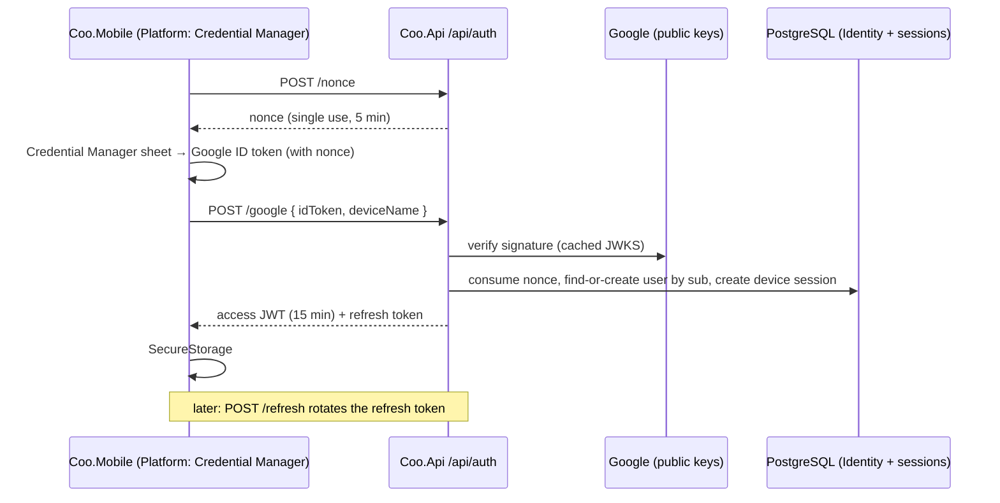

# 3. Identity, sessions and household membership

Date: 2026-09-29

Status: Accepted

Amended by: Spec 011b §15.1 R1 (§6: invitation links are `https://api.coo.lechdigital.nl/i/{code}`, because
`coo.lechdigital.nl` has no DNS; the API serves `assetlinks.json` and an English fallback page with the code) and R5 (§7:
bringing entries over from a household that has synced copies them as new records instead of rewriting them)

## Context

ADR 0002 syncs data per household and authorises every push and pull against the caller's
membership. That needs people to have identities. At the same time, the product promise is
"reducing friction at 3 AM": a new parent must be able to install the app and log a feeding before
creating any account.

The constraints are:

- **Android first.** iOS may follow, and App Store rules then require Sign in with Apple whenever
  another social login is offered.
- **Self-hosted.** Everything runs on the Hetzner host. There is no Firebase and no third-party
  identity provider (Auth0, Entra, Cognito). Using Google as a sign-in *method* is acceptable,
  because it needs only Google Play services on the phone and Google's public signing keys on the
  server. It is not a hosted auth backend.
- **Households, not individuals.** Premium belongs to a household (ADR 0001). Caregivers join a
  household by invitation. A nanny may work for more than one family.
- **Health data about a child.** Care logs are sensitive personal data under GDPR. Google Play
  requires in-app account deletion and a web page for deletion requests.
- **Sessions must not expire at night.** A parent who is forced to sign in again at 3 AM has been
  failed by the product. An expired or unreachable session must never block local logging.
- **Lessons from the sibling apps.** Their device identity is a client-generated GUID with no
  attestation, which forced an IP-hash cap against free-credit farming (PurePrep ADR 0001). Coo
  needs real accounts for households anyway. That same account also gives the trial and entitlement
  rules something stable to key on.

## Decision

### 1. No account until one is needed

On first launch the app creates a **provisional household** and a baby profile locally, with
client-generated UUIDv7 IDs (ADR 0002). Every free feature works without an account and without
the server.

The app asks the person to sign in only when a feature needs the server:

- inviting a caregiver, or accepting an invitation;
- starting the Premium trial, or purchasing;
- turning on backup and restore, which the app offers gently after the first few days of use.

Until then, changes wait in the outbox, as ADR 0002 section 10 already requires.

### 2. Sign-in method: Sign in with Google via Android Credential Manager

- The app uses Android Credential Manager's Sign in with Google. This shows the native one-tap
  account sheet, with no browser and no password.
- The phone obtains a Google **ID token** that carries a single-use nonce issued by the server.
- The server verifies that ID token itself, and issues its own session (section 4).
- The Google ID token is used once, at sign-in, and is never used as an API credential.

Users are keyed by Google's stable subject identifier (`sub`), never by email address. An email can
change, or be reused by someone else.

Planned additional methods, each to be added as another external login on the same user
(section 3):

- **Sign in with Apple**, when iOS ships. Required by the App Store.
- **Email magic link**, for a caregiver without a Google account, or unwilling to use a personal
  one. This is deferred because it needs outbound email with good deliverability from the Hetzner
  host, which is a project of its own.

### 3. User store: ASP.NET Core Identity, without passwords

`Coo.Api.Infrastructure/Identity` uses ASP.NET Core Identity with EF Core and Npgsql, with `Guid`
keys:

- Google sign-in is an **external login** (`AspNetUserLogins`: provider `Google`, key = `sub`).
- Users have no password. `PasswordHash` stays null, and no password endpoint exists.
- Identity provides the user and login tables, the security stamp, lockout and `UserManager`.
  Adding Apple or a magic link later is another login row, with no rework.
- `MapIdentityApi` is **not** used. Its endpoints are designed around passwords, and its bearer
  tokens are opaque Data Protection tokens that we cannot rotate or revoke per device. Coo issues
  its own tokens (section 4).

Identity types never leave Infrastructure. The Domain knows a caregiver only by a `UserId` value
object (CS-HEX-01, CS-DDD-03).

We store the minimum: `sub`, email (shown in the household member list) and display name. We do
not store profile photos or Google access tokens.

### 4. Sessions: a short-lived JWT plus a rotating refresh token, per device

- **Access token.** A JWT signed with HMAC-SHA256, valid for 15 minutes. Its only claims are the
  user ID, the device session ID, and the key ID used to sign it. Household membership is
  deliberately **not** a claim: ADR 0002 requires membership to be checked on every request, so
  that removing a caregiver takes effect immediately, not when their token expires. The signing key
  supports two active key IDs, so that keys can be rotated without signing everyone out.
- **Refresh token.** 256 random bits, stored on the server only as a SHA-256 hash, and bound to one
  device session.
  - **It rotates on every use.** Presenting an already-rotated refresh token is treated as theft:
    the server revokes that device session and the user must sign in again on that device.
  - **Its lifetime is sliding:** 180 days since the device session was last used.
- **On the phone**, both tokens live in MAUI `SecureStorage`, which is backed by the Android
  Keystore. That is the same mechanism CoreChoice already uses for its device identity.
- **Offline or expired never blocks logging.** An expired access token only delays sync. A failed
  refresh because of a network error only means "try again later".
- **A revoked session keeps local data.** If the refresh token is rejected (revoked, or reuse was
  detected), the app keeps every local record and the outbox, and asks the person to sign in again.
  Only `membership-revoked` deletes local data (ADR 0002 section 10), and only for that household.
- **SignalR** receives the access token in the `access_token` query string, as WebSockets require.
  Request logging, including Caddy's access log, must never record that query string.

Endpoints: `POST /api/auth/nonce`, `POST /api/auth/google`, `POST /api/auth/refresh`,
`POST /api/auth/sign-out` (revokes the device session), `DELETE /api/account`.

### 5. Verifying the Google ID token: fail closed

`POST /api/auth/google` accepts the token only when **all** of these hold:

- the signature verifies against Google's published keys;
- `iss` is Google;
- `aud` is Coo's **web** OAuth client ID;
- the token has not expired;
- `email_verified` is true;
- the nonce matches an unused server-issued nonce, and was issued at most 5 minutes ago. The nonce
  is consumed by this check.

Any failure means no session is issued, including Google's key endpoint being unreachable.

As in PurePrep ADR 0001, **Production refuses to start** without the Google web client ID and the
token signing keys. A missing setting must fail at startup, not by accepting every sign-in or
rejecting every sign-in at runtime. The selection logic is a pure function, and the dangerous case
has a test.

Auth endpoints are rate-limited per client address. Forwarded headers stay enabled, for the same
reason CoreChoice's README gives: behind Caddy, without them, every request appears to come from
the proxy.

### 6. Households, roles and invitations

These are domain concepts, in `Coo.Domain/Households`.

**Membership.** A `Membership` joins a user to a household with a role. A user can belong to
several households: the nanny case. The model supports that from day one, even if the first
release's UI shows only one household at a time. Adding it later would mean migrating every
record's scope.

**Roles:**

| Role | Log and view | Invite and remove members | Manage the baby profile | Billing |
|---|---|---|---|---|
| `Owner` (the creator; exactly one) | yes | yes | yes | yes |
| `Parent` | yes | yes (not the Owner) | yes | yes |
| `Caregiver` (for example a nanny) | yes | no | no | no |

**Invitations.** An Owner or Parent creates an invitation for a given role.

- It is shared as a link, `https://api.coo.lechdigital.nl/i/{code}` *(amended by Spec 011b: originally
  `coo.lechdigital.nl`, which has no DNS; moving the link later needs an app update)*. That is an Android App
  Link (`autoVerify`, with `/.well-known/assetlinks.json` served by the API) that opens the app if installed.
  Otherwise the browser shows a small page with a Play Store link and the code, which the app accepts under
  "Enter a code".
- The code is 8 characters from an alphabet without ambiguous characters (no `0/O`, `1/I/l`).
- A code expires after 72 hours and can be used once. The inviter can revoke it before then.
- Accepting an invitation requires sign-in. Attempts are rate-limited per user and per address,
  to prevent code guessing.

**Removing a member.** An Owner or Parent can remove a member. This triggers ADR 0002's
`membership-revoked` flow on that member's devices. The Owner cannot be removed. Transferring
ownership is deferred.

### 7. Turning a provisional household into a real one

**First sign-in with no pending invitation.** The server creates the household **with the
provisional household's ID**. Record IDs are client-generated anyway (ADR 0002), so the server
simply adopts the device's ID when it is unused. No local record is re-keyed, and the outbox drains
exactly as it is.

**Accepting an invitation while local data exists.** The phone holds a provisional household with
entries, and the invitation is for an existing household that may already have the same baby.
The app then asks the person explicitly:

- **Bring my entries over.** The person maps each local baby to a baby in the invited household.
  The app rewrites the household and baby references of the local records *and of their outbox
  entries* in one SQLite transaction, then syncs.
  *(Amended by Spec 011b: a household that has ever synced is never rewritten. Its records are copied
  into the invited household as new records with new IDs, and the person then chooses whether to leave or
  delete the old household.)*
- **Keep them separate.** The provisional household stays on the device as its own household.
  This is possible because users can belong to several households (section 6).

Nothing is discarded without an explicit confirmation from the person.

### 8. Account deletion

`DELETE /api/account`, in the app, and a web deletion-request page at `coo.lechdigital.nl`. Both
are required by Google Play.

- Deleting an account removes the user, their external logins, their device sessions and their
  memberships.
- If the user is a household's Owner and other Parents remain, ownership passes to the Parent who
  joined earliest.
- If the user is the last Parent, the household and all of its care data are deleted, after an
  explicit confirmation that names the baby profiles that will be lost.
- Entries a deleted caregiver logged in a household that still exists stay in that household.
  They are the family's record of their child. Their author reference becomes "former
  caregiver".

### 9. Google Cloud setup (recorded here because it fails silently)

Two OAuth clients are needed in the Google Cloud project:

- a **Web application** client, whose ID is the `aud` the server checks;
- an **Android** client for `com.lechdigital.coo`, registered with the SHA-1 of **every** key the
  app is signed with: the debug keystore, the upload key, and **the Play app signing key**.

The Play app signing key is easy to miss. The sibling apps show that Play re-signs every release
with it. With only the upload key registered, sign-in works in every locally built APK and fails on
the Play-installed build, the one real users run. That setup belongs in a `docs/google-sign-in-setup.md`
alongside the existing `play-validation-setup.md` pattern.

### 10. Where it lives

| Concern | Project |
|---|---|
| `Household`, `Membership`, `Role`, `Invitation`, `UserId`; role rules | `Coo.Domain/Households` |
| Auth and invitation DTOs | `Coo.Contracts/Households`, `Coo.Contracts/Auth` |
| Sign-in, refresh, invite, accept, remove, delete-account use cases; ports `IExternalIdentityVerifier`, `ITokenIssuer`, `IDeviceSessionStore` | `Coo.Api.Application/Auth`, `Coo.Api.Application/Households` |
| ASP.NET Core Identity stores, Google ID token verifier, JWT issuer, refresh-token store | `Coo.Api.Infrastructure/Identity` |
| JWT bearer authentication, household-membership authorisation policy, `/api/auth` endpoints | `Coo.Api` |
| Sign-in orchestration, provisional-household upgrade and merge; ports `ISignInProvider`, `ISessionStore` | `Coo.Mobile.Application/Auth` |
| Token-refreshing `DelegatingHandler` (single-flight refresh) | `Coo.Mobile.Infrastructure` |
| Credential Manager adapter, `SecureStorage` session store | `Coo.Mobile.Platform/Auth` |

The .NET bindings for Credential Manager and Google Identity (`Xamarin.AndroidX.Credentials`,
`Xamarin.GoogleAndroid.Libraries.Identity.GoogleId`) are the one unproven piece. A spike must
confirm them in a trimmed Release build before the auth spec is implemented. The fallback is MAUI
`WebAuthenticator` with the OAuth authorization-code flow with PKCE, in a Custom Tab. The fallback
is behind the same `ISignInProvider` port, so the rest of this ADR does not change either way.

## Consequences

### Positive

- A new parent logs their first feeding seconds after install, with no account screen.
- Sign-in is one tap, with no password to forget and no password database to breach.
- Everything is self-hosted. Google is used only as a credential issuer, verified offline against
  cached public keys, and there is no Firebase anywhere.
- Removing a caregiver takes effect on their next request, not after token expiry, because
  membership is never baked into a token.
- Stolen refresh tokens are detectable (reuse detection), and every device session can be revoked
  on its own.
- Adopting the provisional household's ID makes the common first sign-in a no-op for local data.
- A stable account per person gives the billing ADR something to key trial eligibility on, which
  device GUIDs could not.
- Multi-household membership supports the nanny case without a future migration.

### Negative

- A caregiver without a Google account cannot join until the magic-link method exists. On Android,
  almost everyone has one, but some nannies will not want to use a personal account.
- ASP.NET Core Identity brings tables and machinery (password, 2FA, email-confirmation columns) that
  a password-less design never uses. That is accepted in exchange for a proven user store that the
  planned sign-in methods plug into.
- Symmetric token signing means only the API can verify tokens. That is fine for one service, but a
  second service that must verify tokens would require moving to asymmetric keys.
- A device idle for more than 180 days must sign in again. Its local data is untouched.
- Local-only use means a lost phone loses unsynced history. The app mitigates this by offering
  backup after a few days, but it cannot force it without breaking the no-account promise.
- The invitation merge flow (section 7) is real UI and real data migration on the device, and
  needs its own spec and tests.
- The Credential Manager bindings are unproven on this toolchain until the spike is done.
- Account deletion that cascades to a household is irreversible. It needs a confirmation that is
  hard to trigger by accident, and a test that the Owner-transfer rule runs before any deletion.
