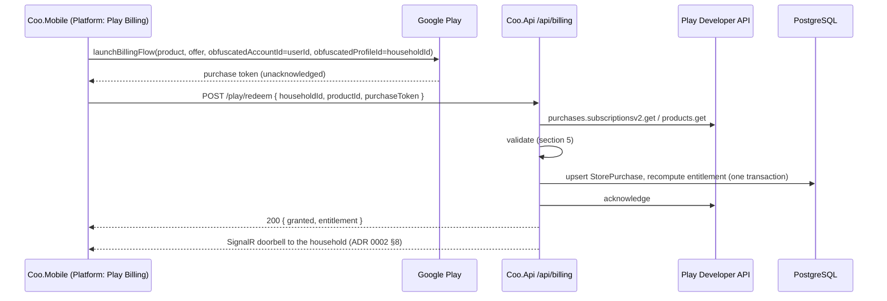

# 4. Household billing and entitlements (Google Play)

Date: 2026-09-29

Status: Accepted — amended 2026-10-02 (see below)

> **Amendment, 2026-10-02 (owner): what Premium covers.** Premium is **the sleep prediction** (ADR 0008), **AI-assisted
> logging** (ADR 0005), and two new AI features: **a written summary of the night** and **a weekly summary**. **Free
> for every household, forever:** all logging, sharing and sync, **the paediatrician report** and **logging from the
> watch** (ADR 0009). The commercial model below stands: a 7-day trial of Premium, then monthly, yearly or lifetime,
> or the free tier forever. §9's feature lists are superseded where they differ ("PDF reports" and "wearable
> quick-logging" are free; the summaries are new server-side Premium features). Spec 012 settles the details.


## Context

Premium belongs to a **household**, not to a person (ADR 0001). If one parent pays, every caregiver
in that household gets Premium. The commercial model is:

- a **7-day free trial** of all Premium features;
- a **monthly** or **yearly** subscription;
- a one-time **Lifetime** purchase.

Android ships first. Payments go through Google Play only: no Stripe and no other gateway. iOS may
follow with the App Store.

The sibling apps (PurePrep, CoreChoice) already sell through Google Play from the same developer
account. What they establish, and Coo keeps:

- The Play Billing Library is used directly through the `Xamarin.Android.Google.BillingClient`
  binding, behind an `IBillingService` port. The adapter is a thin singleton over one long-lived
  connection, and every decision lives in testable code.
- The server validates every purchase with the Google Play Developer API (`androidpublisher` v3),
  through a lookup interface split from the validation rules, so that the rules are tested without
  the Google SDK.
- **Fail closed** (PurePrep ADR 0001). Production refuses to start without a readable Play
  service-account key. Google being unreachable means "not valid".
- **Grant, then finalise.** The client leaves a purchase unfinalised until the server has granted
  it, so that a failed grant ends in Google's automatic refund, never in "charged for nothing".
- Expected refusals are `200` with a reason in the body. Non-2xx means "nothing was decided".
- `deploy/verify-play-access.py` confirms Google answers for the app before a deploy.

What the siblings do **not** cover: they sell consumables only. Coo sells a subscription, whose state
changes over time without the app being open (renewal, grace period, cancellation, hold, refund),
and a non-consumable. That needs a subscription lifecycle, server-side notifications, and an
entitlement model that several people share.

Self-hosting (ADR 0003) rules out Firebase and hosted backends. Google Play delivers its Real-Time
Developer Notifications (RTDN) only through Google Cloud Pub/Sub. Pub/Sub can push them to an HTTPS
endpoint on our own server. It runs none of our code and holds none of our data: a notification
carries only a purchase token and an event type.

## Decision

### 1. Products

| Play product | Type | Detail |
|---|---|---|
| `coo.premium` | Subscription | Base plans `monthly` and `yearly`. Each has a free-trial offer, `trial-7d`, with Play eligibility "never had this subscription". |
| `coo.lifetime` | One-time, non-consumable | Acknowledged, never consumed. |

Play product IDs are permanent and cannot be reused after deletion, so these names are final.
Prices are a product decision and are not part of this ADR.

The trial is Play's free-trial offer: the person confirms a payment method, and the subscription
converts automatically after 7 days unless cancelled. A server-side trial without a payment method
was rejected. It has lower conversion, it needs our own anti-abuse, and it duplicates what Play
already enforces per Google account.

### 2. Client billing library: the direct Play Billing binding

`Xamarin.Android.Google.BillingClient` (Play Billing Library 8.x), not `Plugin.InAppBilling`.
Reasons:

- it is proven in both live apps on this toolchain;
- it exposes everything this ADR needs, including subscription offers and the obfuscated account
  and profile IDs (section 4);
- Google Play enforces minimum Billing Library versions, and a wrapper is one more dependency that
  has to keep up.

The adapter lives in `Coo.Mobile.Platform/Billing`, behind an `IStoreBilling` port in
`Coo.Mobile.Application`, and follows the sibling apps' `PlayBillingService` connection pattern.

### 3. The entitlement model

In `Coo.Domain/Entitlements`, a household's entitlement is **derived**, never stored as a flag:

```
Premium ⇔ the household has at least one StorePurchase where
          (Lifetime and not voided)
       or (Subscription and state ∈ {Active, InGracePeriod, Canceled} and expiresAt > now)
```

- `Canceled` still grants access until `expiresAt`, because the person has paid for that period.
  `OnHold`, `Paused`, `Expired` and `Pending` do not grant access.
- Entitlement is computed at request time from the stored `expiresAt`. An expiry therefore takes
  effect on time even if no background job or notification runs.
- Several purchases can grant one household Premium. For example, both parents subscribed, or a
  subscription and a Lifetime purchase. See section 8.
- The entitlement snapshot sent to devices is:
  - `tier`: Free or Premium;
  - `source`: Trial, Subscription or Lifetime;
  - `validUntil`: null for Lifetime;
  - `willRenew`;
  - `trialEligible`;
  - `payerIsCaller`.

**The history is never held hostage.** When Premium lapses, only Premium features stop. Every log
entry stays visible, editable, synced and exportable as raw data, for every caregiver. A test pins
this: care-log sync and the timeline must never depend on entitlement.

### 4. Purchase flow: bind to the household, grant, then acknowledge



1. Only an **Owner or Parent** who is signed in can buy (ADR 0003 roles). The app hides buying for
   Caregivers, and the server enforces the rule.
2. The app sets Play's `obfuscatedAccountId` to the user's ID and `obfuscatedProfileId` to the
   household's ID. Both are opaque GUIDs, not personal data. Google returns them with every lookup
   of that purchase. This binds the purchase to the household it was bought for, and stops a token
   from being redeemed into another household.
3. The **server acknowledges** the purchase only after the grant has been committed. If granting
   fails, the purchase stays unacknowledged and the app retries. If it never succeeds, Google
   refunds it automatically after 3 days. A failed acknowledgement after a successful grant is
   retried by the reconciler (section 6). The grant stands either way.
4. **Recovering unfinished purchases.** On every app start, and on every entry to the Premium
   screen, the app queries its owned purchases. Any unacknowledged purchase is redeemed again,
   which is safe because redemption is idempotent per purchase token. This recovers crashes,
   process kills and the "restore on a new phone" case with the same code path.
5. `payerIsCaller` lets the payer see "Manage subscription", a deep link to the subscription page
   of the store they bought through. Every other member sees "Premium via {name}".
6. **"Manage subscription" appears only on the payer's own store's platform.** The snapshot
   carries the purchase's `store` (`GooglePlay`, and later `AppStore`). When the device's platform
   does not match that store, the app shows no button and no link. Instead it shows a neutral line:
   "Your subscription is billed through Google Play". The case is common: a payer who bought on
   Android and later switched to an iPhone keeps being billed by Google. The App Store Review
   Guidelines forbid an iOS app from directing people to another platform's purchase management.
   The Google Play Developer Program Policy is equally strict in the other direction. So the rule is
   symmetric, and the mobile spec tests it for both directions.

### 5. Server validation: fail closed

`POST /api/billing/play/redeem` grants only when all of these hold. Otherwise it returns `200` with
`granted: false` and a reason:

- The product ID is a known Coo product.
- Google has the purchase. `404` or `400` from Google means `purchase-not-found`.
- The state is one that grants access (section 3). `Pending` is recorded and returns
  `reason: pending`. It grants nothing until an RTDN or the reconciler confirms payment.
- The purchase's `obfuscatedProfileId` equals the requested `householdId`, and its
  `obfuscatedAccountId` equals the caller.
- The caller is an Owner or Parent of that household.
- The purchase token is not already bound to a different household. There is a unique index on
  the token.

Any other failure from Google (`401`, `403`, `5xx`, a timeout) returns `503`: nothing was decided,
and the client retries. It never grants.

Upgrades, downgrades and resubscriptions produce a new token carrying `linkedPurchaseToken`. The
new purchase replaces the linked one, which is marked `Replaced`. A replaced token is never counted
as an entitlement, and it is never treated as a cancellation.

As in the sibling apps, Production refuses to start without the Play service-account key and the
Pub/Sub push audience (section 6). The selection logic is a tested pure function.

### 6. Keeping state current: RTDN push, plus a reconciler

**RTDN.** Play publishes to a Pub/Sub topic. A **push subscription** delivers each notification to
`POST /api/billing/play/rtdn` on our server.

- Pub/Sub signs each push with an OIDC token for a dedicated service account. The endpoint verifies
  the token's signature, audience and service-account email before reading the body. An
  unauthenticated or invalid push gets `401`, and Pub/Sub retries it.
- **The notification body is only a hint.** For any subscription, one-time-product or
  voided-purchase notification, the server **fetches the purchase from the Play Developer API
  again**, and applies what Google returns now. It never applies the state named in the message.
  Out-of-order, duplicate and forged notifications therefore cannot put a purchase into a wrong
  state.
- The endpoint returns `200` only after the re-fetched state is committed. On failure it returns
  `5xx`, and Pub/Sub keeps redelivering for up to 7 days.
- A change in entitlement rings the household's SignalR doorbell (ADR 0002 §8), so every
  caregiver's app picks up the change on its next pull.

**Reconciler.** A hosted background service in `Coo.Api` runs hourly. It re-fetches every purchase
that is:

- expiring within 24 hours;
- expired in the last 7 days;
- `Pending` or `OnHold`;
- unacknowledged;
- active, bought in the last 7 days, and not checked for 4 hours;
- active, and not checked for 24 hours.

The shorter cadence for young purchases catches early refunds, trial cancellations (which change
`willRenew`) and a broken Pub/Sub setup within hours rather than a day. Early refunds and trial
cancellations cluster in a purchase's first days, and a broken Pub/Sub setup shows up early in the
app's life.

The first grant never depends on the reconciler or on RTDN. It happens synchronously in
`/play/redeem`, and the app repeats the redeem on every start until it succeeds (section 4). So
"I paid and have no Premium" is answered in two ways:

- the Premium screen's **Restore purchases** action, which re-runs the redeem and re-fetches from
  Google immediately;
- an admin endpoint that re-checks one purchase on demand, for support.

The reconciler is the safety net for everything RTDN can miss: our own downtime beyond Pub/Sub's
retry window, a misconfigured subscription, a lost acknowledgement. **The system is correct with
RTDN switched off**, only slower. That keeps the Pub/Sub dependency replaceable by polling alone,
should it ever be dropped.

**Refunds and chargebacks** of a Lifetime purchase arrive as voided-purchase notifications. The
reconciler also checks them daily through the Voided Purchases API. A voided purchase is marked
`Voided` and stops granting access.

### 7. Trial eligibility

- **Play** enforces one trial per Google account for `coo.premium`.
- **The server** additionally computes `trialEligible`: true only if neither the household nor the
  caller has ever held a Coo purchase. The app shows the `trial-7d` offer only when this is true,
  and otherwise launches the base plan without the offer.
- The case the server rule prevents is common: a partner starting a second trial on their own
  Google account once the first has ended.
- The server does not refuse a trial that got past the app. The worst case is 7 days of Premium,
  and refusing a real Play purchase would be worse. AI cost during a trial is bounded by the AI
  parsing ADR's rate limits.

### 8. Edge cases, decided

| Case | Behaviour |
|---|---|
| Both parents subscribe | Both purchases grant; Premium is not doubled. The app hides buying once the household is Premium, which prevents this in normal use. If it happens anyway, Settings shows both payers, with a "Manage subscription" link for the caller's own. We never cancel or refund automatically. |
| Subscribed, then buys Lifetime | Lifetime grants. The app prompts the payer to cancel the subscription in Play, and deep-links there. We do not cancel it for them. |
| Payer is removed from, or leaves, the household | The purchase stays bound to the household (`obfuscatedProfileId`). A subscription grants until the current period ends; the payer can cancel in Play. Lifetime stays with the household. |
| Moving a purchase to another household | Not a product feature in v1. An authenticated admin endpoint handles support cases, like the siblings' `/api/admin/*` routes. |
| Household deleted (ADR 0003 §8) | Its purchases are unbound and kept for accounting. The app tells the payer to cancel their subscription in Play first; deletion does not cancel it. |
| Device offline | The app uses its cached entitlement snapshot until `validUntil` plus 3 days, then falls back to Free on the device until it can sync. Server-side Premium features always check the server's entitlement. |

### 9. Enforcement

- **Server-side Premium features** (AI parsing, PDF reports) require the `HouseholdPremium`
  authorisation policy. It computes entitlement from the database on each request, never from a
  client claim or a token.
- **On-device Premium features** (the sleep predictor, wearable quick-logging) are gated by the
  cached snapshot. A modified client can unlock them locally. That is accepted: they cost us nothing
  to serve, and hardening the client against a rooted phone is not worth the complexity.
- **Delivering the snapshot.** The entitlement snapshot is added to the sync pull response. This is
  an additive `Coo.Contracts` change, compatible with ADR 0002 §11. `GET /api/entitlement` also
  serves it on demand, for example on the Premium screen.

### 10. Time is injected, so every lifecycle state is testable

Every expiry, grace period, trial end and reconciler window is a comparison against "now", so the
billing rules cannot be tested while "now" is the system clock:

- **Domain methods take `now` as a parameter.** For example,
  `Entitlement.Derive(purchases, now)`. `Coo.Domain` never reads a clock, which keeps it free of
  dependencies (CS-HEX-01) and makes every rule a pure function.
- **Application and Infrastructure read time only from the injected .NET `TimeProvider`.** This
  includes the reconciler's schedule, nonce expiry (ADR 0003) and the hybrid logical clock
  (ADR 0002). `DateTime.UtcNow` and `DateTimeOffset.UtcNow` are banned outside the composition
  root, and an analyzer rule plus `Coo.Architecture.Tests` enforce the ban.
- **End-to-end tests** run the real API (`WebApplicationFactory`) with `FakeTimeProvider`, from
  `Microsoft.Extensions.TimeProvider.Testing`, and a scripted `IPlayPurchaseLookup` fake that
  returns a sequence of Google states. A test can then buy, advance 7 days, see the trial convert,
  advance past `expiresAt`, move to grace period and then hold, and assert the entitlement at every
  step. That covers every scenario of losing or regaining Premium in seconds, without Play's
  accelerated test clocks.
- **The clock can be controlled only from tests.** `FakeTimeProvider` is referenced only by test
  projects. No production configuration switch, endpoint or header can move the server's clock.

Play's license testers and test tracks remain the final check that Google behaves as the fakes
assume. The fakes cover the logic; the manual pass covers the contract.

### 11. Where it lives

| Concern | Project |
|---|---|
| `StorePurchase`, `PurchaseState`, `Entitlement`, the derivation rule, trial eligibility | `Coo.Domain/Entitlements` |
| Redeem, RTDN and entitlement DTOs, refusal reasons | `Coo.Contracts/Billing` |
| Redeem, apply-store-state, reconcile and entitlement queries; ports `IPlayPurchaseLookup`, `IPlayAcknowledger` | `Coo.Api.Application/Billing` |
| Play Developer API adapter, Pub/Sub OIDC verifier, EF mappings | `Coo.Api.Infrastructure/Billing/GooglePlay` |
| `/api/billing/play/*` endpoints, the `HouseholdPremium` policy, the reconciler hosted service | `Coo.Api` |
| Premium screen logic, recovery of unfinished purchases, snapshot cache, offline fallback; port `IStoreBilling` | `Coo.Mobile.Application/Premium` |
| Play Billing adapter | `Coo.Mobile.Platform/Billing` |
| Setup and verification: GCP project, Pub/Sub topic and push subscription, Play Console RTDN topic, license testers | `docs/play-billing-setup.md`, extending the siblings' `play-validation-setup.md` |

When iOS arrives, App Store Server API and App Store Server Notifications V2 adapters go under
`Billing/AppStore`. They produce the same `StorePurchase` states, so the entitlement rule does not
change.

## Consequences

### Positive

- One derivation rule, in `Coo.Domain`, decides Premium for every caregiver, on the server and in
  the device cache.
- Being correct does not depend on notifications. They are only a hint that triggers a fresh fetch
  from Google, and the reconciler fills any gap. Duplicate, delayed and forged notifications are all
  harmless.
- "Grant, then acknowledge" means a server failure ends in Google's automatic refund, never in a
  charge without access.
- Binding a purchase to its household through `obfuscatedProfileId` stops tokens from being shared
  across households, with no extra infrastructure.
- Care data is never gated. A lapsed subscription costs features, not the family's history.
- The billing adapter, the lookup split and the fail-closed startup follow patterns already proven
  in two live apps.

### Negative

- Google Cloud Pub/Sub becomes a runtime dependency for timely updates. It is Google-hosted, not
  Firebase, and it holds only purchase tokens. Without it, updates arrive on the reconciler's hourly
  cadence.
- The Play trial asks for a payment method up front. That adds friction at the moment of highest
  intent, and some parents will not start the trial because of it.
- Double payment inside one household is possible, and we only mitigate it in the UI. The fix,
  cancelling the other subscription, stays with the payer in Play.
- On-device Premium features can be unlocked by a modified client.
- The entitlement logic is covered end to end with a fake clock and scripted Google states
  (section 10). Whether Google really behaves as those scripts assume still needs a manual pass:
  Play license testers, a test track, accelerated renewals, and a device. That pass is slow, and is
  repeated before each billing-related release.
- Banning direct clock reads adds friction to every time-dependent line of code, and needs an
  analyzer to enforce.
- There are several more pieces to provision and keep healthy than in the sibling apps:
  - the Pub/Sub topic;
  - the push subscription;
  - the OIDC service account;
  - the RTDN setting in the Play Console.

  A misconfigured push subscription fails quietly, and only the reconciler keeps the system
  correct. `verify-play-access.py` is extended to check the push subscription too.
