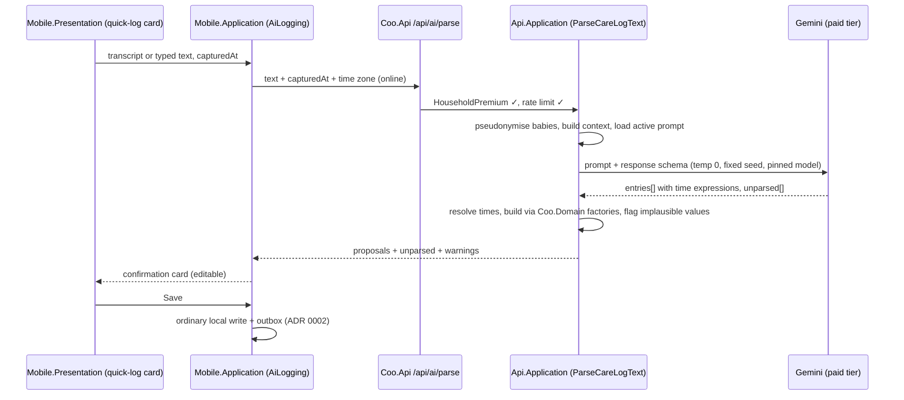

# 5. AI-assisted logging (voice and free text)

Date: 2026-09-29

Status: Accepted

## Context

The Premium headline feature is logging without forms. A parent says or types something like
"She ate 120 ml of formula and had a wet diaper at 14:00", and it becomes structured care-log
entries. This is where "reducing friction at 3 AM" is most visible.

The forces are:

- **Wrong data is worse than no data.** These entries end up in the PDF reports shown to a
  pediatrician (ADR 0001). An invented feeding amount or a misread time is a real harm, not a
  cosmetic bug.
- **Friction still matters.** A confirmation step must cost one tap, not a form.
- **Offline-first** (ADR 0002). Parsing needs the network, but logging must not.
- **Health data about a child** (ADR 0003). The input text goes to a third-party model. What is sent,
  what is kept, and under which terms must be deliberate.
- **Self-hosted** (ADR 0003). The model is called over an API from our server. The phone never
  talks to the model provider, and never holds the key.
- **The sibling apps have proven the building blocks.**
  - CoreChoice calls Gemini (`gemini-flash-lite-latest`) server-side with a response schema,
    temperature 0 and a fixed seed.
  - It stores prompt templates as versioned data, and records the version on every request.
  - A `FakeGeminiClient` lets the whole service run without a key.
  - An evals project (`CoreChoice.Evals`) checks the real model before a prompt is promoted.
  - It promises "nothing you type is written down".
  - `AndroidVoiceDictation` does speech-to-text with Android's `SpeechRecognizer`, asking for the
    microphone permission on first use, never at launch.
- **Households are varied.** Twins, several babies, `ml` or `oz`, and inputs in any of the seven
  supported languages (ADR 0006), or a mix of two.

## Decision

### 1. The AI proposes, the person confirms, the normal write path saves

The server **never writes to the care log**. `POST /api/ai/parse` returns *proposed* entries. The
app shows them in one confirmation card, where each entry is editable. One tap on **Save** writes
them through the ordinary local write path: record plus outbox, in one transaction (ADR 0002 §2).

As a result:

- An AI-created entry is an ordinary entry. It syncs, conflicts, validates and exports exactly like
  a manual one. There is no second write path to keep correct.
- A person always sees what will be saved before it is saved. That is the defence against wrong
  data.
- Saved entries carry `source = AiParsed` and the prompt version, so their accuracy is measurable.

Auto-saving high-confidence entries without confirmation is deferred. It will be reconsidered once
acceptance metrics (section 8) show how often people edit proposals.

### 2. Voice stays on the phone

- Dictation uses Android's `SpeechRecognizer`, following CoreChoice's `AndroidVoiceDictation`: a
  single recognition session per tap, and the microphone permission asked on first use.
  `EXTRA_PREFER_OFFLINE` is set, so that where the device supports it, audio is recognised on the
  device.
- **Audio never reaches Coo's server or the model.** Only the resulting text is sent. Audio is not
  recorded or stored anywhere by Coo.
- The transcript is shown in the confirmation card, so a misheard "12" in place of "120" is visible
  before saving.

### 3. Offline: keep the words, parse later

If the phone is offline, or parsing fails, **the input is never lost**:

- The text and the moment it was captured (`capturedAt`) are saved locally as a **pending note**.
- When connectivity returns, the app **first completes a sync cycle** (ADR 0002 §7), then parses
  the note and shows "1 note to review". Syncing first means that entries other caregivers made in
  the meantime are already on the phone for the duplicate check (§3a). Nothing is saved to the care
  log without that review (section 1).
- Times are resolved against `capturedAt`, not against when the note was parsed. "20 minutes ago",
  spoken at 03:10, still means 02:50 when it is parsed at 07:00.

Pending notes stay on the device and are not synced. A note from a phone that is later lost is
lost with it. That is accepted, because a note is a draft, not a log entry.

### 3a. Proposals are checked against what is already logged

A voice note parsed an hour late is the most common source of duplicates. For example, a parent
dictates "Lena ate 120 ml at 14:00" on a walk with no signal, while a partner at home logs the same
feeding manually. The proposal gets a fresh UUIDv7, so last-writer-wins cannot see that the two
are the same feeding.

Before the confirmation card is shown, every proposal is run through the same `DuplicateDetector`
as the post-pull check (ADR 0002 §9), against the local database:

- A proposal that matches an existing entry is shown as **"Already logged by Naïma at 14:02"**. It
  is **unselected by default**, so the default Save adds nothing twice.
- The person can instead choose **Add anyway**, or **Update Naïma's entry**, which applies the
  proposal's values to the existing entry's ID as an ordinary edit.
- A proposal never updates an existing entry by default. A partner's manual entry is usually the
  more accurate one, and silently overwriting it with an AI reading of a dictation would be exactly
  the wrong-data failure this ADR exists to prevent.

The check runs on the device, not the server, because only the device has the complete local picture
at that moment, including entries still in the outbox.

### 4. What the server sends to the model

A request carries:

- the text, at most 1,000 characters;
- `capturedAt`, and the device's IANA time zone;
- the household's babies as placeholders only (`Baby A`, `Baby B`), after the text has been
  pseudonymised (section 4a);
- context that makes short phrases resolvable:
  - any session in progress, so that "she woke up" ends the current sleep;
  - the last breast side, so that "other side" means something;
  - the household's preferred units.

It does not send caregiver names, email addresses, household or user IDs, or any past entries
beyond that context.

### 4a. Pseudonymisation before anything leaves the server

`Coo.Api.Application/AiParsing` runs a `TextPseudonymiser` over the input before the prompt is
built. It is a pure, unit-tested function with a reversible mapping that lives only in memory for
the duration of the request. It replaces:

| What | How it is recognised | Replaced with |
|---|---|---|
| Babies' names **and nicknames** | The household's baby profiles. A profile has an optional list of nicknames ("Mimi", "Kluska"), because parents rarely use the full name. Matching ignores case and diacritics, and covers inflected forms with a stem-and-suffix match: Polish cases (Zosia, Zosi, Zosię) and the German genitive -s. The other supported languages do not inflect names. | `Baby A`, `Baby B` |
| Caregivers' names | The household members' display names and first names | `Caregiver 1`, `Caregiver 2` |
| Email addresses, phone numbers, URLs | Patterns | `[email]`, `[phone]`, `[link]` |
| Long digit sequences (6 digits or more: PESEL, card or insurance numbers) | Pattern. Care amounts are never this long. | `[number]` |

The model's output is mapped back: `Baby A` becomes the baby's ID, and `Caregiver 1` becomes a
member reference, where a field needs one (for example, "Tomek fed her").

**Names of people outside the household** (a doctor, a grandparent) and places are *not* reliably
recognisable without a named-entity model. Running one on our server costs more than the problem
is worth for v1. The quick-log UI states the limit plainly: "Names of your babies and family are
hidden from the AI. Other names you say are sent as spoken." An eval case keeps the scrubbing honest:
every known name and nickname in the corpus must be absent from the text sent to the model.

### 4b. Terms

The model is called through the **paid** Gemini API tier. On the free tier, Google may use prompts
to improve its products, which is not acceptable for this data. The Gemini API does not guarantee
EU data residency. The privacy policy and the data-processing terms name Google as a processor for
this feature, and the feature is opt-in: it is used only when a person chooses AI logging.

### 5. The model extracts, deterministic code decides

The model returns JSON constrained by a response schema, with temperature 0 and a fixed seed
(CoreChoice's settings). The schema is defined in `Coo.Api.Infrastructure/Ai`, and contains:

- `entries[]`. Each entry has:
  - a `type`: `BreastFeeding`, `BottleFeeding`, `Diaper`, `SleepStart`, `SleepEnd`, `Sleep` or
    `Pumping`;
  - the type's fields;
  - `baby` (a placeholder);
  - `time` (below);
  - `sourceText`: the fragment of the input that produced this entry.
- `unparsed[]`: fragments the model could not map to an entry.

**The model does no time arithmetic.** `time` is a structured expression, one of:

- `{ kind: "clock", hh, mm }`
- `{ kind: "minutesAgo", n }`
- `{ kind: "now" }`
- `{ kind: "unspecified" }`

Deterministic server code resolves the expression against `capturedAt` and the time zone. That
includes "14:00" said at 01:00, which means yesterday afternoon. Language models are unreliable at
date arithmetic; our code is not.

**Everything the model returns is untrusted input** and passes through an anti-corruption layer
(CS-DDD-03):

- Each entry is built through the same `Coo.Domain` factories the app uses. An entry that fails a
  domain rule moves to `unparsed`, with a reason. It is never repaired silently.
- Implausible values are flagged, not dropped. The confirmation card highlights them. Examples:
  - a bottle outside 5–400 ml;
  - a time more than 5 minutes after `capturedAt`, or more than 48 hours before it;
  - a sleep longer than 16 hours.
- A baby placeholder that does not exist moves the entry to `unparsed`.
- With exactly one baby, entries default to that baby.

The input is the person's own text, and the output is constrained by the schema and validated like
any other input. So prompt injection can at worst mislead the person who wrote it, and the
confirmation card shows them the result.

### 6. Prompts and the model are versioned data, gated by evals

- Prompt templates live in the database with a version, as in CoreChoice. A new prompt means
  inserting a new version and switching which one is active. A row is never edited in place.
- Every parse records the prompt version that answered it.
- **The model ID is pinned** in configuration, for example a specific Gemini Flash-Lite version,
  never a `-latest` alias. An alias can change the model under a fixed prompt, and then evals no
  longer describe production. Changing the model follows the same gate as changing a prompt.
- **`Coo.Ai.Evals`** (a new test project) holds a corpus of real-world inputs with expected
  entries: every supported language (English, German, French, Spanish, Italian, Polish, Dutch;
  ADR 0006), mixed-language inputs, twins, `oz`, relative times, "other side",
  corrections ("no wait, 100 ml"), and inputs with nothing to log. As with `CoreChoice.Evals`, it
  runs against the real model on demand, not in CI. Promoting a prompt or a model requires it to
  pass first.

### 7. Access, limits and failure behaviour

- **Access.** `POST /api/ai/parse` requires the `HouseholdPremium` policy (ADR 0004 §9), which
  includes the trial.
- **Limits.** 10 parses per minute and 100 per day per household; 1,000 characters per input.
  These bound the cost of a trial abuser, and are configurable.
- **Timeout.** 10 seconds, with no automatic retry. The person, or the pending-note mechanism,
  retries.
- **Failure behaviour.** A timeout, a `503`, an unusable model response or a hit limit all keep the
  text as a pending note. The app also offers "Log manually", with the transcript shown alongside
  the manual form. A failure never discards what the person said.
- **Without a key.** Production refuses to start without the Gemini key and a pinned model ID. In
  Development, a `FakeCareLogParser` stands in, so the whole flow runs end to end with no key, as in
  CoreChoice.

### 8. What is stored

**Nothing the person says or types is stored on the server.** The text is used to build the prompt
and then discarded. This is CoreChoice's second promise, verified the same way: an integration test
asserts that no fragment of the input appears in any row.

Per request, the server stores:

- a salted hash of the household ID;
- the prompt version and model ID;
- token counts and latency;
- the number of entries proposed, and the number sent to `unparsed`.

After the confirmation card, the app reports counts only, never content, to
`POST /api/ai/parse/{requestId}/outcome`: entries accepted unchanged, edited, and removed. The
accepted-unchanged rate per prompt version is the quality metric that section 1's deferred
auto-save decision will use.

### 9. Where it lives

| Concern | Project |
|---|---|
| Entry factories and rules (reused, nothing AI-specific) | `Coo.Domain/CareLog` |
| Time-expression resolution (pure, takes `capturedAt` and time zone) | `Coo.Domain/CareLog` |
| Parse request and response, proposals, warnings, outcome DTOs | `Coo.Contracts/AiParsing` |
| `ParseCareLogText` use case, pseudonymisation, plausibility flags; port `ICareLogTextParser`, `IPromptTemplateStore` | `Coo.Api.Application/AiParsing` |
| Gemini adapter, response schema, prompt template storage, `FakeCareLogParser` | `Coo.Api.Infrastructure/Ai` |
| Endpoint, `HouseholdPremium` policy, rate limiter | `Coo.Api` |
| Pending notes, the review flow, outcome reporting; port `ISpeechToText` | `Coo.Mobile.Application/AiLogging` |
| Pending-note storage | `Coo.Mobile.Infrastructure` |
| `SpeechRecognizer` adapter | `Coo.Mobile.Platform/Speech` |
| Real-model evals | `tests/Coo.Ai.Evals` |

The parser sits behind `ICareLogTextParser`, so the provider can change without touching the use
case, the contract or the app. The evals are the acceptance test for any replacement.

A Wear OS quick-log, and a future smart-speaker integration, can reuse this endpoint as-is: they
are other sources of text.

## Consequences

### Positive

- AI-created entries are ordinary entries. Sync, validation, conflicts and reports have one path,
  not two.
- A person sees every entry before it is saved. The model's mistakes cost a correction, not a wrong
  record in a pediatric report.
- Time arithmetic and every rule are deterministic and unit-tested. The model does only what it is
  good at: extracting meaning from messy language.
- What someone says is never lost, whether it fails to parse or is spoken offline.
- Voice audio never leaves the device through Coo, and the text is never stored on the server.
- Prompts and the model are versioned and gated by evals. Changes are measurable through the
  accepted-unchanged rate, not judged by impression.
- The patterns (schema-constrained Gemini, prompts as data, fake client, evals) are already proven
  in CoreChoice.

### Negative

- The confirmation tap is friction, which the feature exists to remove. Removing it waits on
  evidence from the metrics.
- Parsing needs the network. Offline, a parent gets a pending note, not an entry, and has to review
  it later.
- Child health text is processed by Google, outside the EU, under the paid API's terms. This must
  be disclosed, and some parents will not use the feature because of it.
- Pseudonymisation covers known household names and nicknames, plus pattern-detectable
  identifiers. Other names and places a parent says reach the model as spoken. Matching Polish
  inflected forms is heuristic, so an unusual declension of a nickname can slip through until it is
  added to the eval corpus.
- Pinning the model means actively tracking Gemini deprecations. A retired model ID is an outage
  for this feature until the evals pass on its successor.
- On-device speech recognition quality varies by device and language, and `EXTRA_PREFER_OFFLINE`
  is only a preference. On some devices, audio is processed by Google's online recognition
  service, which is outside Coo's control and must be mentioned in the privacy policy.
- The eval corpus is real work to build and keep current, and it is the only defence against a
  prompt change quietly degrading one language while the others still pass. Every supported
  language needs its own cases, not a translation of the English ones.

## Implementation notes (Coo 1.1.0, 2026-10-23)

Built as "Tell Coo": a mic button on Today next to "Earlier…", and a launcher shortcut (long-press the icon). Where the
first version differs from the decision above, and why:

- **Live actions as well as entries.** Besides finished entries, the model can return `BreastStart`, `BreastSwitch`,
  `BreastStop`, `SleepStart`, `SleepEnd`, `PumpStart` and `PumpStop`, so "Lena started on the left" starts the timer
  and "she woke up" ends the running sleep, as the buttons do. The context therefore carries what is running.
- **Access.** Premium families get 100 parses a day; others get 5 a day to try it (`AiParsing:FreePerDay`, `0` makes it
  Premium-only). The per-minute limit of §7 is not built yet; the daily count bounds the cost.
- **Prompt and model.** The prompt is a versioned constant (`coo-parse-v1`) in `GeminiCareLogParser`, not a database
  row; the model is pinned to `gemini-3.5-flash-lite` (`AiParsing:Model`). `Coo.Ai.Evals` does not exist yet: the
  first prompt was checked by hand against the real model on English, Polish and Dutch inputs, three events in one
  sentence, a self-correction and small talk.
- **Not yet built:** the outcome report (§8), the salted-hash usage metrics, and the background re-parse of pending
  notes after a sync; pending notes are offered for review when "Tell Coo" is opened.
- **Consent.** Besides the sharing consent the server already requires, the app asks once before the first use, in the
  words of the privacy policy, that the text (never the audio) goes to Google's Gemini.
