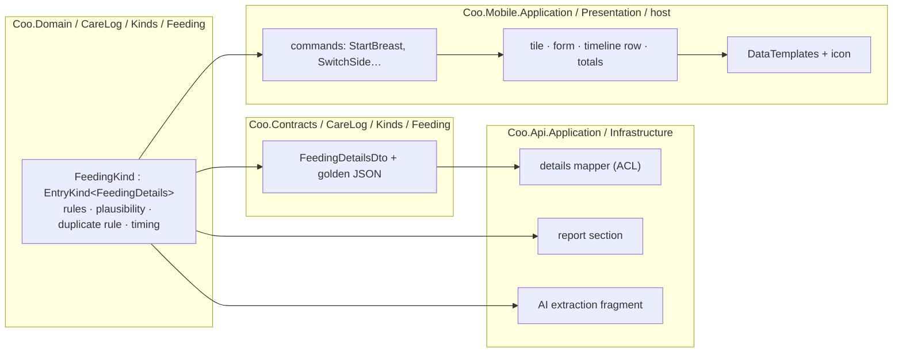
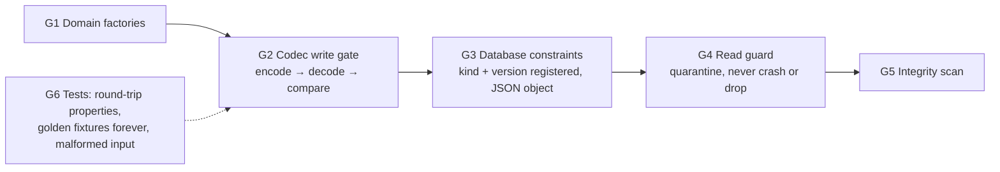

# 10. Extensibility: entry kinds and feature modules

Date: 2026-09-30

Status: Accepted

Amends: ADR 0001 §1 and §2 (the `CareLog` folder layout, and the new shared `Coo.Codecs` project) and
ADR 0002 §3 (the list of synced entity types).

## Context

v1 ships four care entries: feeding, diaper, sleep and pumping. The backlog already names many
more: solids, medication, temperature, growth (weight, length, head circumference), stool colour on
a diaper, tummy time, baths, milestones, doctor visits and vaccinations. There are also features
that are not entries, such as a milk-stash inventory, growth percentiles and more predictors. The
owner's requirement is that **adding these later is easy**, without giving up Clean Architecture.

With the first draft of Spec 001, every entry kind was its own synced entity type with its own
tables. Adding "medication" would have touched about twelve places:

- the domain type;
- a contract DTO;
- push and pull handling;
- an EF migration on the phone and another on the server;
- the architecture tests;
- a tile, a form and a timeline row;
- the reports;
- the AI schema;
- the duplicate rules;
- the localization files.

Worse, **an old client would silently never see the new entries.** The server serves each device
the entity types of its contract version (ADR 0002 §11), so a parent on last month's app would
not see the medication their partner logged. That is not acceptable in a family app.

The forces are:

- **Installed versions lag by months** (ADR 0002 §11). A new kind or field must not be lost,
  hidden or overwritten by a device that does not know it yet.
- **State-based last-writer-wins** (ADR 0002 §3). An old client that edits an entry and writes back
  only the fields it knows **erases** the fields it does not know. That is data loss, not a display
  issue.
- **Trimmed Release builds** (the sibling apps). Runtime reflection, assembly scanning and dynamic
  loading break under trimming. Extension must be wired at compile time.
- **Clean Architecture** (ADR 0001, CS-HEX-01…03). The Domain stays dependency-free. Ports stay in
  Application. DI happens only in the hosts.
- **YAGNI.** No plugin system, no marketplace, no runtime-downloaded features. The aim is that the
  *next developer* (the owner, or an agent) adds a feature in one predictable, test-guarded way.

## Decision

### 1. One synced entry type, many entry kinds

There is **one** synced care-entry type, `CareEntry`, and it carries a **kind**. It replaces
`Feeding`, `DiaperChange`, `SleepSession` and `PumpingSession` as separate entity types in
ADR 0002 §3. The synced entity types become:

| Entity type | What it is |
|---|---|
| `CareEntry` | Every care-log entry, whatever its kind |
| `BabyProfile` | A baby |
| `HouseholdSettings` | Units, time zone, visible kinds |
| `DuplicateDismissal` | A "keep both" decision (Spec 001 §9) |

A `CareEntry` has a **core**, shared by every kind, and **details**, specific to its kind:

| Core field | Meaning |
|---|---|
| `Id`, `HouseholdId`, `Version`, `IsDeleted` | As for every synced record (ADR 0002) |
| `Kind` | A stable string code, for example `feeding`, `diaper`, `sleep`, `pump` |
| `Subject` | Whom the entry is about: `Baby(BabyId)`, or `Caregiver(PersonRef)` for pumping, and later for a parent's own medication |
| `Timing` | `Point(at)` or `Session(start, end?)` |
| `LoggedBy`, `Source`, `Note` | Who logged it, how it was created, and free text |
| `Details` | The kind's own data, for example breast segments or bottle amounts |

The core is everything the **shared surfaces** need without knowing the kind: the timeline, the
day ribbon, sync, the duplicate framework, the "Needs attention" list, deletion and undo, the
raw-data export, "last at" and "time since". A new kind gets all of them for free.

**Kind codes are permanent.** A code is never renamed and never reused. A retired kind stays
readable, as ADR 0002 §11 already requires ("removing a feature does not reject its data").

### 2. Storage: fixed core columns, and the details as JSON

The phone (SQLite) and the server (PostgreSQL) each have **one** `care_entries` table:

- the core fields as real, indexed columns:
  `household_id`, `kind`, `subject_baby_id`, `subject_person_id`, `start_at`, `start_offset`,
  `end_at`, `end_offset`, `logged_by`, `source`, `note`;
- the ADR 0002 sync columns: `seq` on the server, plus `version` and `is_deleted` on both sides;
- `details`: a JSON document (`jsonb` on PostgreSQL, `TEXT` on SQLite).

The indexes are `(household_id, seq)` for sync and `(household_id, subject_baby_id, start_at)`
for the timeline and the duplicate check.

**A new kind, or a new optional field on a kind, needs no migration on either side.**
A migration is needed only when the *core* changes, which should be rare and deliberate.

Totals and reports are computed in memory by each kind's module (section 4). At about 10,000
entries a year per household (ADR 0002), that is cheap. If a future kind ever needs heavy
querying inside its details, it can get its own projection table without changing the protocol.

### 3. Forward compatibility: a client never destroys what it does not understand

These rules are what make "add it later" safe with old clients in the wild.

1. **Unknown kind.** A client that receives a kind it does not know stores the entry exactly as
   received, as an opaque entry.
   - It shows the entry on the timeline, using the core only: "An entry from a newer version of
     Coo — update the app to see it". The time and who logged it are shown.
   - The entry is read-only. It can be deleted, which writes a tombstone.
   - It is excluded from totals, duplicate checks and predictions.
2. **Unknown property on a known kind.** Contract DTOs keep unknown JSON properties
   (`[JsonExtensionData]`). The phone stores the **raw details JSON** it received. When the phone
   writes an edit, the mapper serialises the fields it knows and **merges back every property it
   does not know** from the stored raw JSON.
   - As a result, an old client can correct the time of a diaper change without erasing the stool
     colour that a newer client recorded.
   - This lives entirely in the contract mapping. The Domain never sees JSON.
3. **Unknown value in a known field**, for example a new enum member such as `DonorMilk`. Enums
   travel as strings. A value the client cannot represent makes that entry **read-only on that
   client**, with the same "update the app" hint. Guessing a value would be a silent corruption.
4. **The server is always the newest.** The server knows every kind, and validates each change
   against the rules of its `schemaVersion` (ADR 0002 §11), unchanged.
5. **Within one kind, changes are additive** (ADR 0002 §11): new fields are optional, and nothing is
   renamed or removed. A breaking change to a kind's details goes through a contract version bump
   and an upgrader in the anti-corruption layer, as for any other contract.

### 4. An entry kind is a vertical slice, registered explicitly

Each kind is **one folder per layer**, plus **one registration line per layer**. No shared code
contains a `switch` on the kind. Shared surfaces iterate over registered kinds instead.

**What a kind provides, layer by layer:**

| Layer | The kind provides | Required |
|---|---|---|
| `Coo.Domain` | The details type(s), and an `EntryKind<TDetails>` descriptor: code, subject type, timing shape, hard rules, plausibility rules, and the duplicate rule. It is added to the static `EntryKinds.All` catalogue. | Yes |
| `Coo.Contracts` | The details DTO, and golden JSON fixtures | Yes |
| `Coo.Api.Application` | A details mapper (the ACL), and a report section | The mapper, yes. The report section is optional, with an explicit `NoReportSection`. |
| `Coo.Api.Infrastructure/Ai` | An AI extraction fragment: the schema piece and the prompt guidance | Optional, with an explicit `NotAiParsable` |
| `Coo.Mobile.Application` | Kind-specific commands (for example `SwitchSide`). Log, amend, delete and undo are generic and come for free. | Only if the kind has operations beyond the generic ones |
| `Coo.Mobile.Presentation` | A log tile, a form view model, a timeline-row formatter, and a totals contributor | Yes. Totals are optional. |
| `Coo.Mobile` (host) | A `DataTemplate` for the form and the row, and an icon | Yes |
| Localization | `kind.{code}.*` keys in all seven languages | Yes (the ADR 0006 parity test) |
| Reminders, insights, Wear OS | A reminder rule, an insight, a watch action | Optional |

**Registration is explicit, and compile-time only.** Each layer's `AddXxx()` extension
(ADR 0001 §2) registers its kind modules by hand, for example
`services.AddEntryKindModule<FeedingPresentation>()`. Nothing is discovered by reflection at
runtime, so trimmed Release builds keep working. JSON serialisation uses a source-generated
`JsonSerializerContext`, and each kind adds its DTOs to it.

**Completeness is tested, not remembered.** `Coo.Architecture.Tests` enumerates
`EntryKinds.All` and fails if any kind is missing from a required registry:

- the contract mapper;
- the presentation modules;
- the JSON context;
- the localization keys;
- the golden fixtures;
- the report or AI registries, or their explicit opt-out.

The MAUI host is not in `Coo.Tests.slnf`. A Debug-build startup check therefore asserts that
every kind has its `DataTemplate`, and Release falls back to the generic core-only row.

Adding a kind is then a documented recipe, `docs/recipes/add-an-entry-kind.md`, written together
with Spec 001's four kinds and kept accurate by those tests.

### 5. Extension points for features that are not entry kinds

The same pattern applies wherever a feature plugs into a shared surface. The extension points
are interfaces defined in the Application layers (CS-HEX-02), registered many times through DI,
and consumed by the shared surface:

| Extension point | Used by | Example of a later feature |
|---|---|---|
| `IEntryKindModule` (per layer, section 4) | Timeline, Today, forms, sync mapping, reports, AI | Medication, growth |
| `IReminderRule` | `ReminderPlanner` (ADR 0007) | "Medication due", "Vitamin D daily" |
| `IInsight` | Today insights card, reports | Growth percentiles, a feeding-interval predictor |
| `IReportSection` | PDF reports | A growth-chart page |
| `INeedsAttentionSource` | "Needs attention" list | A stash item nearing expiry |
| `ISettingsSection` | The settings screen | Per-feature preferences |
| `IHomeSection` (stage-aware: `Expecting`, `Born`) | The Today screen (Spec 006 §3a) | Pregnancy tips, exercises, a contraction timer |

Rules:

- **An extension point is added when a second feature needs it, not before.** The table lists
  points whose first consumers are already in the accepted ADRs. Anything new starts as a plain
  feature folder.
- **Features are vertical slices inside each Application and Presentation project**
  (`CareLog/`, `Insights/`, `Reminders/`, `Reports/`, `AiLogging/`, `Households/`, `Billing/`,
  `Sync/`). One feature does not reach into another feature's internals. It uses that feature's
  public use cases or ports.
- **A new non-entry synced type** is rare, and is by design more work. For example, a
  milk-stash item has its own lifecycle, so it is not an entry. Sync is generic over an
  `ISyncedRecordType` registry (serialiser, table, apply rule), so such a type is added as one
  registration plus its table and migration. The completeness test covers these too.

### 6. Feature availability

- **Care data is never gated** (ADR 0004 §3). Every entry kind is free to log, view, sync and
  export. Premium gates *features* (predictions, AI logging, the watch, reminders beyond the
  basics) through the existing `FeatureGate`. Each extension declares a `FeatureId` when it is
  Premium.
- **A household chooses which kinds it uses.** `HouseholdSettings.HiddenKinds` hides a kind's log
  tile and totals, for example pumping in a formula-only household. Existing entries of a hidden
  kind stay on the timeline. As more kinds arrive, the Today screen stays calm by default: a new
  kind can ship hidden and be offered as "New: log medication".
- **No remote feature flags in v1.** Kinds and features ship with the app. A server-driven kill
  switch can be added later as one more input to `FeatureGate`, if a need appears.

### 7. Guards: corrupted details never reach a database

The `details` column cannot be typed by the database the way a per-kind table would be. Instead,
six guards sit between the code and the stored row, each one catching what the previous one might
miss.

**G1 — Domain factories** (unchanged). No domain object exists that breaks a hard rule.

**G2 — One codec per kind, and it is the only way in or out.**

- A new shared project, **`Coo.Codecs`** (`net10.0`), references only `Coo.Domain` and
  `Coo.Contracts`. For each kind it holds one `EntryDetailsCodec<TDetails>`: domain details ⇄ the
  current details DTO ⇄ JSON, plus the version chain (section 8).
- Both sides compile the same codec, so the phone and the server can never encode differently.
  This amends ADR 0001 §2: contract ⇄ domain mapping for entry details lives in `Coo.Codecs`, not
  separately in each Application layer.
- **The write gate.** Every write encodes the details, immediately decodes the result back through
  the same codec and the Domain factories, and requires the result to **equal** the original
  domain value. If any step fails, the transaction is rolled back and nothing is written. It is
  treated as a programming error, which is logged and fails the tests. A mapper bug therefore
  cannot store a malformed or lossy document.
- Repositories accept `CareEntry` domain objects only, never raw JSON. An architecture test
  enforces that only `Coo.Codecs` and the two persistence folders touch the `details` column or
  the JSON types.

**G3 — The database refuses what the code does not know.**

- **PostgreSQL:**
  - `details jsonb NOT NULL CHECK (jsonb_typeof(details) = 'object')`.
  - A generated column, `details_version int GENERATED ALWAYS AS ((details->>'v')::int) STORED`,
    that is `NOT NULL`.
  - A composite foreign key, `(kind, details_version)` → `entry_kind_versions(kind, version)`.
    That table is filled at startup from the codecs' catalogue, with an idempotent insert.
  - As a result, a row with an unregistered kind, an unregistered version or a non-object document
    **cannot be inserted**, whatever code tries. Registering a kind is an insert into a reference
    table, not a schema migration.
- **SQLite** (the phone):
  - `CHECK (json_valid(details) AND json_type(details) = 'object' AND json_extract(details, '$.v') >= 1)`.
  - The phone has no foreign key on the kind. It must be able to store opaque entries from newer
    clients (section 3). An opaque row is flagged `is_opaque`, and the write gate does not apply to
    it: it is stored byte for byte as received, and only the server's codec ever validated it.

**G4 — The read guard.** Every read decodes through the codec. A row that fails to decode never
crashes the app, and is never silently dropped:

- It is **quarantined**: the raw row is kept and marked, and excluded from totals, predictions and
  reports.
- On the phone, it appears in "Needs attention" as "This entry could not be read". The person can
  view its time and kind, and can delete it.
- On the server, it is logged with the row ID and counted in a metric that raises an alert.

**G5 — The integrity scan.**

- On the server, a daily background job, and an admin command
  (`coo-admin verify`), decode every row through the codecs and the Domain rules and report every
  failure.
- On the phone, the same scan runs once after every app update, after migrations and data
  migrations (section 9).

**G6 — Tests that make the guards trustworthy.**

- **Round-trip property tests** for each kind (FsCheck, test projects only): generate valid domain
  details, then encode and decode, and the result must be equal. Thousands of cases per kind, on
  every build.
- **Golden fixtures for every released details version, kept forever.** For example,
  `feeding.v1.breast.json` and `feeding.v1.bottle-mixed.json`. They must decode to the expected
  domain value in every future build. Deleting one fails the build, as with the released-codes list
  in Spec 001 §7.1.
- **Malformed-input tests.** Wrong types, missing fields, extra nesting, out-of-range numbers and
  an unknown `v` must be rejected by the codec, and must never produce a domain object.
- **The G3 constraints are tested against real PostgreSQL** (Testcontainers) and real SQLite, by
  inserting bad rows directly and expecting the database to refuse them.

### 8. Evolving stored data: versioned details, upcasters and data migrations

Changing what is stored must stay possible, and safe, for years.

**Every details document carries its version**, `"v": n`, per kind.

- **Reading any version works.** Each codec holds a chain of **upcasters**, pure C# functions from
  one DTO version to the next, for example `FeedingDetailsV1 → FeedingDetailsV2`. A v1 row is
  decoded as v1, upcast step by step, and handed to the Domain as the current model.
- **Writing is always the current version.** An old row is therefore upgraded the next time it is
  edited, with no extra work.
- **Serving older clients** (ADR 0002 §11, N and N−1): the server downcasts where the older shape can
  hold the data. Where it cannot, the older client receives the entry as unrepresentable, and shows
  it read-only (section 3.3). It never receives a lossy copy.
- **Additive fields need no new version.** A new optional field (stool colour) is read as absent
  from older documents, and old clients preserve it (section 3.2). A version bump is only for
  changes in shape: a renamed field, a split field, or a change of unit.

**Data migrations, for rewriting stored rows in bulk.** Alongside EF schema migrations, both sides
have an `IDataMigration` runner:

- A data migration is a C# class with a permanent ID. It is recorded in a `data_migrations` table
  when it completes, and it is idempotent, so a crash halfway through resumes safely.
- It runs in batches: on the server at startup, in the background, and on the phone after an app
  update, before the integrity scan.
- It decodes each row (upcasting as needed), and writes it back through the write gate (G2) in the
  current version.
- **Every data migration has an equivalence test.** `decode(before)` must equal `decode(after)` for
  the whole fixture corpus. A migration may change how data is stored, never what it means.

There are two kinds of change, and they are handled differently:

| Change | Example | How it is done | Syncs? |
|---|---|---|---|
| **Representation.** The same meaning, stored differently. | Renaming a field, moving a value from details to a core column, splitting `v1` into `v2` | An upcaster, plus an optional data migration on each side. `version` and `seq` are **not** bumped, because every device upcasts on read anyway. | No |
| **Correction.** The meaning changes. | Fixing entries stored with a wrong unit by a bug | A domain use case that edits each affected entry through the normal write path, with new HLC stamps. It is written as a named, reviewed, one-off job. | Yes, like any edit |

**Changing the core** (for example, adding a column) is an EF schema migration plus, where data
moves, a paired data migration with its equivalence test. The core is therefore still changeable,
with the same safety as the details.

### 9. What does not change

- The Domain remains dependency-free. Kinds are plain C# types, and the catalogue is a static
  list, not DI.
- Every entry is still built through Domain factories. The AI, the watch and manual forms share one
  write path (ADR 0005 §1, ADR 0009).
- The ADR 0002 protocol is unchanged. Only its list of entity types shrinks.

## Consequences

### Positive

- **A new entry kind needs no database migration, no sync change and no new endpoint.** It is one
  folder per layer, and the tests say what is missing.
- **Old clients never lose, hide or erase new data.** Unknown kinds are shown and kept, unknown
  properties are merged back, and unknown values make an entry read-only.
- New optional fields (stool colour, a medication's dose unit) are additive changes to one
  kind, with no ripple effects.
- The shared surfaces (timeline, sync, duplicates, "Needs attention", export, undo) are written
  once, against the core, and are tested once.
- **Corrupted details cannot be written, and unreadable ones are never lost.** The write gate, the
  database constraints, the read guard and the integrity scan (section 7) stop them.
- **Stored data can evolve** through versioned details, upcasters and equivalence-tested data
  migrations (section 8). Old rows stay readable forever, which the golden fixtures prove.
- The explicit registration keeps trimmed Release builds safe and the object graph readable.
- The recipe plus the completeness tests make "add a feature" a routine, predictable task for a
  person or an agent.

### Negative

- **The database does not type-check the inside of `details` field by field.** Instead it refuses
  unregistered kinds and versions, and anything that is not an object (G3). Everything finer is
  enforced by the codec write gate, the Domain and the integrity scan (G2, G4, G5). That is five
  layers of code guard in front of one layer of database guard, where a per-kind table would give
  one strong database layer.
- Queries into details (for example "all bottles over 200 ml") are JSON queries, or are done in
  memory. That is fine at this volume, but it is less convenient than columns.
- Merging back unknown properties is real complexity. **It is not caused by JSON**: any design
  with old clients and last-writer-wins needs it, including one table per kind. It lives in one
  generic, tested component in `Coo.Codecs`, not in each kind.
- The guards cost work: a new shared project, a codec per kind, the version chains, the data
  migration runner, the scans and the property tests. They are written once, and each new kind
  adds only its codec, its fixtures and its generators.
- The read-only fallback for unrepresentable values means an old client occasionally cannot edit
  an entry until it updates. That is accepted over silent corruption.
- Changing the core needs a schema migration **and** a data migration, both with tests. That is
  safe (section 8), but it is more work than changing a kind's details, so the core should still be
  chosen carefully now (Spec 001 §6).
- The indirection (descriptors, registries, modules) is more ceremony than four hard-coded types.
  It pays off from the fifth kind onwards, and the backlog already has more than ten.
