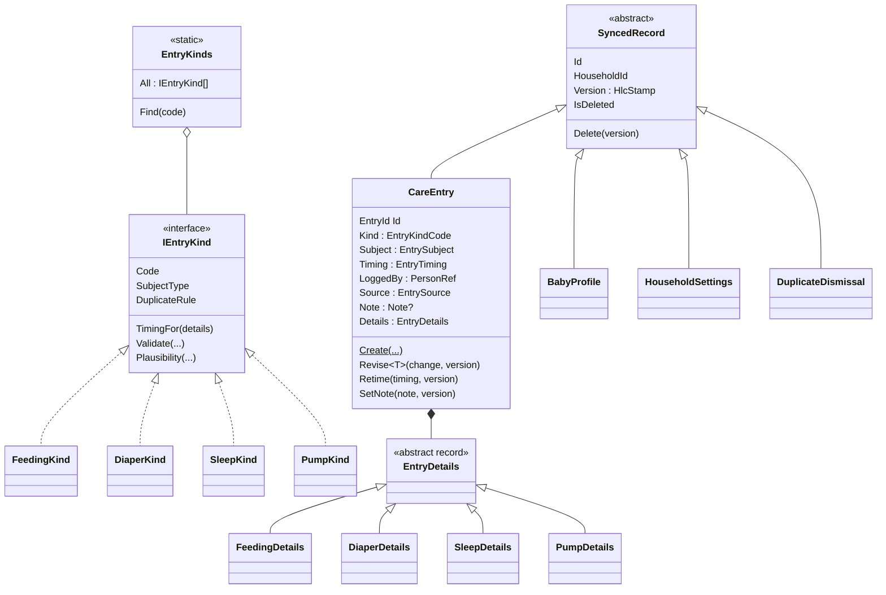

# Spec 001 — Care-log domain model

Date: 2026-09-30

Status: Accepted (revision 2)

Depends on: ADR 0001 (layout), 0002 (sync), 0003 (households), 0005 (AI logging), 0006 (units and
times), 0008 (sleep predictor), 0009 (Wear OS), **0010 (extensibility)**.

Revision 2 rebuilds the model on ADR 0010: one `CareEntry` with a *kind*, instead of four separate
entry types. The owner's answers to revision 1's questions are recorded in §15.

## 1. Purpose and scope

This spec defines what `Coo.Domain` knows about babies, households and care entries. It covers
the types, their invariants, the entry-kind framework, and the pure services that every other spec
builds on. It fixes **behaviour and rules**. It does not fix wire formats (the contracts spec) or
tables (the persistence specs; ADR 0010 §2 gives their shape).

**In scope**

- Common building blocks: typed IDs, `Result` and error codes, the hybrid logical clock stamp,
  records and tombstones, last-writer-wins.
- `BabyProfile`, `HouseholdSettings`, and age, including corrected age.
- The `CareEntry` core, and the **entry-kind framework**: `EntryKind<TDetails>` and the
  `EntryKinds.All` catalogue.
- The four v1 kinds: `feeding`, `diaper`, `sleep` and `pump`.
- Hard rules (the domain refuses) and plausibility warnings (the domain flags).
- The duplicate framework, and `DuplicateDismissal`.
- `TimeExpressionResolver` (ADR 0005 §5).

**Out of scope**

| Concern | Where it goes |
|---|---|
| `Membership`, `Role`, `Invitation` | The identity spec (ADR 0003 §6) |
| `Entitlement`, `FeatureGate` | The billing spec (ADR 0004) |
| `SleepClassifier`, `SleepPredictor` | The predictor spec (ADR 0008). This spec only stores the nap or night override. |
| DTOs, JSON, codecs, upcasters, the write gate, merging back unknown properties, opaque entries | `Coo.Codecs` and the persistence specs (ADR 0010 §3, §7, §8). The Domain never sees JSON. Codecs build details only through the public details factories in this spec. |
| Outbox, `seq`, `SyncRejected` | The sync spec (ADR 0002) |
| Tiles, forms, timeline rows, reports, AI fragments for each kind | Their layer specs. ADR 0010 §4 lists what each kind must provide. |
| Solids, medication, temperature, growth, stool colour | Later kinds and fields, added through ADR 0010 without any migration (§15, Q1 and Q3) |

## 2. Design principles

1. **Every synced record is its own aggregate.** Sync is per record, with last-writer-wins
   (ADR 0002 §3). The household references nothing; entries reference the household by ID.
2. **Only single-record rules are invariants.** A rule that needs another record, such as "no two
   sleeps overlap" or "not before the baby's birth", cannot be enforced on an offline device
   (ADR 0002 §9). It becomes a warning or a duplicate flag, never a rejection.
3. **Hard rules reject what is meaningless. Warnings flag what is unusual.** Hard rules run in the
   factories and methods, with the same compiled code on the device and on the server. Warnings
   never block a save.
4. **Time is a parameter.** No domain type reads a clock (ADR 0001 §2).
5. **The domain assigns no IDs.** The caller passes a UUIDv7, so that the watch, AI proposals and
   forms all create entries the same way (ADR 0002 §1, ADR 0009 §2).
6. **Every mutation carries a version stamp**, an `HlcStamp` issued by the caller's clock.
7. **Errors are codes** (ADR 0006), stable once released.
8. **Open for new kinds, closed for modification** (ADR 0010). No shared domain code contains a
   `switch` on the kind. The core, the validation pipeline, plausibility and duplicates delegate
   to the kind's descriptor. Adding a kind adds a folder, and never edits a shared type.

## 3. Common building blocks (`Coo.Domain/Common`)

### 3.1 Typed IDs

These are `readonly record struct` wrappers over `Guid`: `HouseholdId`, `BabyId`, `UserId`,
`DeviceId`, `EntryId` and `DismissalId`.

- The constructor rejects `Guid.Empty`.
- The domain does not check that an ID is version 7. The application layer does, and has a test
  for it.

### 3.2 `Result<T>` and `DomainError`

- Factories and mutators return `Result<T>` or `Result`, and never throw for a rule violation.
  Throwing is reserved for programming errors.
- A `DomainError` has a dotted `Code` (for example `sleep.too-long`) and optional arguments, such
  as the limit that was exceeded. The server returns the code as the `rejected` reason
  (ADR 0002 §5).
- A method reports the **first** failing rule, in the pipeline order of §6.4, so the same input
  always gives the same code.

### 3.3 `HlcStamp` and `HybridLogicalClock` (`Common/Versioning`)

```csharp
public readonly record struct HlcStamp(long WallClockMs, int Counter, DeviceId DeviceId)
    : IComparable<HlcStamp>;
```

- **Order:** `WallClockMs`, then `Counter`, then `DeviceId`, compared as its 16 bytes in RFC 4122
  (big-endian) order. The order is explicit so that the Kotlin watch (ADR 0009) compares
  identically. Golden fixtures in `Coo.Domain.Tests` are shared with the watch project.
- `HybridLogicalClock` holds the last stamp it issued:
  - `Tick(physicalNowMs)`: `wall = max(last.wall, physicalNowMs)`. The counter is
    `last.counter + 1` if `wall` did not advance, and 0 otherwise.
  - `Observe(remote, physicalNowMs)`: the standard HLC merge. The next `Tick` exceeds both.
  - The caller persists the clock's state. The class takes it in its constructor and exposes it as
    `Last`.
- `HlcStamp.IsTooFarAhead(serverNowMs)` is true when the stamp is more than **24 hours** ahead of
  the server clock (ADR 0002 §4).

### 3.4 `SyncedRecord`, tombstones and last-writer-wins

Every synced record derives from `SyncedRecord`, which holds `Id`, `HouseholdId` (immutable),
`Version` and `IsDeleted`.

- `Delete(version)` writes a tombstone. Deleting a record that is already deleted fails with
  `record.already-deleted`.
- Any other mutator on a deleted record fails with `record.deleted`. There is no undelete method. (Spec 011d: the local undo of a merge writes the record again, live, with a newer version — replacement in the store, as sync already allows, never a Domain method.)
  A remote edit with a higher version beats a tombstone by *replacement* in sync (ADR 0002 §3),
  not through a method.
- A mutator called with a stamp that is not greater than `Version` fails with
  `record.stale-version`.
- `LastWriterWins.Pick(a, b)` returns the state with the higher `Version`. It is total and
  symmetric. The device, the server and the watch all use this one comparison.

### 3.5 Rehydration and its visibility

Each record type has an `internal static Rehydrate(...)` that rebuilds stored or pulled state
**without** re-running the creation rules. Validating an incoming change against the rules of its
`schemaVersion` (ADR 0002 §11) is done by the server's application layer through the ordinary
factories, never through `Rehydrate`.

`Coo.Domain` declares `InternalsVisibleTo` for exactly these projects:

- `Coo.Api.Infrastructure` and `Coo.Mobile.Infrastructure`;
- `Coo.Api.Application` and `Coo.Mobile.Application`;
- the test projects.

This is a **deliberate, documented exception to CS-MOD-01** (owner decision, §15 Q7). An
architecture test, `Domain_InternalsVisibleTo_IsExactlyTheApprovedList`, fails if the list changes.
A second test, `Rehydrate_IsCalledOnlyFromInfrastructureOrMapping`, fails if application use cases
call `Rehydrate` outside their `Mapping/` folders.

## 4. Value objects (`Coo.Domain/CareLog`)

All value objects are `record` or `readonly record struct`, and are valid by construction through
factories that return `Result<T>`.

### 4.1 `Volume`

- It is stored as **millilitres**, a `decimal` rounded to 0.1 ml (ADR 0006 §5).
- `FromMillilitres(decimal)` and `FromOunces(decimal)`, with 1 US fl oz = 29.5735 ml.
  "4 oz" is stored as 118.3 ml and displays as 4.0 oz again.
- It must be greater than 0 and at most 1,000 ml (`volume.out-of-range`).
- Formatting and display steps are presentation concerns.

### 4.2 `TimeRange`

- `Start` (a `DateTimeOffset`) and an optional `End`. `End == null` means in progress.
- `End`, if set, must be strictly after `Start` (`time.end-not-after-start`).
- `Duration(now)`: `End − Start`, or `now − Start` while in progress.
- `Overlaps(other, now)`: an open range is treated as ending at `now`.
- Each instant keeps its own offset. A sleep across a DST change has different offsets at its two
  ends, which is correct.

### 4.3 `EntryTiming`

Every entry has one of two shapes of timing:

- `EntryTiming.Point(DateTimeOffset at)`, for a diaper change or a bottle.
- `EntryTiming.Session(TimeRange range)`, for a breast feed, a sleep or pumping.

`OccurredAt` is `at`, or `range.Start`. It orders the timeline and drives the duplicate check.
`IsInProgress` is true for a session with no `End`.

### 4.4 `EntrySubject`

Whom an entry is about:

- `EntrySubject.Baby(BabyId)`;
- `EntrySubject.Caregiver(PersonRef)`: pumping now, and later, for example, a parent's own
  medication.

Each kind declares which subject it accepts (§7.1).

### 4.5 `EntrySource`

The **creation** origin. It is immutable, so a later edit does not change it.

| Value | Meaning |
|---|---|
| `Manual` | A form, or a one-tap tile |
| `Timer` | The in-app timer |
| `Watch` | The Wear OS app (ADR 0009) |
| `AiParsed(promptVersion)` | An accepted AI proposal (ADR 0005 §1) |

### 4.6 `PersonRef`

- `PersonRef.User(UserId)` for a signed-in member.
- `PersonRef.ThisDevicesPerson` for entries made before sign-in (ADR 0003 §1). At first sign-in,
  the mobile application rewrites them to the new `UserId` in the same transaction as the
  household upgrade (ADR 0003 §7). They have never been pushed, so no synced version is affected.
  The server rejects `ThisDevicesPerson` (`person.unresolved`).
- A `UserId` that is no longer a member is shown as "former caregiver" (ADR 0003 §8), and is never
  rewritten.

### 4.7 `Note`

Optional free text, trimmed, 1–500 characters (`note.too-long`). Whitespace-only text becomes "no
note". A note is never sent to the AI model.

### 4.8 `EntryKindCode`

A `readonly record struct` wrapping a lowercase ASCII string of 2–32 characters, matching
`[a-z][a-z0-9-]*` (`kind.code-invalid`). The code is permanent once released: it is never renamed
and never reused (ADR 0010 §1). The codes for v1 are `feeding`, `diaper`, `sleep` and `pump`.

## 5. Babies and households (`Coo.Domain/Households`)

### 5.1 `BabyProfile` (synced record)

| Field | Rules |
|---|---|
| `Name` | Trimmed, 1–40 characters (`baby.name-invalid`) |
| `Nicknames` | 0–5 entries, each 1–40 characters. They must be unique among themselves and different from `Name` by `NameKey` (`baby.nickname-duplicate`). The pseudonymiser uses them (ADR 0005 §4a). |
| `BirthDate` | A `DateOnly`, at most 1 day after `today`, to allow for time zones (`baby.birth-in-future`) |
| `DueDate` | An optional `DateOnly`, from 6 weeks before `BirthDate` to 24 weeks after it (`baby.due-date-out-of-range`) |

The methods are `Create`, `Rename`, `SetNicknames`, `SetBirthDate`, `SetDueDate` and `Delete`.
Each takes a stamp. `today` is passed in where a rule needs it.

**`NameKey.From(string)`** is the single definition of "the same name":

- it lowercases with the invariant culture;
- it removes diacritics after NFD decomposition;
- it maps the letters that do not decompose explicitly: `ł`→`l`, `ø`→`o`, `ß`→`ss`, `đ`→`d`;
- it collapses whitespace.

The pseudonymiser reuses it. Inflection matching belongs to the pseudonymiser, not the domain.

**Amended by Spec 006 §3a (2026-10-01): an expected baby.** `BirthDate` is optional. A profile needs a
birth date or a due date (`baby.birth-or-due-date-required`). While unborn, the due date lies between
6 weeks before and 44 weeks after `today`. `RecordBirth(birthDate, version, today)` sets the birth date,
and `IsBorn` reports it.

### 5.2 Age

`BabyAge.On(profile, today)` returns:

- `Actual`: in days, with weeks and months for display.
- `Corrected`: `Actual − (DueDate − BirthDate)`, when `DueDate` is after `BirthDate` **and** the
  actual age is under 24 months (ADR 0008 §2). Otherwise it equals `Actual`. It is never
  negative.
- `IsCorrected` and `IsBeforeDueDate`.

### 5.3 `HouseholdSettings` (synced record)

There is one per household, and its `Id` **is** the `HouseholdId`. Two devices creating it
concurrently therefore converge through last-writer-wins.

| Field | Rules |
|---|---|
| `VolumeUnit` | `Millilitres` or `Ounces` (ADR 0006 §5). The caller chooses the default from the device region. |
| `TimeZoneId` | A non-empty IANA ID (`settings.time-zone-empty`). The application resolves it, and rejects unknown IDs. |
| `HiddenKinds` | A set of `EntryKindCode` whose tiles and totals are hidden (ADR 0010 §6). Unknown codes are kept, not dropped, because they may come from a newer client. |

## 6. The `CareEntry` core (`Coo.Domain/CareLog`)

### 6.1 Shape



- The core fields are exactly those in ADR 0010 §1. **They are the hardest part of the model to
  change later** (ADR 0010, Negative), so each one is justified by a shared surface that needs it:

  | Field | Needed by |
  |---|---|
  | `Kind` | Everything that dispatches to a kind |
  | `Subject` | Filtering by baby, twins, duplicates, pseudonymisation |
  | `Timing` | Timeline, day ribbon, "time since", duplicates, the predictor, reminders |
  | `LoggedBy` | "Who logged it" on every row, and family-activity notices (ADR 0007) |
  | `Source` | AI accuracy metrics (ADR 0005 §8) |
  | `Note` | Every kind |

- `Kind` and `Subject` are immutable after creation. Changing either is a delete plus a new entry,
  so that duplicates, dismissals and per-baby history stay stable.

### 6.2 Operations

| Method | Effect |
|---|---|
| `CareEntry.Create(id, household, subject, details, timing?, loggedBy, source, version, now)` | The kind is taken from the details type through the catalogue. `timing` is omitted for kinds that derive it from their details (§7.1). |
| `Revise<TDetails>(Func<TDetails, Result<TDetails>> change, version, now)` | Applies a kind-specific change, such as `d => d.SwitchSide(at)`, re-derives the timing if the kind derives it, and re-runs the pipeline. It fails with `entry.details-type-mismatch` if `TDetails` is not this entry's details type. |
| `Retime(timing, version, now)` | Changes the timing, for kinds that do not derive it. It fails with `entry.timing-derived` for kinds that do. |
| `SetNote(note?, version)` | Sets or clears the note |
| `Delete(version)` | Writes a tombstone (§3.4) |

Kind-specific behaviour (switch side, end a sleep, add a pumping yield) lives on the **immutable
details records** as methods that return a new `Result<TDetails>`. The entry applies the change
through `Revise`. This keeps behaviour in the domain (CS-DDD-02), with no anemic setters and no
entry subclass per kind.

### 6.3 Opaque entries are not a domain concept

A kind the client does not know, or a value it cannot represent (ADR 0010 §3), never becomes a
`CareEntry`. The mobile mapping holds it as an opaque read model outside the domain. The domain
therefore never needs an "unknown" branch.

### 6.4 The validation pipeline

`Create`, `Revise` and `Retime` run these steps in order, and report the first failure:

1. **Record state:** `record.deleted` and `record.stale-version` (§3.4).
2. **Kind lookup:** the details type is registered in `EntryKinds.All` (`kind.unknown`, which is
   a programming error on any client that compiled the kind).
3. **Subject:** the subject type matches the kind (`entry.subject-not-allowed`).
4. **Change rules** (`Revise` only): the kind's `ValidateChange(before, after)`, for example
   `feeding.method-change-not-allowed`. This runs before the timing shape, so a breast feed revised into a
   bottle reports the method change, not the shape that would follow from it.
5. **Timing shape:** the kind's `TimingFor(details)` allows this shape (`entry.timing-shape-not-allowed`).
   Derived timing must match what the details imply.
6. **Future bound:** no instant is more than **24 hours** after `now` (`time.too-far-in-future`).
   This matches the HLC bound. The everyday "a few minutes ahead" case is a warning (§8), so that a
   phone with a fast clock can still log "now".
7. **The kind's own rules:** `IEntryKind.Validate`, in the order listed for each kind in §7.

## 7. Entry kinds (`Coo.Domain/CareLog/Kinds`)

### 7.1 The descriptor

```csharp
public abstract class EntryKind<TDetails> : IEntryKind where TDetails : EntryDetails
{
    public abstract EntryKindCode Code { get; }
    public abstract SubjectType Subject { get; }          // Baby | Caregiver
    public abstract TimingRule TimingFor(TDetails details); // PointOnly | SessionOnly | DerivedFromDetails
    protected abstract Result Validate(TDetails details, EntryTiming timing);
    protected virtual IEnumerable<Warning> Plausibility(TDetails details, EntryTiming timing,
                                                        PlausibilityContext context) => [];
    public virtual DuplicateRule? Duplicates => null;
    protected virtual EntryTiming DeriveTiming(TDetails details) => throw ...; // for DerivedFromDetails
}
```

- `EntryKinds.All` is a **static, hand-written list** in `Coo.Domain`, with no DI and no
  reflection (ADR 0010 §4).
- `Coo.Domain.Tests` checks the catalogue:
  - every `EntryDetails` subtype belongs to exactly one kind;
  - codes are unique;
  - codes are never removed. That test compares against a checked-in list of released codes,
    `released-kind-codes.txt`, which may only grow.

### 7.2 `feeding` — one kind, several methods

There is one kind, as the owner decided (§15 Q4). Its details say **how** the baby was fed and
**what milk** it was, so that the reports can separate breastfeeding from pumped milk and from
formula.

`FeedingDetails` is an abstract record with two sealed subtypes. The **method cannot be changed by
an edit** (`feeding.method-change-not-allowed`). Correcting a breast feed to a bottle is a delete
and a new entry.

| Subject | `Baby` |
|---|---|
| Timing | Decided per method by `TimingFor`. A breast feed is `DerivedFromDetails`, a `Session` spanning its segments. A bottle is `PointOnly`, with the instant supplied by the caller. |

#### `BreastFeed`: at the breast, with a duration per side

- `Segments`: an ordered list of `BreastSegment(Side, Start, End?)`, where `Side` is `Left` or
  `Right`. This is what the timer produces as the parent switches, pauses and resumes.
- `IsCompleted`: false while the timer runs or is paused.
- **Every completed breast feed has a duration for each side it used** (§15 Q2). There is no
  untimed breast feed.

Rules, in order:

| Code | Rule |
|---|---|
| `breast.no-segments` | At least one segment |
| `breast.segments-overlap` | Segments are in time order and do not overlap. Gaps (pauses) are allowed. |
| `breast.open-segment-not-last` | Only the last segment may be open, and only while not completed |
| `breast.completed-with-open-segment` | A completed feed has every segment closed |
| `breast.too-long` | From the first start to the last end is at most **6 hours**. A timer left running must be corrected before it can complete. |

Operations, on `BreastFeed`, each returning `Result<BreastFeed>`:

| Operation | Effect |
|---|---|
| `Start(side, at)` | Static. One open segment, not completed. |
| `FromSideDurations(start, [(side, minutes), …])` | Static. The form's path ("Left 10 min, then Right 5 min, started 14:00"). It builds back-to-back segments. Every listed side needs 1–240 minutes (`breast.side-duration-invalid`). At least one side is required. |
| `SwitchSide(at)` | Closes the open segment and opens the other side at `at` |
| `Pause(at)` | Closes the open segment (`breast.no-open-segment`) |
| `Resume(side, at)` | Opens a segment (`breast.segment-already-open`) |
| `Complete(at)` | Closes any open segment, and marks the feed completed |
| `WithSegments(segments)` | The correction path from the edit form. It keeps the completion state. |

Derived values: `LeftDuration`, `RightDuration`, `TotalDuration` and `LastSide`. `LastSide` serves
"other side" in the AI context (ADR 0005 §4) and the "12:40 · L" line on the log tile.

#### `BottleFeed`: from a bottle, and what was in it

- `Components`: 1 or 2 `BottleComponent(Milk, Volume)`, where `Milk` is `ExpressedBreastMilk`
  (pumped milk) or `Formula`. A mixed bottle records both amounts, so that the report can say
  "620 ml today, of which 400 ml formula".
- `Total`: derived, the sum of the components.

Rules, in order:

| Code | Rule |
|---|---|
| `bottle.no-components` | At least one component |
| `bottle.duplicate-milk` | Each milk type appears at most once |
| `bottle.total-out-of-range` | The total is at most 1,000 ml |

Operation: `WithComponents(components)`. The time is the entry's point timing, so correcting it
uses `Retime`, which is allowed for bottles and refused for breast feeds (`entry.timing-derived`).

`Milk` is an **open-ended enum** by design. A future `DonorMilk` is an additive value, and old
clients show such entries read-only (ADR 0010 §3.3).

### 7.3 `diaper`

| Subject | `Baby` |
|---|---|
| Timing | `PointOnly` |
| Details | `Contents`: `Wet`, `Dirty` or `Mixed` (the watch tile's three buttons, ADR 0009) |

Operation: `WithContents(contents)`. There are no further rules. Stool colour and consistency are a
later additive field (§15 Q3).

### 7.4 `sleep`

| Subject | `Baby` |
|---|---|
| Timing | `SessionOnly`. The session is open while the baby sleeps. |
| Details | `KindOverride`: `null` (the classifier decides), `Nap` or `Night`. The person's label always wins (ADR 0008 §3). |

| Code | Rule |
|---|---|
| `sleep.too-long` | A closed session lasts at most **24 hours** |

Ending a sleep means `Retime` with the same start and an end. The mobile application's `EndSleep`
command also checks that the sleep was open (`sleep.already-ended`), so that a double tap does not
move the end time.

Anyone may end a sleep that someone else started (ADR 0002). `LoggedBy` stays with the person who
started it. Two open sleeps for one baby are allowed. The duplicate framework flags them.

### 7.5 `pump`

| Subject | `Caregiver`: the person who pumped. It defaults to `LoggedBy`. |
|---|---|
| Timing | `SessionOnly` |
| Details | `Yield`: `null` (not recorded yet), `BySide(left?, right?)` with at least one side, or `Total(volume)` |

| Code | Rule |
|---|---|
| `pump.yield-empty` | `BySide` with neither side set |
| `pump.too-long` | A closed session lasts at most **4 hours** |

Operation: `WithYield(yield?)`. A completed session without a yield is valid. A parent can log the
time now and the amount later.

## 8. Plausibility warnings (`Coo.Domain/CareLog/Plausibility`)

`Plausibility.For(entry, context)` returns warning codes. It never fails and never blocks a save.
The `context` holds `now`, and optionally the baby's profile and a `capturedAt` (for AI
proposals). The **common** checks run for every kind. Each kind adds its own.

| Code | Scope | When |
|---|---|---|
| `warn.in-future` | common | Any instant more than 5 minutes after `now` |
| `warn.before-birth` | common, baby subjects | Any instant before `BirthDate` |
| `warn.long-ago` | common, AI | More than 48 hours before `capturedAt` (ADR 0005 §5) |
| `warn.time-not-stated` | common, AI | The time was `Unspecified` (§10) |
| `warn.running-long` | common, sessions | Open for longer than the kind's `RunningLongAfter`: 3 h for a feed, 3 h for a pump, 16 h for a sleep. This feeds the "timer still running" reminder (ADR 0007). |
| `warn.bottle-amount` | feeding | A bottle total outside 5–400 ml |
| `warn.breast-long` | feeding | A breast feed longer than 90 minutes |
| `warn.sleep-long` | sleep | Longer than 16 hours |
| `warn.pump-amount` | pump | A yield above 500 ml |

The thresholds are named constants in one `PlausibilityThresholds` record per kind, plus the
common one, and each has tests.

## 9. Duplicates (`Coo.Domain/CareLog/Duplicates`)

### 9.1 The framework

`DuplicateDetector.Find(candidates, existing, dismissed, now)` returns `DuplicatePair[]`. It holds
no kind-specific logic. For each pair of entries with the **same kind and the same subject**, it
asks that kind's `DuplicateRule`. A kind with no rule is never flagged.

- After a pull, `candidates` is the newly received entries, and `existing` is the local entries
  within ±24 hours of them. For AI proposals (ADR 0005 §3a), `candidates` is the unsaved
  proposals.
- Deleted entries are ignored. An entry never pairs with itself. Each pair appears once, with its
  IDs in canonical order.

A `DuplicateRule` is one of:

- `Within(TimeSpan tolerance, Func<details, details, bool>? sameVariant)`: `OccurredAt` values
  within the tolerance, optionally only for the same variant;
- `Overlapping`: session ranges overlap, with open ranges treated as ending at `now`.

The v1 rules (ADR 0002 §9), as named constants in `DuplicateTolerances`:

| Kind | Rule |
|---|---|
| `feeding` | `Within(15 min)`, same method only. A breast feed followed by a top-up bottle is normal. |
| `diaper` | `Within(10 min)`. The contents are not compared, because one person's "wet" is another's "mixed". |
| `pump` | `Within(15 min)`. The subject (the person pumping) already matches. |
| `sleep` | `Overlapping` |

### 9.2 `DuplicateDismissal` (synced record)

"Keep both" writes `DuplicateDismissal(id, household, EntryPair, version)`. It syncs, so that a
partner is not asked about the same pair again (§15 Q6).

- `EntryPair` is canonical, with the smaller ID first.
- Two offline dismissals of the same pair are harmless.
- "Keep this one" and "Keep that one" write an ordinary tombstone for the other entry, and no
  dismissal.

## 10. `TimeExpressionResolver` (`Coo.Domain/CareLog/Time`)

`Resolve(TimeExpression expr, DateTimeOffset capturedAt, TimeZoneInfo zone)` returns
`Result<ResolvedTime>`: the instant, plus an optional warning (ADR 0005 §5).

| Expression | Resolution |
|---|---|
| `Now` | `capturedAt` |
| `Unspecified` | `capturedAt`, with `warn.time-not-stated` |
| `MinutesAgo(n)` | `capturedAt − n minutes`. `n` must be 0–2,880 (`time.minutes-ago-out-of-range`). |
| `Clock(hh, mm)` | The **latest** local `hh:mm` in `zone` that is at most **5 minutes** after `capturedAt`. "14:00" said at 13:58 means today. "14:00" said at 01:00 means yesterday. `hh` must be 0–23 and `mm` 0–59 (`time.clock-invalid`). |

Daylight saving:

- A **skipped** local time moves forward by the gap. On the spring-forward day in Europe/Warsaw,
  02:30 becomes 03:30.
- A **repeated** local time (the fall-back hour) takes the later occurrence that still satisfies
  the rule.
- The result carries the zone's offset at that instant.

The prompt maps "2 pm" to `Clock(14, 0)`, and the evals check it. The resolver therefore has no
a.m./p.m. logic.

## 11. Where it lives

| Concern | Folder in `Coo.Domain` |
|---|---|
| IDs, `Result`, `DomainError`, `SyncedRecord`, `LastWriterWins` | `Common/` |
| `HlcStamp`, `HybridLogicalClock` | `Common/Versioning/` |
| `BabyProfile`, `BabyAge`, `NameKey`, `HouseholdSettings` | `Households/` |
| `CareEntry`, the core value objects, `EntryDetails`, `IEntryKind`, `EntryKind<T>`, `EntryKinds` | `CareLog/` |
| One folder per kind: details, operations, descriptor, thresholds | `CareLog/Kinds/Feeding/`, `…/Diaper/`, `…/Sleep/`, `…/Pump/` |
| The plausibility framework and the common checks | `CareLog/Plausibility/` |
| `DuplicateDetector`, `DuplicateRule`, `DuplicateTolerances`, `DuplicateDismissal`, `EntryPair` | `CareLog/Duplicates/` |
| `TimeExpression`, `TimeExpressionResolver` | `CareLog/Time/` |

`Coo.Domain` references no package, only the BCL.

**Synced entity types** (ADR 0010 §1): `CareEntry`, `BabyProfile`, `HouseholdSettings` and
`DuplicateDismissal`.

## 12. Adding an entry kind (the domain part)

This is the domain slice of the recipe in ADR 0010 §4. The full, cross-layer recipe goes in
`docs/recipes/add-an-entry-kind.md` once the other layers exist.

1. Create `CareLog/Kinds/<Name>/`, with a sealed `<Name>Details : EntryDetails` record, its
   operations, and a `<Name>Kind : EntryKind<<Name>Details>` class.
2. Choose a permanent code, and append it to `released-kind-codes.txt` when it ships.
3. Declare the subject, the timing rule, the hard rules (with codes `<code>.*`), the plausibility
   thresholds and, if it applies, a duplicate rule.
4. Add the kind to `EntryKinds.All`.
5. Add tests: one boundary test on each side of every hard rule, and the plausibility and duplicate
   tolerances.
6. The cross-layer completeness tests (ADR 0010 §4) now fail and list what the other layers still
   need.

**Worked check.** Adding `medication` later would be:

- `MedicationDetails(Name, Dose?, DoseUnit?)`;
- the subject `Baby`, or `Caregiver` for a parent's own medication;
- `PointOnly` timing;
- no duplicate rule, or `Within(30 min)`.

That touches no shared domain type, no table and no sync code, which is the property this revision
exists to guarantee.

## 13. Error codes

The codes are stable once released. New codes are added, and none is renamed.

| Area | Codes |
|---|---|
| Records | `record.deleted`, `record.already-deleted`, `record.stale-version` |
| Entry core | `kind.unknown`, `kind.code-invalid`, `entry.subject-not-allowed`, `entry.timing-shape-not-allowed`, `entry.timing-derived`, `entry.details-type-mismatch` |
| Values | `volume.out-of-range`, `note.too-long`, `person.unresolved` |
| Time | `time.end-not-after-start`, `time.too-far-in-future`, `time.minutes-ago-out-of-range`, `time.clock-invalid` |
| Baby | `baby.name-invalid`, `baby.nickname-duplicate`, `baby.birth-in-future`, `baby.due-date-out-of-range` |
| Settings | `settings.time-zone-empty` |
| `feeding` | `feeding.method-change-not-allowed`, `breast.no-segments`, `breast.segments-overlap`, `breast.open-segment-not-last`, `breast.completed-with-open-segment`, `breast.too-long`, `breast.side-duration-invalid`, `breast.no-open-segment`, `breast.segment-already-open`, `bottle.no-components`, `bottle.duplicate-milk`, `bottle.total-out-of-range` |
| `sleep` | `sleep.too-long`, `sleep.already-ended` (application) |
| `pump` | `pump.yield-empty`, `pump.too-long` |

## 14. Acceptance tests (`tests/Coo.Domain.Tests`)

Test names follow `MethodName_StateUnderTest_ExpectedBehavior`, with AAA comments. Every hard rule
gets a test at its boundary value and a test just past it.

**Versioning**

- `Compare_SameWallClockDifferentCounter_OrdersByCounter`, and the same for `DeviceId`, using the
  golden fixtures shared with the watch.
- `Tick_PhysicalClockGoesBackwards_StampStillIncreases`.
- `Observe_RemoteStampAhead_NextTickIsGreaterThanRemote`.
- `IsTooFarAhead_Exactly24HoursAhead_ReturnsFalse`, and 24 hours plus 1 ms returns true.
- `Pick_EitherArgumentOrder_ReturnsSameWinner`.

**Records and the core**

- `Delete_AlreadyDeleted_FailsWithAlreadyDeleted`.
- `Revise_OnDeletedEntry_FailsWithRecordDeleted`.
- `Revise_VersionNotGreater_FailsWithStaleVersion`.
- `Revise_WrongDetailsType_FailsWithDetailsTypeMismatch`.
- `Create_PumpWithBabySubject_FailsWithSubjectNotAllowed`.
- `Create_DiaperWithSessionTiming_FailsWithTimingShapeNotAllowed`.
- `Retime_BreastFeed_FailsWithTimingDerived`.
- `Create_Instant25HoursAhead_FailsWithTooFarInFuture`.
- `Create_Instant10MinutesAhead_SucceedsWithInFutureWarning`.

**The catalogue (open for extension)**

- `All_EveryDetailsSubtype_BelongsToExactlyOneKind`.
- `All_Codes_AreUnique`.
- `All_Codes_ContainEveryReleasedCode`.
- `Find_UnknownCode_ReturnsNone`.

**Values and baby**

- `FromOunces_FourOunces_RoundTripsToFourPointZero`.
- `FromMillilitres_1000_Succeeds` and `FromMillilitres_1000Point1_Fails`.
- `From_PolishAndGermanLetters_MapToAsciiKey`: `Łucja` gives `lucja`, and `Straße` gives
  `strasse`.
- `SetNicknames_NicknameEqualsNameByKey_Fails`.
- `On_PretermUnder24Months_ReturnsCorrectedAge`, `On_PretermOver24Months_ReturnsActualAge` and
  `On_BeforeDueDate_CorrectedIsZeroAndFlagged`.

**Feeding**

- `SwitchSide_WhileRunningLeft_ClosesLeftAndOpensRight`.
- `Complete_WhilePaused_MarksCompletedWithoutNewSegment`.
- `FromSideDurations_LeftTenRightFive_BuildsBackToBackSegments`.
- `FromSideDurations_SideWithZeroMinutes_FailsWithSideDurationInvalid`.
- `FromSideDurations_NoSides_FailsWithNoSegments`.
- `Complete_SpanOverSixHours_FailsWithTooLong`.
- `Revise_BreastToBottle_FailsWithMethodChangeNotAllowed`.
- `Create_MixedBottle_TotalIsSumOfComponents`.
- `Create_BottleWithFormulaTwice_FailsWithDuplicateMilk`.
- `Create_BreastFeed_TimingIsSessionSpanningSegments`.

**Sleep and pump**

- `Retime_SleepOver24Hours_FailsWithTooLong`.
- `Retime_EndedByDifferentCaregiver_KeepsLoggedBy`.
- `Create_PumpCompletedWithoutYield_Succeeds`.
- `Create_PumpBySideWithNoSides_FailsWithYieldEmpty`.

**Duplicates**

- One test per row of §9.1, at the tolerance (flagged) and just past it (not flagged).
- `Find_BreastAndBottleWithinFiveMinutes_ReturnsNoPair`.
- `Find_SameKindDifferentBabies_ReturnsNoPair`.
- `Find_KindWithoutRule_ReturnsNoPair`, using a test-only kind. This proves the framework needs no
  change for a new kind.
- `Find_PairDismissedInReverseOrder_ReturnsNoPair`.
- `Find_DeletedExistingEntry_ReturnsNoPair`.
- `Find_TwoOpenSleepsSameBaby_ReturnsPair`.

**Time expressions**

- `Resolve_Clock1400CapturedAt0100_ReturnsYesterday1400`.
- `Resolve_Clock1400CapturedAt1358_ReturnsToday1400`.
- `Resolve_Clock0230OnSpringForwardDay_Returns0330Local` (Europe/Warsaw).
- `Resolve_ClockInRepeatedHour_ReturnsLaterAllowedOccurrence`.
- `Resolve_MinutesAgo2881_Fails`.
- `Resolve_Unspecified_ReturnsCapturedAtWithWarning`.

## 15. Decisions (owner review of revision 1, 2026-09-30)

| # | Question | Decision |
|---|---|---|
| Q1 | Solids, medication, temperature and growth in v1? | **Later.** ADR 0010 makes each one a new kind with no migration and no sync change (see the worked check in §12). |
| Q2 | Untimed breast feeds? | **No.** A breast feed requires a duration for each side it used (§7.2). |
| Q3 | Stool colour and consistency? | **Later**, as an optional field on `diaper`. Old clients preserve it (ADR 0010 §3.2). |
| Q4 | Feeding as one type | **One kind, `feeding`.** Its method (breast or bottle) and its milk (expressed breast milk or formula, with amounts per milk) keep breastfeeding, pumped milk and formula distinct (§7.2). |
| Q5 | Hard limits: breast 6 h, pump 4 h, sleep 24 h | **Accepted.** |
| Q6 | Sync "keep both" as `DuplicateDismissal` | **Accepted.** |
| Q7 | `Rehydrate` visibility | **Added:** `InternalsVisibleTo` for the Infrastructure and Application projects, as a documented CS-MOD-01 exception, guarded by two architecture tests (§3.5). |
| Q8 | `ThisDevicesPerson` before sign-in | **Accepted.** |
| — | Extensibility across the whole app | **ADR 0010** (Proposed): one `CareEntry` with kinds, JSON details, the forward-compatibility rules, per-layer kind modules with completeness tests, and extension points for non-entry features. |

### Still open

None. ADR 0010 was accepted on 2026-09-30. It amends ADR 0001 §1 and
ADR 0002 §3.
