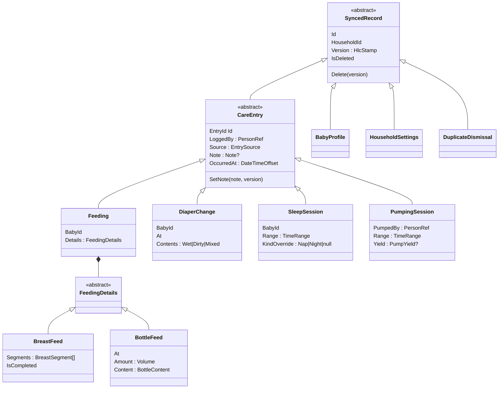

# Spec 001 — Care-log domain model

Date: 2026-09-30

Status: **Draft — for review**

Depends on: ADR 0001 (layout), 0002 (sync), 0003 (households), 0005 (AI logging), 0006 (units and
times), 0008 (sleep predictor), 0009 (Wear OS).

## 1. Purpose and scope

This spec defines what `Coo.Domain` knows about babies, households and care entries: the types,
their invariants, and the pure services that every other spec builds on. It fixes **behaviour and
rules**, not wire formats (`Coo.Contracts`, a later spec) or tables (the persistence specs).

**In scope**

- Common building blocks: typed IDs, `Result` and error codes, the hybrid logical clock stamp.
- `BabyProfile`, `HouseholdSettings`, and the age calculation (including corrected age).
- The four care entries: `Feeding` (breast or bottle), `DiaperChange`, `SleepSession` and
  `PumpingSession`.
- Value objects: `Volume`, `TimeRange`, `BreastSegment`, `PumpYield`, `EntrySource`, `PersonRef`,
  `Note`.
- Hard rules (the domain refuses) and plausibility warnings (the domain flags).
- `DuplicateDetector` and `DuplicateDismissal`.
- `TimeExpressionResolver` (ADR 0005 §5).
- Last-writer-wins resolution and tombstones as domain behaviour.

**Out of scope** (with where each one goes)

| Concern | Where |
|---|---|
| `Membership`, `Role`, `Invitation` and role rules | Identity spec (ADR 0003 §6) |
| `Entitlement`, `Plan`, `FeatureGate` | Billing spec (ADR 0004) |
| `SleepClassifier`, `SleepPredictor` | Sleep predictor spec (ADR 0008). This spec only stores the classification override. |
| Wire DTOs, `schemaVersion`, contract mapping | Contracts spec |
| Outbox, `seq`, `SyncRejected` status | Sync spec (ADR 0002). These are persistence and application concerns, not domain ones. |
| What happens to a deleted baby's entries | The use case in the mobile application spec |
| Solids, medication, temperature, growth, untimed breast feeds | Later. See §13, Q1 and Q2. |

## 2. Design principles

1. **Every synced record is its own aggregate.** Sync is per record, with last-writer-wins
   (ADR 0002 §3), so an aggregate boundary wider than one record would be split by the protocol
   anyway. The household is **not** an aggregate that contains entries. Entries reference it by ID.
2. **Only single-record rules are invariants.** A rule that needs another record, such as "no two
   sleeps overlap" or "not before the baby's birth", cannot be enforced on an offline device
   (ADR 0002 §9). It becomes a **warning** or a **duplicate flag**, never a rejection.
3. **Hard rules reject what is meaningless. Warnings flag what is unusual.** A hard rule fails the
   factory or method, on the device and on the server, with the same compiled code. A warning never
   blocks a save. The UI shows it, and so does the AI confirmation card (ADR 0005 §5).
4. **Time is a parameter.** No domain type reads a clock. `now` is passed in (ADR 0001 §2).
5. **The domain assigns no IDs.** The caller passes a UUIDv7, so that the watch, the AI proposal
   flow and a manual form all create entries the same way (ADR 0002 §1, ADR 0009 §2).
6. **Every mutation carries a version stamp.** Every factory and every mutating method takes the
   `HlcStamp` for that write. The domain stores it. The caller's clock issues it.
7. **Errors are codes, not text** (ADR 0006). Every failure is a `DomainError` with a stable,
   dotted code (§11), localized by the app.

## 3. Common building blocks (`Coo.Domain/Common`)

### 3.1 Typed IDs

`readonly record struct` wrappers over `Guid`: `HouseholdId`, `BabyId`, `UserId`, `DeviceId`,
`EntryId`, `DismissalId`.

- One `EntryId` type is shared by all four entry kinds. The duplicate detector, dismissals and the
  "Needs attention" list refer to entries without knowing their kind, and IDs are globally unique
  anyway.
- The constructor rejects `Guid.Empty`. The domain does not check that an ID is version 7. That is
  the caller's job, and a test in the application layer covers it.

### 3.2 `Result<T>` and `DomainError`

- Factories and mutating methods return `Result<T>` or `Result`. They never throw for a rule
  violation. Throwing is reserved for programming errors, such as a null argument.
- A `DomainError` has a `Code` (for example `sleep.end-not-after-start`) and optional arguments
  (for example the limit that was exceeded). The server returns the code as the `rejected` reason
  (ADR 0002 §5).
- A method that can fail for several reasons reports the **first** one, in the order in which the
  rules are listed in this spec. The order is fixed, so the same input always gives the same code.

### 3.3 `HlcStamp` and `HybridLogicalClock` (`Common/Versioning`)

```csharp
public readonly record struct HlcStamp(long WallClockMs, int Counter, DeviceId DeviceId)
    : IComparable<HlcStamp>;
```

- **Order:** `WallClockMs`, then `Counter`, then `DeviceId`, compared as its 16 bytes in RFC 4122
  (big-endian) byte order. That order is explicit so that the Kotlin watch app (ADR 0009) compares
  stamps identically. Golden fixtures in `Coo.Domain.Tests` are shared with the watch project.
- `HybridLogicalClock` is a small stateful class that owns the last stamp issued:
  - `Tick(long physicalNowMs)`: `wall = max(last.wall, physicalNowMs)`. The counter is
    `last.counter + 1` if `wall` did not advance, and `0` otherwise.
  - `Observe(HlcStamp remote, long physicalNowMs)`: advances past `remote` using the standard HLC
    merge, so that the next `Tick` is greater than both.
  - The state is persisted by the caller (a mobile infrastructure concern). The class only
    exposes `Last` and a constructor that takes it.
- `HlcStamp.IsTooFarAhead(long serverNowMs)` is true when `WallClockMs` exceeds the server clock by
  more than **24 hours** (ADR 0002 §4).

### 3.4 Records and tombstones

Every synced record derives from `SyncedRecord`:

| Member | Meaning |
|---|---|
| `Id` | The record's ID |
| `HouseholdId` | Its household, immutable |
| `Version` | The `HlcStamp` of the last write, including the delete |
| `IsDeleted` | Tombstone flag |

- `Delete(HlcStamp version)` sets `IsDeleted` and `Version`. Deleting a deleted record fails with
  `record.already-deleted`.
- Every mutating method on a deleted record fails with `record.deleted`. The domain has no
  "undelete" method. A remote edit with a higher version wins over a tombstone (ADR 0002 §3), but
  that happens by replacing the record in sync, not by calling a method.
- `Version` must strictly increase. A method called with a stamp less than or equal to the current
  `Version` fails with `record.stale-version`. This catches clock bugs in the caller.

### 3.5 Last-writer-wins

`LastWriterWins.Pick(a, b)` returns the state with the higher `Version`. It is total (stamps never
tie, because `DeviceId` breaks ties) and symmetric. It is the one comparison that the device, the
server and the watch all use.

### 3.6 Rehydration

Each record type has an `internal static Rehydrate(...)` factory that rebuilds state from storage
or from a pulled record **without** re-running the creation rules. Persistence and contract
mapping use it. Validating an incoming change against the rules of its `schemaVersion`
(ADR 0002 §11) is done by the server's application layer, which calls the ordinary factories, not
`Rehydrate`.

`InternalsVisibleTo` names the two Infrastructure projects, the two Application projects and the
test projects. This is the one exception to CS-MOD-01's "test projects only". Without it, a record
could only be rebuilt through public setters, which CS-DDD-01 rules out. **Flagged for review
(Q7).**

## 4. Value objects (`Coo.Domain/CareLog`)

All value objects are `record` or `readonly record struct`, and are valid by construction: their
factories return `Result<T>`.

### 4.1 `Volume`

- Stored as **millilitres**, a `decimal` rounded to 0.1 ml (ADR 0006 §5).
- `Volume.FromMillilitres(decimal)` and `Volume.FromOunces(decimal)`, with
  `1 US fl oz = 29.5735 ml`. Converting from ounces rounds to 0.1 ml, so "4 oz" is stored as
  118.3 ml and displays as 4.0 oz again.
- It must be greater than 0 and at most 1,000 ml (`volume.out-of-range`). Anything larger is not a
  feed or a pumping yield. It is a typo.
- The domain does not format a volume. Display rounding (for example 0.5 oz steps) is a
  presentation concern.

### 4.2 `TimeRange`

- `Start` (`DateTimeOffset`) and an optional `End`. `End == null` means "in progress".
- If `End` is set, it must be strictly after `Start` (`time.end-not-after-start`).
- `Duration(DateTimeOffset now)` returns `End - Start`, or `now - Start` while in progress.
- Each instant keeps its own offset. A sleep that crosses a DST change has a different offset at
  each end, which is correct.
- `Overlaps(other, now)` treats an in-progress range as ending at `now`.

### 4.3 `EntrySource`

The **creation** origin. It is immutable, so a later edit does not change it.

| Value | Meaning |
|---|---|
| `Manual` | A form or a one-tap tile |
| `Timer` | Started and stopped with the in-app timer |
| `Watch` | Created on the Wear OS app (ADR 0009) |
| `AiParsed(promptVersion)` | Accepted from an AI proposal (ADR 0005 §1). Carries the prompt version. |

### 4.4 `PersonRef`

Who did something (logged an entry, or pumped).

- `PersonRef.User(UserId)` for a signed-in member.
- `PersonRef.ThisDevicesPerson` for entries made before sign-in (ADR 0003 §1). On first sign-in, the
  mobile application rewrites these to the new `UserId` in the same transaction as the household
  upgrade (ADR 0003 §7). They are still in the outbox and have never been pushed, so no synced
  version is affected. The server rejects `ThisDevicesPerson` (`person.unresolved`).
- A `UserId` that is no longer a member is displayed as "former caregiver" (ADR 0003 §8). The
  domain does not rewrite it.

### 4.5 `Note`

Optional free text on every entry: trimmed, 1–500 characters (`note.too-long`). An empty or
whitespace-only note becomes "no note". Notes are never sent to the AI model.

## 5. Babies and households (`Coo.Domain/Households`)

### 5.1 `BabyProfile` (synced record)

| Field | Rules |
|---|---|
| `Name` | Trimmed, 1–40 characters (`baby.name-invalid`) |
| `Nicknames` | 0–5 entries, each 1–40 characters. They must be unique among themselves and different from `Name`, compared ignoring case and diacritics (`baby.nickname-duplicate`). Used by the pseudonymiser (ADR 0005 §4a). |
| `BirthDate` | `DateOnly`. At most 1 day after `today`, to allow for time zones (`baby.birth-in-future`). |
| `DueDate` | Optional `DateOnly`. From 6 weeks before `BirthDate` to 24 weeks after it (`baby.due-date-out-of-range`). |

Methods: `Create`, `Rename`, `SetNicknames`, `SetBirthDate`, `SetDueDate`, `Delete`. Each takes a
`HlcStamp`. `today` is passed in wherever a rule needs it.

**Name normalisation.** A single `NameKey.From(string)` (lower-invariant, diacritics removed after
NFD decomposition, whitespace collapsed) is the comparison key for nickname uniqueness. The
pseudonymiser reuses it, so both use one definition of "the same name". Inflection matching
(Polish cases, German genitive) is **not** in the domain. It belongs to the pseudonymiser
(ADR 0005 §4a).

### 5.2 Age

`BabyAge.On(BabyProfile, DateOnly today)` returns:

- `Actual`: whole days since `BirthDate`, plus weeks and months for display;
- `Corrected`: `Actual` minus `(DueDate − BirthDate)`, when `DueDate` is after `BirthDate` **and**
  the actual age is under 24 months (ADR 0008 §2). Otherwise it is the same as `Actual`;
- `IsCorrected`, so the UI can say "5 months (corrected)".

Corrected age is never negative. A preterm baby before the due date has a corrected age of 0 days,
and `IsBeforeDueDate` is true.

### 5.3 `HouseholdSettings` (synced record)

One per household. Its `Id` equals the `HouseholdId`, so two devices creating it concurrently
converge through last-writer-wins instead of producing two records.

| Field | Rules |
|---|---|
| `VolumeUnit` | `Millilitres` or `Ounces` (ADR 0006 §5). The default comes from the device region, and is chosen by the caller. |
| `TimeZoneId` | An IANA ID, non-empty. The domain does not look it up. The application layer resolves it to a `TimeZoneInfo`, and rejects unknown IDs. |

ADR 0002 §3 lists entity types "for example". This spec adds `HouseholdSettings` and
`DuplicateDismissal` (§8) to that list. The household itself, its members and its roles are
server-managed (ADR 0003) and are not synced records in this sense.

## 6. Care entries (`Coo.Domain/CareLog`)

### 6.1 The shared base: `CareEntry`



- `OccurredAt` is the instant used for ordering on the timeline, and by the duplicate detector:
  the start of a session, or the moment of a point event.
- `LoggedBy` and `Source` are set at creation and are immutable.

**Rules on every entry's times** (in this order):

1. `time.too-far-in-future`: no instant may be more than **24 hours** after `now`. This matches the
   HLC bound. The tighter, everyday check (more than 5 minutes ahead) is a warning (§7), because a
   device whose clock is a few minutes fast must still be able to log "now".
2. The kind's own rules (below).

### 6.2 `Feeding`

The synced entity type is `Feeding` (ADR 0002 §3). Its `Details` are either `BreastFeed` or
`BottleFeed`. **The kind cannot be changed by an edit.** Correcting a breast feed that should have
been a bottle is a delete and a new entry. That keeps every edit a change of values within one
shape, and it keeps the duplicate detector's "same kind" rule stable.

#### `BreastFeed`

- `Segments`: an ordered list of `BreastSegment(Side, Start, End?)`, with `Side` being `Left` or
  `Right`. Segments are what the timer produces: starting on the left, switching to the right,
  pausing and resuming.
- `IsCompleted`: false while the timer is running or paused.

Rules:

| Code | Rule |
|---|---|
| `breast.no-segments` | At least one segment |
| `breast.segments-overlap` | Segments are in time order and do not overlap. Gaps (pauses) are allowed. |
| `breast.open-segment-not-last` | Only the last segment may be open, and only while not completed |
| `breast.completed-with-open-segment` | A completed feed has every segment closed |
| `breast.too-long` | The span from the first start to the last end is at most **6 hours**. A timer that was left running must be corrected before it can be completed. |

Methods:

| Method | Effect |
|---|---|
| `StartBreast(id, household, baby, side, at, loggedBy, source, version)` | One open segment, not completed |
| `LogBreast(id, household, baby, segments, loggedBy, source, version)` | A completed feed from a form ("Left 10 min, then Right 5 min") |
| `SwitchSide(at, version)` | Closes the open segment at `at`, and opens the other side at `at` |
| `Pause(at, version)` | Closes the open segment |
| `Resume(side, at, version)` | Opens a new segment. Fails if one is already open. |
| `Complete(at, version)` | Closes any open segment at `at`, and marks the feed completed |
| `ReplaceSegments(segments, version)` | The correction path from the edit form. It keeps the completion state. |

Derived: `LeftDuration`, `RightDuration`, `TotalDuration`, `LastSide` (for "other side" in
ADR 0005 §4, and "12:40 · L" on the log tile). `OccurredAt` is the first segment's start.

#### `BottleFeed`

| Field | Rules |
|---|---|
| `At` | The moment of the feed |
| `Amount` | A `Volume`. It is required, because a bottle without an amount adds nothing to a pediatric report. |
| `Content` | `Formula`, `BreastMilk` or `Mixed` |

Methods: `LogBottle(...)` and `Amend(at, amount, content, version)`.

### 6.3 `DiaperChange`

| Field | Rules |
|---|---|
| `At` | The moment of the change |
| `Contents` | `Wet`, `Dirty` or `Mixed` (the watch tile's three buttons, ADR 0009) |

Methods: `Log(...)` and `Amend(at, contents, version)`. Stool colour and consistency are Q3.

### 6.4 `SleepSession`

| Field | Rules |
|---|---|
| `Range` | A `TimeRange`. It is open while the baby sleeps. |
| `KindOverride` | `null` (let the classifier decide), `Nap` or `Night`. The person's label always beats the classifier (ADR 0008 §3). |

| Code | Rule |
|---|---|
| `sleep.too-long` | A closed range lasts at most **24 hours** |
| `sleep.already-ended` | `End` on a session that is already closed. The correction path is `Amend`. |

Methods: `Start(id, household, baby, at, loggedBy, source, version)`, `Log(...)` (closed, from a
form), `End(at, version)`, `Amend(range, version)`, `SetKind(kind?, version)`.

Anyone can end a sleep that someone else started. That is the "completion of an ongoing session"
case in ADR 0002. `LoggedBy` stays the person who started it.

Two open sessions for one baby are allowed (ADR 0002 §9). The duplicate detector flags them.

### 6.5 `PumpingSession`

Pumping belongs to a household member, not to a baby.

| Field | Rules |
|---|---|
| `PumpedBy` | A `PersonRef`. It defaults to `LoggedBy` in the factories. |
| `Range` | A `TimeRange`. It is open while the pumping timer runs. |
| `Yield` | Optional while in progress. Otherwise it is `PumpYield.BySide(left?, right?)`, with at least one side set, or `PumpYield.Total(volume)`. `Total` is derived for `BySide`. |

| Code | Rule |
|---|---|
| `pump.too-long` | A closed range lasts at most **4 hours** |
| `pump.yield-empty` | `BySide` with neither side set |

Methods: `Start`, `Log`, `End(at, yield?, version)`, `Amend(range, yield, version)`.

A completed session **without** a yield is allowed. A parent may log the time now and the amount
later, and the "Needs attention" list does not nag about it.

## 7. Plausibility warnings (`Coo.Domain/CareLog/Plausibility`)

`PlausibilityCheck.For(entry, context)` returns zero or more `Warning` codes. It never fails and
never blocks a save. The `context` holds `now`, and optionally the baby's profile and a
`capturedAt` (for AI proposals).

| Code | When |
|---|---|
| `warn.in-future` | Any instant more than 5 minutes after `now` |
| `warn.before-birth` | Any instant before the baby's `BirthDate` (needs the profile) |
| `warn.long-ago` | More than 48 hours before `capturedAt` (AI proposals only; ADR 0005 §5) |
| `warn.bottle-amount` | A bottle outside 5–400 ml |
| `warn.pump-amount` | A pumping yield above 500 ml |
| `warn.sleep-long` | A sleep longer than 16 hours |
| `warn.breast-long` | A breast feed longer than 90 minutes |
| `warn.running-long` | An in-progress session older than 3 hours for a feed or a pump, or 16 hours for a sleep. This feeds the "timer still running" reminder (ADR 0007). |
| `warn.time-not-stated` | The AI's time was `unspecified` and was resolved to `capturedAt` (§9) |

All the thresholds live in one `PlausibilityThresholds` record, named constants with tests, like
the duplicate tolerances.

## 8. Duplicates (`Coo.Domain/CareLog/Duplicates`)

### 8.1 `DuplicateDetector`

A pure function: `Find(IReadOnlyCollection<CareEntry> candidates, IReadOnlyCollection<CareEntry> existing, IReadOnlySet<EntryPair> dismissed, DateTimeOffset now)`
returns `DuplicatePair[]`.

- After a pull, `candidates` is the newly received entries, and `existing` is the local entries
  within ±24 hours of them.
- For AI proposals (ADR 0005 §3a), `candidates` is the proposals, which are not saved yet.
- Deleted entries are never matched.
- An entry is never paired with itself.
- A pair appears once, however it is found, with its IDs in a canonical order.

Rules (ADR 0002 §9). The tolerances are named constants in `DuplicateTolerances`.

| Pair | Probable duplicate when |
|---|---|
| Feeding / feeding | Same baby, same kind, `OccurredAt` within **15 minutes** |
| Diaper / diaper | Same baby, within **10 minutes**. The contents are not compared, because one person's "wet" is another person's "mixed". |
| Pumping / pumping | Same `PumpedBy`, starts within **15 minutes** |
| Sleep / sleep | Same baby, overlapping ranges (open ranges end at `now`) |

A breast feed and a bottle feed close together are **not** flagged. A top-up bottle after the
breast is normal.

### 8.2 `DuplicateDismissal` (synced record)

"Keep both" writes a `DuplicateDismissal(id, household, EntryPair, version)`. It syncs, so that a
partner is not asked about the same pair again (ADR 0002 §9 "never flagged again").

- `EntryPair` is canonical (the smaller ID first), so dismissing (a, b) also dismisses (b, a).
- Two caregivers dismissing the same pair offline create two dismissals. That is harmless: both
  say the same thing.
- "Keep this one" and "Keep that one" create no dismissal. They delete the other entry, which is an
  ordinary tombstone.

## 9. `TimeExpressionResolver` (`Coo.Domain/CareLog/Time`)

It resolves the model's structured time (ADR 0005 §5) to an instant:
`Resolve(TimeExpression expr, DateTimeOffset capturedAt, TimeZoneInfo zone)` →
`Result<ResolvedTime>`, where `ResolvedTime` holds the instant and any warning.

| Expression | Resolution |
|---|---|
| `Now` | `capturedAt` |
| `Unspecified` | `capturedAt`, with `warn.time-not-stated` |
| `MinutesAgo(n)` | `capturedAt − n minutes`. `n` must be 0–2,880 (48 hours), otherwise `time.minutes-ago-out-of-range`. |
| `Clock(hh, mm)` | The **latest** local `hh:mm` in `zone` that is no more than **5 minutes** after `capturedAt`. "14:00" said at 13:58 is today. "14:00" said at 01:00 is yesterday afternoon. `hh` must be 0–23 and `mm` 0–59 (`time.clock-invalid`). |

DST rules for `Clock`:

- **A skipped time** (the spring-forward gap, for example 02:30 in Europe/Warsaw on the last
  Sunday of March) moves forward by the length of the gap: 02:30 becomes 03:30 local.
- **A repeated time** (the fall-back hour) uses the later of the two occurrences that is still
  allowed by the rule above, which is consistent with "latest".
- The resulting `DateTimeOffset` carries the zone's offset at that instant, not the offset of
  `capturedAt`.

The model never produces 12-hour times. "2 pm" is mapped to `Clock(14, 0)` by the prompt, and
the evals check that. So the resolver has no a.m./p.m. rule.

## 10. Where it lives

| Concern | Folder in `Coo.Domain` |
|---|---|
| Typed IDs, `Result`, `DomainError`, `SyncedRecord`, `LastWriterWins` | `Common/` |
| `HlcStamp`, `HybridLogicalClock` | `Common/Versioning/` |
| `BabyProfile`, `BabyAge`, `NameKey`, `HouseholdSettings` | `Households/` |
| Entries, value objects | `CareLog/` |
| `PlausibilityCheck`, `PlausibilityThresholds` | `CareLog/Plausibility/` |
| `DuplicateDetector`, `DuplicateTolerances`, `DuplicateDismissal`, `EntryPair` | `CareLog/Duplicates/` |
| `TimeExpression`, `TimeExpressionResolver` | `CareLog/Time/` |

`Coo.Domain` references no package. Everything here uses only the BCL: `TimeZoneInfo`, `DateOnly`,
`Guid`, and string normalisation.

**Synced-entity checklist** (ADR 0002, Negative). Each of these types needs a contract DTO, push
and pull handling, a local table and a server table with the four sync columns, and an
architecture-test entry:

`BabyProfile`, `HouseholdSettings`, `Feeding`, `DiaperChange`, `SleepSession`, `PumpingSession`,
`DuplicateDismissal`.

## 11. Error codes

The complete list for this spec. Codes are stable once released. New ones are added, and none is
renamed.

| Area | Codes |
|---|---|
| Records | `record.deleted`, `record.already-deleted`, `record.stale-version` |
| Values | `volume.out-of-range`, `note.too-long`, `person.unresolved` |
| Time | `time.end-not-after-start`, `time.too-far-in-future`, `time.minutes-ago-out-of-range`, `time.clock-invalid` |
| Baby | `baby.name-invalid`, `baby.nickname-duplicate`, `baby.birth-in-future`, `baby.due-date-out-of-range` |
| Breast | `breast.no-segments`, `breast.segments-overlap`, `breast.open-segment-not-last`, `breast.completed-with-open-segment`, `breast.too-long`, `breast.segment-already-open`, `breast.no-open-segment` |
| Sleep | `sleep.too-long`, `sleep.already-ended` |
| Pumping | `pump.too-long`, `pump.yield-empty` |
| Settings | `settings.time-zone-empty` |

## 12. Acceptance tests (`tests/Coo.Domain.Tests`)

Test names follow `MethodName_StateUnderTest_ExpectedBehavior`. Every hard rule has one passing
test at its boundary value and one failing test just past it. Every row below is at least one test.

**Versioning**

- `Compare_SameWallClockDifferentCounter_OrdersByCounter`, and the same for `DeviceId`, using the
  golden fixtures shared with the watch.
- `Tick_PhysicalClockGoesBackwards_StampStillIncreases`.
- `Observe_RemoteStampAhead_NextTickIsGreaterThanRemote`.
- `IsTooFarAhead_Exactly24HoursAhead_ReturnsFalse`, and 24 hours plus 1 ms returns true.
- `Pick_EitherArgumentOrder_ReturnsSameWinner`.

**Records**

- `Delete_AlreadyDeleted_FailsWithAlreadyDeleted`.
- `End_OnDeletedSleep_FailsWithRecordDeleted`.
- `Amend_WithVersionNotGreaterThanCurrent_FailsWithStaleVersion`.

**Values**

- `FromOunces_FourOunces_RoundTripsToFourPointZero`.
- `FromMillilitres_Zero_Fails`; `FromMillilitres_1000_Succeeds`; `FromMillilitres_1000Point1_Fails`.

**Baby**

- `SetNicknames_NicknameEqualsNameIgnoringDiacritics_Fails` ("Zosia" and "ZOSIA", "Łucja" and
  "Lucja"). The expected NFD behaviour of `ł` is pinned by a test, because `ł` does not decompose.
  `NameKey` maps it explicitly.
- `On_PretermUnder24Months_ReturnsCorrectedAge`; `On_PretermOver24Months_ReturnsActualAge`;
  `On_BeforeDueDate_CorrectedAgeIsZeroAndFlagged`.

**Entries**

- `SwitchSide_WhileRunningLeft_ClosesLeftAndOpensRight`.
- `Complete_WhilePaused_MarksCompletedWithoutNewSegment`.
- `LogBreast_OverlappingSegments_FailsWithSegmentsOverlap`.
- `Complete_SpanOverSixHours_FailsWithTooLong`.
- `End_ByDifferentCaregiver_KeepsOriginalLoggedBy`.
- `End_AlreadyEndedSleep_FailsWithAlreadyEnded`.
- `End_PumpingWithoutYield_Succeeds`.
- `Log_AnyEntry25HoursInFuture_FailsWithTooFarInFuture`; `Log_AnyEntry10MinutesInFuture_SucceedsWithInFutureWarning`.

**Duplicates**

- One test per row of §8.1, at the tolerance (flagged) and just past it (not flagged).
- `Find_BreastAndBottleWithinFiveMinutes_ReturnsNoPair`.
- `Find_PairDismissedInReverseOrder_ReturnsNoPair`.
- `Find_DeletedExistingEntry_ReturnsNoPair`.
- `Find_TwoOpenSleepsSameBaby_ReturnsPair`.

**Time expressions**

- `Resolve_Clock1400CapturedAt0100_ReturnsYesterday1400`.
- `Resolve_Clock1400CapturedAt1358_ReturnsToday1400`.
- `Resolve_Clock0230OnSpringForwardDay_Returns0330Local` (Europe/Warsaw).
- `Resolve_ClockInRepeatedHour_ReturnsLaterAllowedOccurrence`.
- `Resolve_MinutesAgo2881_Fails`.
- `Resolve_Unspecified_ReturnsCapturedAtWithWarning`.

## 13. Decisions for the owner

These are the choices this draft made on its own. Each one has a recommendation; the spec is
written as if the recommendation is accepted.

| # | Question | Recommendation |
|---|---|---|
| Q1 | Solids, medication, temperature and growth in v1? | **No.** The four entries from the ADRs only. Each one can be added later as a new entity type without breaking the protocol. |
| Q2 | Untimed breast feeds ("fed on the left at 14:00", duration unknown)? | **No, not in v1.** The form asks for minutes per side, and the tile and watch start a timer. Accepting "unknown" would weaken every duration total in the reports. |
| Q3 | Stool colour and consistency on a dirty diaper? | **Later, as optional fields** (an additive contract change). A pale stool is a real warning sign in newborns, so this is a strong v1.1 candidate. |
| Q4 | Feeding as one entity type with a breast or bottle kind, rather than two types | **One type**, as in ADR 0002 §3. The kind is immutable. |
| Q5 | Hard duration limits: breast 6 h, pumping 4 h, sleep 24 h | **As written.** A forgotten timer must be corrected before it is saved, rather than producing a 9-hour feed in a report. |
| Q6 | "Keep both" syncs as a `DuplicateDismissal` record, not as local state | **Sync it.** Otherwise a partner is asked the same question again. It costs one more entity type. |
| Q7 | `Rehydrate` is `internal`, visible to the Infrastructure and Application projects as well as the tests | **Accept the exception to CS-MOD-01**, or make `Rehydrate` public and guard it with an architecture test that only those projects call it. |
| Q8 | Entries made before sign-in are marked `ThisDevicesPerson`, and rewritten at first sign-in | **As written.** The alternative, a per-install person ID mapped on the server, breaks on reinstall. |
