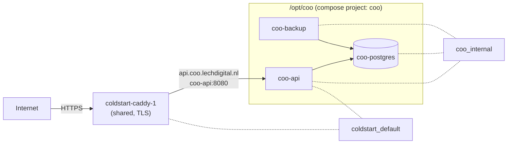

# Spec 008 — Backend and deployment

Date: 2026-10-01

Status: Accepted (2026-10-01: Q1 (a), found already enabled; Q2 after this increment; Q3 Docker Desktop on the Mac; Q4 its own PostgreSQL)

Depends on: ADR 0001 §4–§5 (server persistence, deployment shape), ADR 0002 §6 (per-household `seq`), ADR 0010 §2
and G3–G5 (storage, database guards, integrity scan), Spec 003 (codecs). Recipe: PurePrep's `deploy/` and
CoreChoice's `DEPLOY.md`.

Delivered by: **Increment 8** (`docs/ROADMAP.md`). Coo gets a live server, ready for sign-in (Increment 10) and sync
(Increment 11). The app does not talk to it yet.

## 1. Purpose

- **A running backend** at `https://api.coo.lechdigital.nl`, deployed the way PurePrep and CoreChoice are.
- **PostgreSQL** with the server's half of the storage guards. The database itself refuses an unknown kind, an
  unknown details version, or details that are not a JSON object.
- **Daily backups**, and a restore that has been tried once, on purpose.
- **A deploy you can repeat:** one script, which refuses to ship when the tests fail.

**Out of scope:**

| Not in this increment | Where |
|---|---|
| The Settings tab | Increment 9 (Q2) |
| Sign-in, accounts, households you can join | Increment 10 |
| Push, pull and the SignalR doorbell | Increment 11 |
| Play Billing and the Play service-account key | Increment 12 |
| The Coo website and privacy policy | `lechdigital.nl/projects/coo/` (GitHub Pages), before the release |

## 2. The shape on the server



- **Exactly PurePrep's pattern:** the source is rsynced to `/opt/coo`, Docker builds the image there, and
  `docker compose up -d --build` replaces the container. Caddy handles TLS.
- **ADR 0001 §5, unchanged:**
  - the compose project is `name: coo`;
  - the containers are `coo-api`, `coo-postgres` and `coo-backup`;
  - Caddy's upstream is the **container name**, `coo-api`;
  - PostgreSQL is only on the private `coo_internal` network (`internal: true`). Caddy cannot reach it, and it has
    no published port.
- **Memory limits**, because the 4 GB host runs four other stacks (about 2.1 GB is free today):

  | Container | Limit | Notes |
  |---|---|---|
  | `coo-postgres` | 384 MB | PostgreSQL 17, the image Coldstart already uses; `shared_buffers` 64 MB |
  | `coo-api` | 384 MB | ASP.NET Core 10 |
  | `coo-backup` | 128 MB | Sleeps between dumps |

- **The Caddy block**, appended to `/opt/coldstart/Caddyfile`:

  ```
  # Coo backend (separate /opt/coo stack, joined on this network). Upstream is the CONTAINER name.
  api.coo.lechdigital.nl {
  	reverse_proxy coo-api:8080
  }
  ```

  It is applied as CoreChoice's `DEPLOY.md` does it: back up the file, `caddy validate`, `caddy reload` (never a
  restart), then check that Coldstart, PurePrep and CoreChoice still answer. **The owner is asked right before this
  step**, because this Caddy serves the other sites too.

## 3. Secrets

- **The database password is generated on the server** (`openssl rand`) straight into `/opt/coo/.env` (mode 600). It
  is never printed, never in the repo, and never in an image layer.
- `deploy/.env.example` lists every variable, with no values.
- **The Play key rule.** PurePrep ADR 0001 says Production refuses to start without the Google Play key. It applies from Increment 12,
  with the first purchase endpoint. Until then there is no purchase to protect, and no key on the server.
- The same start-up rule ("a missing setting fails at start, never at runtime") applies now to the connection
  string. A test covers it.

## 4. The database

**Schema by EF Core migrations** (ADR 0001 §4), applied **at start-up** by `coo-api`, before it accepts requests.
There is one instance, so no locking is needed. `EnsureCreated` is never used.

Migration 1 creates three tables:

| Table | Columns | Why now |
|---|---|---|
| `entry_kind_versions` | `kind`, `version` (primary key) | G3: filled at start-up from the codecs' catalogue, with an idempotent insert |
| `households` | `id`, `next_seq`, `created_at` | The per-household counter that every accepted write increments (ADR 0002 §6). Its other columns come with sign-in (Increment 10). |
| `care_entries` | ADR 0010 §2 core columns, `seq`, `version`, `is_deleted`, `details jsonb` | The table sync will fill. Creating its core now avoids a core migration later. |

**G3, the database guards** (ADR 0010):

- `details jsonb NOT NULL CHECK (jsonb_typeof(details) = 'object')`;
- `details_version int GENERATED ALWAYS AS ((details->>'v')::int) STORED NOT NULL`;
- foreign key `(kind, details_version)` → `entry_kind_versions(kind, version)`;
- foreign key `household_id` → `households(id)`;
- indexes `(household_id, seq)` (unique) and `(household_id, subject_baby_id, start_at)`.

**The write path, server side.** One `CareEntryStore` in `Coo.Api.Infrastructure`:

- it takes `CareEntry` domain objects only, never JSON;
- it writes through the codecs' write gate (encode, decode, compare);
- in the same transaction, it takes the next `seq` by updating the household's counter row.

Sync (Increment 11) uses it unchanged. In this increment, only tests call it.

**G4, the read guard.** A row that fails to decode is logged with its ID and counted, never dropped and never a
crash.

**G5, the integrity scan:**

- a daily background job;
- the same scan on demand: `docker exec coo-api dotnet Coo.Api.dll verify`;
- it decodes every row through the codecs and the Domain rules, and reports each failure by row ID;
- it exits non-zero when anything fails, so a cron job or a script can act on it.

## 5. Health

`GET /health`:

| Situation | Answer |
|---|---|
| Ready | `200 {"status":"ok","version":"0.8.0+<commit>","database":"ok"}` |
| The database is unreachable, or migrations have not finished | `503 {"status":"unavailable","database":"…"}` |

- The version carries the **git commit**, passed in by the deploy script, so a deploy can be verified by its commit.
- **Forwarded headers are on** (ADR 0003 §5), trusting only the Docker network, so that logs show the real
  client address, not Caddy's.

## 6. Backups

- **`coo-backup`:** a `pg_dump -Fc` every day, kept **14 days** in `/opt/coo/backups` on the host. It is
  Coldstart's backup container, with Coo's names. A failed dump is logged as `backup FAILED`.
  - Its first dump is **10 minutes after start**, not at start. The local rehearsal found that a dump at start races
    the API's migrations, and captures an empty database.
- **A restore drill, as part of this increment:** the newest dump is restored into a scratch database, and its row
  counts are compared with the live ones. `deploy/restore-drill.sh` does it again whenever wanted, and
  `--fresh` takes a dump first. A backup that was never restored is not trusted.
- **Off-site:** Hetzner's server backups (Q1): a daily image of the whole server, kept 7 days, which includes the
  dumps. A lost disk no longer takes the backups with it.

## 7. Deploying

`deploy/deploy-prod.sh --confirm`, modelled on PurePrep's:

1. It refuses without `--confirm`.
2. **Interlock:** `dotnet test Coo.Tests.slnf` must pass, including the PostgreSQL tests (§9).
3. It rsyncs only what the image is built from:
   - `src/Backend` and `src/Shared`;
   - `Directory.Build.props`, `Directory.Packages.props`, `NuGet.config`, `.editorconfig`;
   - the banned-API lists, the `Dockerfile` and `deploy/docker-compose.prod.yml`.
4. `docker compose --env-file .env -f deploy/docker-compose.prod.yml up -d --build`, with the commit as a build
   argument.
5. **It waits for `/health` through the public URL**, so the check also proves Caddy's routing. It compares the
   reported commit with the one it deployed. On failure, it prints the container's last 30 log lines.

`DEPLOY.md` in the repo records the first deployment as it was actually done, as CoreChoice's does.

**The Dockerfile:**

- multi-stage: the .NET 10 SDK builds, and the ASP.NET 10 runtime runs, as a non-root user;
- `.dockerignore` keeps `bin/`, `obj/`, the mobile projects and the tests out of the build context.

## 8. Where it lives

| Concern | Project |
|---|---|
| The store port, the integrity-scan use case | `Coo.Api.Application` |
| EF Core, Npgsql, migrations, `CareEntryStore`, the catalogue sync, the scan job | `Coo.Api.Infrastructure` |
| `/health`, the `verify` command, forwarded headers, start-up checks | `Coo.Api` (composition root) |
| Dockerfile, compose, `.env.example`, deploy and restore-drill scripts | repo root and `deploy/` |

## 9. Tests

| Where | What |
|---|---|
| `Coo.Api.Infrastructure.Tests` (Testcontainers, real PostgreSQL 17) | Migrations apply to an empty database. **G3:** raw inserts of an unknown kind, an unknown version and a non-object document are each refused by the database. The write path round-trips every kind. `seq` increases with no gaps within a household, and two households do not share a counter. A row with bad details is quarantined by the read guard, not dropped. The integrity scan reports it, by ID. |
| `Coo.Api.IntegrationTests` (WebApplicationFactory, real PostgreSQL) | `/health` returns 200 when ready and 503 when the database is down. A missing connection string fails at start-up. |
| Architecture tests | `Coo.Api.Application` does not reference EF Core or Npgsql. The repository takes domain objects only. |
| CI | The PostgreSQL tests run on GitHub's Ubuntu runners, which have Docker. CI also builds the Docker image, so a broken Dockerfile fails the build, not the deploy. |

**Docker on the Mac.** Testcontainers needs a running Docker: Docker Desktop (Q3). Without it, the PostgreSQL tests
**fail with a clear message** ("start Docker Desktop"), rather than being skipped: xUnit 2 cannot skip at run time,
and a silent skip would hide a gap. The deploy script's interlock needs them green.

## 10. Increment 8 — deliverables

| # | Deliverable | How you check it |
|---|---|---|
| 1 | The API is live over HTTPS | `https://api.coo.lechdigital.nl/health` in your browser shows `ok`, the version and the commit |
| 2 | The neighbours are untouched | getcoldstart.nl, PurePrep and CoreChoice answer as before |
| 3 | The database refuses bad data | The G3 tests, green in CI |
| 4 | A backup restores | The restore drill's output: row counts match. Hetzner backups show as enabled for the server. |
| 5 | The integrity scan runs | `verify` on the server reports 0 failures |
| 6 | Deploys are repeatable | A second `deploy-prod.sh --confirm` replaces the container and keeps the data |
| 7 | CI green | GitHub Actions, including the PostgreSQL tests and the image build |

## 11. What this increment leaves ready

- **Sign-in (Increment 10)** adds its tables in a migration, and its endpoints in the same `coo-api`. The invitation
  links and Android's `/.well-known/assetlinks.json` are served by the API host too, so no second DNS record is
  needed.
- **Sync (Increment 11)** uses `CareEntryStore` and the `seq` counter unchanged.

## 12. Decisions for the owner

| # | Question | Recommendation |
|---|---|---|
| Q1 | **Off-site backups.** (a) Turn on **Hetzner's server backups**: daily images of the whole server, kept 7 days, for about 20% of the server's monthly price. They also cover Coldstart, PurePrep and CoreChoice, and our nightly dumps are inside them. (b) A Hetzner **Storage Box**, with the dumps copied over nightly. (c) Local dumps only, for now. | **(a).** It's one switch in the Hetzner console, it protects all four products, and nothing new needs credentials. (b) can be added later, for longer retention. |
| Q2 | **Settings, before or after this?** The Settings tab (baby profile, units, language, theme, quiet hours, about) works offline. | **After: as Increment 9**, ahead of sign-in. Sign-in, Family and Premium then each add their section to a tab that already exists. The roadmap shifts by one. |
| Q3 | **Docker on the Mac**, for the PostgreSQL tests and the deploy interlock. | **Start Docker Desktop when deploying,** or keep it running. The CLI is already installed, but its daemon isn't running. No other tool is needed. |
| Q4 | **Its own PostgreSQL, or a database inside Coldstart's?** Owner: "its own. It's a different product, and this one can be big. It must be clean and proper." | **Its own `coo-postgres`, as ADR 0001 §5 decided.** It costs about 100–200 MB of memory. Coldstart and Coo can then be upgraded, restored and moved independently. |

## 13. Built and verified (2026-10-01, `coldstart-prod`)

All deliverables of §10 were checked on the server, on commit `e03dbdf`:

| # | Checked |
|---|---|
| 1 | `https://api.coo.lechdigital.nl/health` answers `{"status":"ok","version":"0.8.0+e03dbdf","database":"ok"}`, through Caddy, with a certificate issued on the first request |
| 2 | getcoldstart.nl, PurePrep's and CoreChoice's `/health` all answered 200 after the Caddy reload; every neighbour container kept its uptime |
| 3 | The G3 tests, green in CI on `b7afdf9`, and again in the deploy interlock |
| 4 | `restore-drill.sh --fresh`: `DRILL OK`, households 0/0, entry_kind_versions 4/4, care_entries 0/0. Hetzner backups are enabled: daily, window 02–06 UTC, seven images kept |
| 5 | `verify`: `0 rows checked, 0 failures`, exit 0. The database is still empty; the scan meets real rows with Sync (Increment 11) |
| 6 | A second `deploy-prod.sh --confirm` recreated `coo-api` only; `coo-postgres` and `coo-backup` kept running on the same volume, and `/health` reported the commit |
| 7 | CI, green on `b7afdf9` |

**How it went, where it differs from the text above:**

- **Q1 needed no action.** The server's Hetzner backups were already on, with images going back to 2026-09-25, so
  the `hcloud` context was only used to confirm it.
- **The first deploy reports `DEPLOY FAILED`, by design.** Its health check goes through the public URL, and Caddy
  has no route until the one-time Caddy block. The containers were checked on the host instead, and the second
  deploy is the one that proves the interlock. `DEPLOY.md` says so.
- **`coo-api` has no `curl` or `wget`,** so it has no container health check; health is only checked from outside,
  through Caddy, which also proves the routing.
- **The Caddy block has two spaces in `reverse_proxy  coo-api:8080`,** and Caddy warns that the file is not
  formatted. It works. `caddy fmt --overwrite` would rewrite the whole shared file, so it was left alone. The
  pre-edit copy is `/opt/coldstart/Caddyfile.bak-2026-10-01`.
- **The production steps were run by the owner** (`!` in the session): Claude Code's auto mode refuses deploys and
  writes over SSH to the production host, even when approved in chat.

