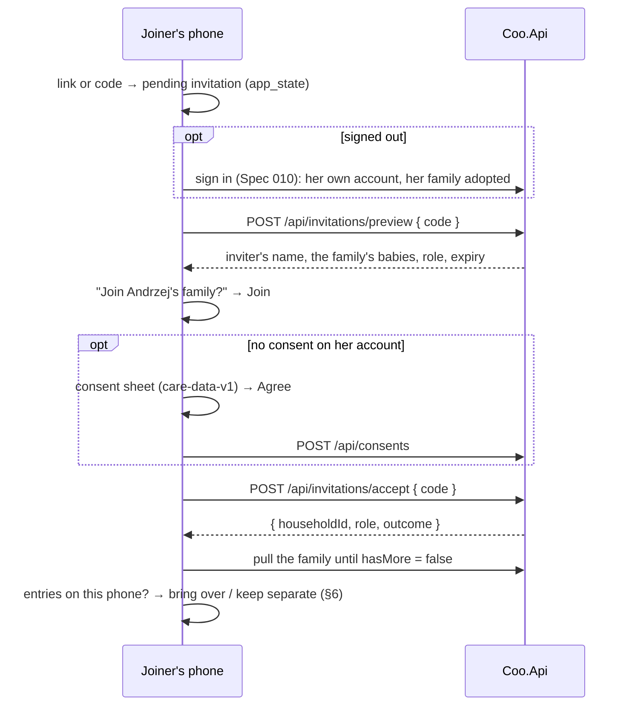

# Spec 011b — Members and invitations

Date: 2026-10-06

Status: Accepted (2026-10-06), by the controller under the owner's delegation. The rulings in §15.1 are binding (the
owner's decisions and the controller's rulings); the recommendations in §15.2 are accepted as written; the owner's
answers to §15.3 (2026-10-06) are recorded there and in §14.

Depends on: ADR 0003 §6–§8 (roles, invitations, removal, the provisional household, account deletion; **amended by this
spec**, §15.1 R1), ADR 0002 §10 (`membership-revoked`), ADR 0006 (localization), Spec 010 (sign-in, the reusable
`SignIn`, §10.6's carries), Spec 011 (sync, consent, bring-over, the sync line, §13.4's carries), the privacy policy at
`https://lechdigital.nl/projects/coo/privacy`.

Delivered by: **Increment 11b** (`docs/ROADMAP.md`). The app is version **0.12.0 (versionCode 15)** from this increment
(§15.1 R10).

## 1. Purpose

A second person joins a family with **their own Google account**, as a Parent, and both log the same baby. The owner's
test: he and his girlfriend, each signed in with their own account on their own phone, log Maja and see each other's
entries.

What this increment adds:

- inviting a parent by link or code, and withdrawing an invitation;
- joining with your own account, with consent first, and deciding what happens to the entries and the family already
  on your phone: bring them over, or keep them as a separate family;
- several families on one phone, and a simple way to switch the one shown;
- the member list, removing a member, leaving a family, and the "you were removed" sheet;
- the carries from Spec 010 §10.6 and Spec 011 §13.4.

**Out of scope:**

| Not in this increment | Where |
|---|---|
| Inviting a Caregiver (the role exists in the Domain and on the server; nothing creates it) | Later (§15.1 R2) |
| Transferring ownership; the Owner leaving a family that has other members | Later (ADR 0003 §6) |
| Notifications of any kind (a join, a removal, a new entry), the SignalR doorbell | Increment 13 (ADR 0007) |
| Email magic links for people without a Google account | Later (ADR 0003 §2) |
| Naming a family; showing who logged an entry | Later |
| The invitation fallback page in seven languages | Increment 18 (§15.1 R1, ADR 0006 §2) |
| Moving invitation links to `coo.lechdigital.nl` | When the owner adds that DNS; needs an app update (§15.1 R1) |
| The Play app-signing key in `assetlinks.json` | Increment 18 (configuration only) |
| Withdrawing consent without deleting the account | Later (Spec 011 Q2) |

## 2. What the person sees

The app says **family**, never "household", in every language (§15.1 R10).

**Settings → Family**, a new section right after Account:

| Row | Shown when | Opens |
|---|---|---|
| **Showing: Maja** (second line: "Your family" or "Family of Andrzej") | More than one family is on this phone | The family switcher (§7.3) |
| **Members** (second line: "2 people") | The shown family is shared (on the server) | The Family page |
| "This family's log is only on this phone." | The shown family is not shared (provisional, or kept local by Spec 011 Q4) | — |
| **Invite a parent** | Signed out (§3), or the shown family is shared, not soft-locked, and you are its Owner or a Parent | §3; signs in first if needed |
| **Join a family** | Always | "Enter a code" (§4.4); signs in first if needed |
| **Bring entries over** | More than one family is on this phone and the shown one may be brought (§6) | The bring-over sheet |

**The Family page** (pushed, not modal):

- the family's label (§7.3) as the title;
- **members**: each person's name, their email in small text, and their role: "Parent · created the family" (the Owner),
  "Parent", "Caregiver"; the person's own row ends in "(you)";
- for an Owner or Parent: **Remove** on every other member except the Owner, with a confirmation (§8.1);
- for an Owner or Parent: **open invitations**, each "Invitation for a parent · until Thu 9 Oct, 14:02" with
  **Withdraw** (confirmed), and the **Invite a parent** button;
- **Leave this family** or **Delete this family**, only where §8.3 allows it;
- offline, the last list fetched, with "Couldn't refresh. Check your connection."; Remove, Withdraw, Invite and Leave
  then say "That didn't work. Check your connection and try again." and change nothing.

**Joining** (§5) is a short run of modal sheets: sign in (if needed), the invitation, consent (if not given), then what
to do with this phone's entries (if any). **Removal** (§8.2) is one modal sheet. **The sync line** gains a true line for
refusals that retrying cannot fix (§9). **Today** shows a banner only while the shown family is soft-locked and is the only
family on the phone (§8.2).

Being signed out, offline, removed or mid-join **never blocks logging** (ADR 0003 §4).

## 3. Inviting

**Who:** an Owner or a Parent of a shared family. **Role:** Parent only (§15.1 R2): the request names the role, and the
server refuses every other role with `invitation.role-unsupported`, so Caregiver invitations later are an Application
change, not a contract change.

**Signed out or without consent:** **Invite a parent** opens sign-in in place (Spec 010 Q3), then consent if the account
has none (Spec 011 §3), then carries on. A family that is not shared cannot be invited into: after sign-in and consent the
shown family is the account's own (adopted, Spec 010 §3.2), which exists on the server at once.

**The code** (ADR 0003 §6):

- 8 characters from `ABCDEFGHJKMNPQRSTUVWXYZ23456789` (31 symbols: no `0/O`, `1/I/L`), drawn with
  `RandomNumberGenerator`. About 8.5 × 10¹¹ codes.
- Shown as `ABCD-EFGH`. Entered in any case; spaces and hyphens are ignored. Anything else is refused on the phone,
  without a request.
- Valid for **72 hours**, **used once**, and **withdrawable** by any Owner or Parent of the family (§15.2 Q3).
- Stored on the server only as its SHA-256 hash, like nonces and refresh tokens. The plain code exists only in the
  creation response and on the inviter's share sheet. An open invitation therefore cannot be shared again: the inviter
  withdraws it or creates a new one.
- At most **5 open invitations per family** (`409 invitation.too-many`). Creating is limited to **20 per user per day**.

**Sharing:** right after creation, Android's share sheet opens with this text (one resource, three placeholders):

> Join my family on Coo, so we can keep our baby's log together: https://api.coo.lechdigital.nl/i/ABCDEFGH
>
> If the link doesn't open Coo, go to Settings → Family → Join a family in Coo and enter the code ABCD-EFGH. It can be
> used once, until Thu 9 Oct, 14:02.

Closing the share sheet without sending leaves the invitation open; it shows in the Family page's list.

**Withdrawing** ("Withdraw this invitation? Its link and code stop working."): `revoked_at` is set; the code is refused
from then on. A removed or departing member's open invitations are withdrawn in the same transaction (§8.1, §8.3), so a
link they sent cannot add anyone after they are gone.

## 4. The link

### 4.1 An Android App Link on the API's host

`coo.lechdigital.nl` has no DNS (§15.1 R1). Invitation links are **`https://api.coo.lechdigital.nl/i/{code}`**, with the
code unhyphenated (`/i/ABCD-EFGH` is accepted too). Caddy already sends every path of that host to `coo-api`; no Caddy
change.

`MainActivity` declares an intent filter: `ACTION_VIEW`, categories `DEFAULT` and `BROWSABLE`, scheme `https`, host
`api.coo.lechdigital.nl`, path prefix `/i/`, **`autoVerify="true"`**. The activity is `SingleTop`, so a link arriving
while Coo runs comes through `OnNewIntent` as well as `OnCreate`. Either way the code is parsed (§3), stored as the
**pending invitation** in `app_state` with the time it arrived, and the join flow (§5) opens as soon as no other modal
sheet is showing. A malformed path opens Coo with "This invitation can't be used…" (§5.2).

### 4.2 `/.well-known/assetlinks.json`

Anonymous `GET`, `200`, `application/json`, no redirect:

```json
[{ "relation": ["delegate_permission/common.handle_all_urls"],
   "target": { "namespace": "android_app", "package_name": "com.lechdigital.coo",
               "sha256_cert_fingerprints": ["AB:CD:…"] } }]
```

The fingerprints come from configuration, `AppLinks:Sha256CertFingerprints:0…n`: the debug key's now (the
`~/Library/Application Support/Xamarin/Mono for Android/debug.keystore` that signs every build installed so far,
`BUILD.md`), the Play app-signing key's in Increment 18. Each must be 32 colon-separated hex bytes. Like the sign-in
settings (ADR 0003 §5), **Production refuses to start** without at least one well-formed fingerprint; outside Production,
none means an empty list. `DEPLOY.md` gains the `keytool -list -v` command and the `.env` name.

### 4.3 The fallback page, `/i/{code}`

When the link does not open Coo (not installed, or verification failed), the browser shows a small, release-ready page in
English (§15.1 R1), server-rendered from one template with inline CSS:

> **Coo — Baby Log & Sleep**
>
> You've been invited to share a baby's log on Coo, a baby tracker for parents.
>
> 1. Install Coo from Google Play. *(link: `https://play.google.com/store/apps/details?id=com.lechdigital.coo`)*
> 2. Open Coo, go to **Settings → Family → Join a family**, and enter this code: **ABCD-EFGH**
>
> The code can be used once, within 72 hours of being sent. You'll need a Google account to join.
>
> *Privacy policy* · *lechdigital.nl*

- The page **never looks the code up**: it only checks its shape and prints it. It names no person, baby or family and
  says nothing about whether the code is valid, so it is no oracle and needs no rate limit. A malformed
  code gives the same page without step 2's code ("enter the code from your invitation").
- Headers: `Cache-Control: no-store`, `Referrer-Policy: no-referrer`, `X-Robots-Tag: noindex`,
  `Content-Security-Policy: default-src 'none'; style-src 'unsafe-inline'`. No script, no image, no external
  resource, no cookie; the two links at the foot are plain links.
- Codes in paths stay out of logs: `Microsoft.AspNetCore` logs at `Warning` (no request lines), and the Caddy block for
  this host has no `log` directive (`DEPLOY.md`), so Caddy keeps no access log for it. The app's own calls send the code in a request **body** (§10.1), never a path or query.

### 4.4 "Enter a code"

Settings → Family → **Join a family**, and the first-launch setup's new link **Have an invitation? Enter a code**, open a
sheet: "Join a family" · "Enter the code from your invitation." · a field (placeholder `ABCD-EFGH`, capitals, no
autocorrect) · **Continue**. A well-formed code becomes the pending invitation and the join flow runs.

## 5. Joining

### 5.1 The flow



1. **Sign in**, only if signed out: "Sign in to join a family" · "You've been invited to a family on Coo. Sign in with your
   Google account to see the invitation." · **Sign in with Google** · **Not now**. It is the same `SignIn` as everywhere
   (Spec 010), so a first sign-in creates her account and adopts her provisional family as usual.
2. **The invitation:** "Join Andrzej's family?" · "Andrzej invited you to join as a parent. You'll both see the family's
   log and add to it." · "Their family's log has: Maja." (or "Their family's log has no baby yet.") · **Join** · **Not
   now**. When the preview says she is already a member: "You're already in this family." · **OK**, the family is shown,
   and nothing is accepted.
3. **Consent**, only if her account has none for the current wording: Spec 011 §3's sheet, unchanged (§15.1 R4). **Not
   now** joins nothing: the invitation stays unused and the pending invitation is cleared ("You can join later with the
   same link, until Thu 9 Oct, 14:02.").
4. **Accept.** On success, the family is pulled in full, then §6 decides whether to ask anything. When nothing is asked,
   the joined family is shown, with the toast "You've joined Andrzej's family."

**Not now** at any step clears the pending invitation and changes nothing on the server. A pending invitation older than
72 hours is dropped at the next start; a younger one reopens the flow at start (the app was closed mid-flow). While the flow runs it owns the modal sheets: `SyncPrompter` opens no consent or
bring-over sheet of its own until the flow ends.

**Consent is the joiner's own** (§15.1 R4). The server refuses an accept without a consent to the current wording
(`403 sync.consent-required`), so nobody becomes a member of a family whose log their phone would then download and
add to without having agreed. Accepting uploads nothing by itself; consent before membership keeps one rule for every
member: no membership without consent, no sync without consent.

### 5.2 Answers

| Answer | The person sees |
|---|---|
| `joined`, `rejoined` | Step 4 |
| `already-member` | "You're already in this family." The family is shown; nothing else changes; the invitation stays unused. |
| `404 invitation.invalid` (unknown, expired, used, withdrawn, or the family is gone: one code, no oracle) | "This invitation can't be used. It may have expired, been used or been withdrawn. Ask for a new one." |
| `429 auth.rate-limited` | "Too many tries. Wait a while and try again." |
| No answer (network, timeout, 5xx) | "That didn't work. Check your connection and try again." The pending invitation stays; **Try again**. |

An accept whose answer was lost is retried with the same code: the same user re-presenting a code they already used, and
still an active member, gets `200 joined` again (idempotent), never `invitation.invalid`.

### 5.3 Nothing of this phone's is pushed mid-join

From the moment a pending invitation exists until §6's choice is made, the cycle **pushes nothing from a family that has
never synced** (Spec 011 §4's test). Without this, the consent given in step 3 would let the next cycle push her
provisional entries into her own adopted family before she chose, and they could then only be copied, not moved. After
accept, the joined family is stored as **joining** in `app_state`; the cycle pulls it (and syncs every other family that
has synced) until the choice clears it.

**A sign-in during the flow that finds an existing account family** (Spec 010 `existing` or `joined`): the invitation's
choice replaces Spec 011's join-pending choice. This phone's entries are offered into the invited family only; the
account's own family is pulled as another family (§7) and is not offered a bring-over. One question, about the family she
asked to join.

**A brand-new phone opened by an invitation** (no baby set up yet) skips the first-launch baby step: the join flow runs
first; when it completes with a baby in the family, setup is not shown; when she says Not now, setup continues as usual.

## 6. The entries and the family already on the joiner's phone

The **source** is the family shown before joining; the **target** is the joined family, pulled in full. Nothing is asked
when the source has no entries, unless it has a baby and the target has none (Spec 011's M7 rule): then the sheet brings
the baby. When nothing is asked, an empty source that is her account's never-synced family is still left as in §6.1.
Otherwise:

> **This phone has 42 entries for Maja.** Their family's log has: Maja.
>
> **Bring my entries over** · **Keep them separate**

**Bring my entries over** maps each source baby to a target baby or **Add as a new baby** (Spec 011 §4's mapping), then
follows one of two paths, chosen by the phone, never by the person:

### 6.1 A source that has never synced: move (ADR 0003 §7)

Spec 011 §4's bring-over, unchanged, with the target being the joined family: one SQLite transaction re-keys the records
and their outbox rows to the target; the target's settings win; versions are not bumped (the records were never on a
server). Afterwards the source is empty on the phone.

When the source is her account's adopted family (the same ID as the provisional one), it is then **left automatically,
only if empty**: the phone
sends `POST /api/households/{source}/leave { confirm: false }`. The server deletes that family only when she is its only
member and it holds no record (§8.3); otherwise it answers `household.confirmation-required`, and the family simply stays
as a separate family (another phone of hers had pushed into it). Nothing is discarded, so nothing is asked.

### 6.2 A source that has synced: copy (§15.1 R5)

Spec 011's ruling stands: **a family that ever synced is never re-keyed.** The phone **copies** instead, in one SQLite
transaction:

| Source record | In the target |
|---|---|
| Each live care entry (not tombstoned) of a known kind that passed the read guard | A new care entry: a new UUIDv7, the target household, `subject_baby_id` by the mapping, the same kind, times, source and `logged_by` (`this-device` resolved to `user:<her id>`), `details` exactly as stored (unknown properties kept, ADR 0010 §3), a fresh HLC stamp, an outbox row |
| A source baby mapped to a target baby | Nothing: the target's profile wins |
| A source baby added as new | A new baby profile with a new ID, the same names and dates, a fresh stamp, an outbox row; entries mapped to it follow |
| Each live duplicate dismissal whose two entries were both copied | A new dismissal pairing the two copies, a new ID, a fresh stamp, an outbox row |
| Settings | Nothing: the target's win |
| Tombstones, quarantined entries, entries of a kind this version cannot read, rejected-and-unreadable entries | Not copied; counted |

The source is **not touched**: same records, same outbox, same cursor. The target becomes the shown family. The phone
records `copied_from` (source, target) in `app_state`: the bring-over is not offered again for that pair, and a double
tap cannot copy twice (the button is busy-guarded and the marker is written in the copy's transaction). The duplicate
check runs over the target, so an event both parents logged appears once in Needs attention as "Probably the same".

Then, in place, about the old family:

| She is, in the source family | She is asked |
|---|---|
| The Owner and its only member | "Your entries are now in Andrzej's family too. Delete your old family? Its 42 entries for Maja are deleted from Coo's server and this phone. The copies stay." (and, if any were not copied, "3 entries can't be brought over and are deleted with it.") · **Delete old family** · **Keep it** |
| A Parent or Caregiver | "Your entries are now in Andrzej's family too. Leave your old family? Its log is removed from this phone. Entries you added stay with that family." · **Leave** · **Keep it** |
| The Owner, with other members | Nothing (the Owner cannot leave while others are in it, §8.3); the toast "Your entries are now in Andrzej's family too." |

**Delete old family** and **Leave** run §8.3's leave, with `confirm: true`. The source's unpushed changes need no warning:
their current state was copied.

### 6.3 Keep them separate

Both families stay on the phone. The joined family is shown; the toast says "Both families are on this phone. Switch
between them in Settings → Family." A source that has never synced is her account's own family (adopted at sign-in), so
it now syncs like any account family (§7.2). A provisional family that belongs to no account (Spec 011 Q4's local family)
stays local and unshared, as before.

**Later:** Settings → Family → **Bring entries over** (more than one family on the phone) opens the same sheet with a
target to choose, under the same rules: a never-synced source moves, an account family that synced copies, and a family
of another account is never offered (Spec 011 Task 14's privacy ruling).

## 7. Several families on one phone

### 7.1 Account families

The phone keeps a `family_memberships` table: each **active** membership of the signed-in account (household, role,
joined at), plus the Owner's display name and the member count, from `GET /api/me` (`memberships[]`, §10.1) and
`GET /api/households/{id}/members`. It is refreshed at start and resume, after an accept, remove or leave, and when a
cycle meets `NotAMember` or a soft-lock. Sign-out clears it.

**The home family** is `StoredSession.AccountHousehold`: the family the sign-in returned. Spec 011's join-pending and
`created` logic apply to it only, unchanged. When the home family stops being an active membership (left, deleted,
confirmed removed), the home becomes the earliest-joined remaining account family; with none, §8.4 makes a new one.
`Account.TrySetHomeAsync(generation, household)` moves it under the generation rule (Spec 011 §8.1).

### 7.2 Every account family syncs

A cycle runs the home family first (as today), then every other account family held on the phone, in joined order, each
with its own soft-lock check, push and pull (Spec 011 §6). A family the account belongs to but the phone does not yet
hold is bootstrapped (pulled from 0) once consent is given: a fresh phone signed in to a two-family account gets both.

- A soft-locked or removed family does not stop the others; a failed family (no connection) ends the cycle and backs off,
  as today.
- **The sync line** speaks for the shown family's state, with **Pending** counted across every family on the phone: it
  says "Up to date" only when every family's outbox is empty and the last cycle synced them all.
- No cycle pushes a family the account is not an active member of; Spec 011's `household-mismatch` stop still guards the
  home family.

### 7.3 Showing one family, and switching

- **Labels:** a family is named by its babies' names ("Maja", or "Maja, Leo" with the culture's list separator), with a
  second line: "Your family" when the signed-in person is its Owner, otherwise "Family of Andrzej" (the Owner's display
  name). A family with no baby yet: "No baby yet". A local family of no account: "On this phone only".
- **The switcher** (§15.1 R6): Settings → Family → **Showing: …** opens an action sheet, "Show which family?", listing
  every family on the phone except soft-locked ones, each by its label. Choosing one makes it active
  (`IHouseholdMoves.ActivateAsync`); Today, Log and Settings follow (the engine's `DataChanged`). Nothing else changes:
  no data moves, and the choice is per phone.
- Today and Log show no switcher: the baby's name they already show tells which family is open. Logging always writes to
  the shown family.

## 8. Removing, leaving and the removed phone

### 8.1 Removing a member

An Owner or Parent removes any other member except the Owner (ADR 0003 §6, `Membership.CanRemove`): "Remove Kasia from
the family? Her phones stop sharing this family's log, and it is removed from them. Entries she added stay." ·
**Remove** · **Cancel**.

The server, in one transaction (§10.4): the membership's `revoked_at` is set (the row stays, so ADR 0002 §10's
`membership-revoked` answer and `/membership`'s `revoked` work); her open invitations for that family are withdrawn. Her
entries stay in the family. Her account, her sessions and her other families are untouched.

### 8.2 The removed phone (§15.1 R7)

Spec 011 §6.5 already soft-locks on the exact signal and confirms through `/membership`. 11b adds:

- **The removal sheet replaces "paused".** When `/membership` answers `revoked` (`SyncStatus.Removal`), this modal opens
  over whatever is showing:

  > **You were removed from this family**
  >
  > Someone in the family that logs Maja removed you, so its log will be removed from this phone. Entries you already
  > shared stay with the family.
  >
  > 3 entries you logged weren't shared yet. **Share them as text**
  >
  > **OK**

  The middle paragraph shows only when that family's outbox holds care entries. **Share them as text** opens Android's
  share sheet with one line per entry in the person's language and clock ("Mon 6 Oct, 03:12 · Bottle · 120 ml · note"),
  oldest first; the sheet stays open. **OK** calls `SyncEngine.AcknowledgeRemovalAsync`, which deletes the family from
  the phone (ADR 0002 §10) and refreshes the family list. Back closes the sheet without deleting; it opens again at the
  next start or resume. Nothing is deleted before OK.
- **A soft-locked family is hidden** (Spec 011 ruling 13): it leaves the switcher, and if it is shown and another family
  is on the phone, the phone switches to that one at once (the earliest-joined account family, else any). If it is the
  **only** family, it stays shown with Today's banner "Sharing with this family is paused. Your entries are safe on this
  phone.", and logging carries on (§15.2 Q6): a soft-lock is unconfirmed, and ADR 0003 §4 forbids blocking logging; what
  is logged meanwhile is offered as text if the removal is confirmed.
- A removed family no longer stays named in `app_state` (Spec 011 §13.4): acknowledging clears it everywhere.

### 8.3 Leaving a family (in scope, §15.2 Q1)

| The leaver | Server result | Allowed when |
|---|---|---|
| A Parent or Caregiver | Their membership ends (`revoked_at`), their open invitations are withdrawn | The account has another active family |
| The Owner, as the only active member | The family is deleted with all of its records, memberships and invitations | The account has another active family; `confirm: true` if the family holds any record |
| The Owner, with other active members | Refused, `409 household.owner-cannot-leave` | Never (ownership transfer is deferred) |

- **Leaving your only family is not offered** (`409 household.last-family`): leaving would leave an account with nothing
  to share, and "stop sharing everything" is account deletion (Spec 011 Q2). Removal can still leave an account with no
  family; §8.4 handles it.
- **In the app:** the Family page shows **Leave this family** (non-Owner) or **Delete this family** (Owner, only member)
  when allowed, and §6.2 offers them after a copy.
  - Leave: "Leave this family? Its log is removed from this phone. Entries you added stay with the family." · **Leave** ·
    **Cancel**.
  - Delete: "Delete this family? Its log of Maja, 42 entries, is deleted from Coo's server and this phone. This can't be
    undone." · **Delete** · **Cancel**.
  - Either way, if that family's outbox holds care entries: "3 entries on this phone weren't shared yet and will be
    lost." is added to the confirmation.
- After the server's `200`, the phone deletes that family locally (the person has just confirmed; no soft-lock dance is
  needed), switches to another family and refreshes the list. A lost answer is retried: leaving a family you have
  already left answers `200` with the same outcome.

### 8.4 No family left (Spec 011 §13.4 carry)

`ActiveHouseholdAsync` must never throw after a removal. `AcknowledgeRemovalAsync` deletes the last family **and**
creates a new provisional family (device defaults, as `EnsureProvisionalHousehold`) in one SQLite transaction, then makes
it active. Start-up routing shows the first-launch baby step for it.

The account then has no active family on the server. The next cycle sends `POST /api/households { householdId }` with
the new family's ID: the server creates it with her as Owner when the ID is unused (`201`), exactly the rule of sign-in's
adoption; `409 household.id-taken` re-keys the never-synced family to a fresh UUIDv7 (`MoveAllAsync`) and tries again.
The new family becomes the home family and syncs (her consent stands). `409 household.already-has-family` (she was
invited back meanwhile) refreshes the family list instead; the new family then stays on the phone only.

## 9. The sync line: refusals that retrying cannot fix (Spec 011 §13.4)

| Cycle result | Line | Then |
|---|---|---|
| `403 sync.not-a-member` | "Sharing stopped: this family is no longer on Coo's server. Your entries are safe on this phone." | That family stops until a wake (start, resume, Sync now, an account change), like `no-progress`; the other families go on; the family list is refreshed |
| `400 sync.malformed`, `sync.batch-too-large` | "Sharing stopped. Your changes are safe on this phone. Coo will try again when you reopen the app." (Spec 011's no-progress line) | Stops until a wake |
| A push answered without a result for every change (`undecided`) | The same no-progress line | Stops until a wake |
| Removed (confirmed) | Nothing new: the removal sheet takes over (§8.2) | — |
| Soft-locked, unconfirmed | "Sharing is paused. Your entries are safe on this phone." (unchanged) | As today |

`NotAMember` happens when a family was deleted under a member (its last parent left or deleted their account while a
Caregiver remained) or a membership row is gone. It never deletes local data (ADR 0002 §10).

## 10. The server

### 10.1 Endpoints

All need the access token, except the two anonymous ones. Every household endpoint checks an **active** membership per
request; a caller who is not an active member gets `403 household.forbidden`, never ADR 0002 §10's problem body (only
sync answers carry it).

| Endpoint | Who | Purpose |
|---|---|---|
| `POST /api/households/{id}/invitations` | Owner, Parent | `{ role: "parent" }` → `201 { invitationId, code, link, expiresAt }` |
| `DELETE /api/households/{id}/invitations/{invitationId}` | Owner, Parent | Withdraw → `204` (already withdrawn, used or expired: `204`) |
| `GET /api/households/{id}/members` | Any member | `{ members: [{ userId, name, email, role, joinedAt, isYou }], invitations: [{ invitationId, role, createdBy, createdAt, expiresAt }] }`; `invitations` is empty for a Caregiver |
| `DELETE /api/households/{id}/members/{userId}` | Owner, Parent | Remove → `204`; `403 household.forbidden` (the Owner, oneself, or a Caregiver caller); `404 household.member-not-found` |
| `POST /api/households/{id}/leave` | Any member | `{ confirm }` → `200 { outcome: "left" \| "deleted" }`; `409 household.owner-cannot-leave`, `409 household.last-family`, `400 household.confirmation-required` |
| `POST /api/households` | Signed in | `{ householdId }` → `201`; `409 household.id-taken`; `409 household.already-has-family` when the caller has an active family |
| `POST /api/invitations/preview` | Signed in | `{ code }` → `{ householdId, inviterName, babyNames[], role, expiresAt, alreadyMember }` |
| `POST /api/invitations/accept` | Signed in, with consent | `{ code }` → `{ householdId, role, outcome: "joined" \| "rejoined" \| "already-member" }` |
| `GET /api/me` (exists) | Signed in | Adds `memberships: [{ householdId, role, joinedAt }]`, active only; `membership` stays (the earliest active one) for 0.11.0 phones |
| `GET /.well-known/assetlinks.json` | Anonymous | §4.2 |
| `GET /i/{code}` | Anonymous | §4.3 |

`POST /api/households/{id}/leave` with `confirm: false` deletes an Owner-only family **only when it holds no record**
(care entries, baby profiles, settings, dismissals, tombstones included); otherwise `household.confirmation-required`.
`babyNames` are the live baby profiles' names. All codes are codes, never text (ADR 0006).

**Error codes, new:** `invitation.invalid`, `invitation.role-unsupported`, `invitation.too-many`, `household.forbidden`,
`household.member-not-found`, `household.owner-cannot-leave`, `household.last-family`,
`household.confirmation-required`, `household.id-taken`, `household.already-has-family`. Reused: `auth.rate-limited`,
`sync.consent-required`. Every code the phone can receive maps to a string (ADR 0006 §3).

### 10.2 Rate limits (§15.1 R3)

- Preview and accept share one chained limiter: **10 per user per hour** and **30 per client address per hour**, fixed
  windows, failures and successes alike. Guessing one of a family's at most 5 open codes at 10 tries an hour is hopeless
  (about 10⁻¹¹ per try).
- Creating invitations: **20 per user per day**.
- `UseRateLimiter` moves after `UseAuthentication` so a policy can partition on the user claim; forwarded headers stay
  first, so the address partitions still see the real client (Spec 010 §10.2). The limiters are in memory (one instance);
  a restart resets them, which is accepted.

### 10.3 Data (one EF migration, `MembersAndInvitations`)

| Table | Notes |
|---|---|
| `invitations` (new) | `id` (UUIDv7, PK), `household_id` (FK, `ON DELETE CASCADE`), `role` (checked like `memberships.role`), `code_hash` (unique), `created_by` (FK users, `ON DELETE CASCADE`), `created_at`, `expires_at`, `accepted_by` (FK users, `ON DELETE SET NULL`), `accepted_at`, `revoked_at`; index on `household_id` |
| `memberships` (exists) | `revoked_at` is now set by remove and leave; an index on `user_id` if absent |

**Purge:** the daily `SyncHistoryCleanupJob` also deletes every invitation whose `expires_at` has passed, used and
withdrawn ones included, so no invitation row outlives its 72 hours by more than a day. The accepted row is kept until
then so a retried accept stays idempotent (§5.2).

**Active means `revoked_at IS NULL`** everywhere it matters: `GetMe`, sign-in's earliest membership
(`FindEarliestMembershipAsync`), `ListMembersAsync`, the succession rule and the member list. Today's queries read
revoked rows too; a removed user would otherwise sign in to the family that removed them.

### 10.4 Transactions and the Spec 010 §10.6 carries

**Every membership change locks the family first.** Accept, remove, leave, `POST /api/households/{id}/invitations` and
account deletion each start with `SELECT … FROM households WHERE id = … FOR UPDATE` (several families: ascending ID
order), then re-read what they decide on. Two concurrent changes to one family therefore serialise.

- **Accept**, in this order: find the invitation by hash; lock its family; re-read the invitation `FOR UPDATE`.
  Accepted by this caller, who is still an active member: `200 joined` (idempotent). Expired, used by anyone else (or
  by this caller who has since left or been removed), or withdrawn: `invitation.invalid`. No consent:
  `403 sync.consent-required`. Already an active member: `already-member`, and the invitation stays unused. A revoked
  membership is reactivated (`revoked_at = NULL`, the invitation's role, `joined_at = now`): `rejoined`. Otherwise a
  Parent membership is inserted: `joined`. Then the invitation is marked accepted.
- **DeleteAccount's plan is decided under the locks** (§10.6 carry): the store locks every family the user is an active
  member of, reads their active members **inside** the transaction, and decides each with `HouseholdSuccession.WhenLeaving`
  there (pure Domain, callable from Infrastructure), instead of the use case reading the plan before the transaction. A
  concurrent accept either commits first (the joiner counts: ownership passes to her when she is the earliest remaining
  parent) or waits and then finds the family gone (`invitation.invalid`).
- **Ownership promotion checks its row count** (§10.6 carry): the `UPDATE … SET role = 'owner'` must touch exactly one
  row; otherwise the transaction rolls back and the request fails (`500`; the phone's retry runs again from fresh reads).
- Leave and remove withdraw the leaver's open invitations for that family in the same transaction.

### 10.5 Roles on push (Spec 011 §13.4 carry, §15.1 R8)

ADR 0003 §6: Parents **may** manage the baby profile. The server already matches it: `BabyProfile` and
`HouseholdSettings` changes, deletes included, need `CanManageBaby` (Owner or Parent); care entries and dismissals need
any active membership (Spec 011 ruling 3). Nothing changes in the rule. What is added is the **HTTP-level test**: a
Parent who joined through `/api/invitations/accept` pushes a baby profile and settings change (`applied`); a Caregiver
membership seeded directly in the test database pushes the same (`rejected sync.role-forbidden`) and a care entry
(`applied`).

### 10.6 The Domain

`Coo.Domain/Households` gains, with no new dependency (CS-HEX-01):

- `InvitationCode` (a `record` value object): `Parse` (normalises case, strips spaces and hyphens, checks length and
  alphabet) and `FromRandom(Func<int, int> nextIndex)`, so randomness is passed in.
- `Invitation` (an entity, private setters): `IsUsable(now)`, `Accept(UserId, now)`, `Withdraw(now)`, with the 72-hour
  lifetime as a constant.
- `HouseholdLeaving.Decide(members, leaver, hasOtherFamily)`: `MembershipEnds`, `HouseholdDeleted` or `LeaveRefused`
  (`OwnerWithMembers`, `LastFamily`).
- `Membership.CanWithdraw(Invitation)`: an Owner or Parent of the same family.

That 11b invites Parents only is an Application rule (`CreateInvitation`), not a Domain one.

## 11. Where it lives

| Concern | Project |
|---|---|
| `InvitationCode`, `Invitation`, `HouseholdLeaving`, `CanWithdraw` | `Coo.Domain/Households` |
| Invitation, member, leave and household DTOs and codes; `MeResponse.memberships` | `Coo.Contracts/Households`, `Coo.Contracts/Auth` |
| `CreateInvitation`, `PreviewInvitation`, `AcceptInvitation`, `WithdrawInvitation`, `ListMembers`, `RemoveMember`, `LeaveHousehold`, `CreateHousehold`; ports `IInvitationStore`, `IHouseholdMembershipStore` (the locked transactions); `DeleteAccount` and `GetMe` changes | `Coo.Api.Application/Households`, `/Auth` |
| The stores, the migration, the purge, active-only queries, the locks | `Coo.Api.Infrastructure/Persistence` |
| `HouseholdEndpoints`, `InvitationEndpoints`, `AppLinkEndpoints` (assetlinks and the page), the rate-limit policies, the fingerprint startup check | `Coo.Api/Hosting` |
| `JoinFamily` (pending invitation, preview, accept, the mid-join push guard), `Families` (account families, home, labels, switching), `Members` (list, remove, leave, invite, withdraw), `CopyEntriesOver`; the multi-family cycle; ports `IHouseholdApi`, `IShareSheet` | `Coo.Mobile.Application/Households`, `/Sync` |
| `HouseholdClient`, `family_memberships` (data migration), the copy transaction, the delete-and-replace on removal | `Coo.Mobile.Infrastructure` |
| Family section, Family page, join, enter-a-code, removal, leave and switcher view models; `SyncLine` | `Coo.Mobile.Presentation` |
| The App Link intent filter and `OnNewIntent`, the share sheet, the pages | `Coo.Mobile` (host), `Coo.Mobile/Pages` |

## 12. Tests

| Where | What |
|---|---|
| Domain | `InvitationCode`: the alphabet, normalisation, every ambiguous character refused, length; `Invitation`: expiry at exactly 72 h, used once, withdrawn; `HouseholdLeaving`: each outcome; `CanRemove` and `CanWithdraw` per role pair |
| Api.Application | Create: Parent only, the 5-open cap, Caregiver refused; accept: each answer of §5.2, consent required, idempotent retry, rejoin reactivates; remove: the Owner and oneself refused, invitations withdrawn; leave: each row of §8.3, `confirm: false` on an empty and a non-empty family; `GetMe` lists active memberships only; `DeleteAccount` decides from in-transaction reads |
| Api.Infrastructure (Testcontainers) | The migration; the hash is unique; the purge; active-only queries; a promotion touching 0 rows rolls back; **a concurrent accept and account deletion** (held with a `TaskCompletionSource`): either order yields a consistent family (the joiner promoted, or the family gone and the accept refused) |
| Api integration | Invite, preview, accept as a second user, both push and pull each other's entries; **the role test of §10.5**; remove → the removed user's next sync gets the exact `membership-revoked` body, `/membership` says `revoked`; rate limits answer `429` per user and per address; `assetlinks.json` from configuration; `/i/{code}` headers, no lookup, the malformed variant; Production refuses to start without a fingerprint |
| Mobile.Application | The join flow's order and each Not now; no push of a never-synced family while an invitation is pending or joining; move vs copy chosen by `HasEverSyncedAsync`; a family of another account never offered; the multi-family cycle (a soft-locked family does not stop the others; Pending across families); hiding and switching on soft-lock; removal of the last family leaves a family and a new home; the stop-until-wake lines |
| Mobile.Infrastructure (real SQLite) | The copy is one transaction (a failure changes nothing), new IDs, the source untouched, unknown properties kept, dismissals remapped, tombstones and quarantined entries skipped and counted, `copied_from` written; delete-and-replace on removal is one transaction |
| Presentation, Localization | Family labels; the member rows and roles; the sync line's new rows; every new key in seven languages; no new string contains "household" in any language |

## 13. The privacy policy (§15.1 R11)

The policy and the deletion page (repository `lech-digital`, `projects/coo/privacy/index.html`,
`projects/coo/delete-account/index.html`, `sitemap.xml`) must say this **before 0.12.0 reaches anyone but the owner**,
which here means before the girlfriend's phone is updated. Only true facts about 0.12.0; keep the markup.

| Where | New text |
|---|---|
| "Last updated" | The day of the edit |
| In short, bullet 4 | "Signing in is **optional**. If you sign in and **agree to share**, your family's log is stored on our server in Germany, and only then. You can invite another parent to your family, and they see and add to the same log." |
| "If you sign in", first paragraph | "Signing in is optional. You need it to share your log between phones and with the people in your family. Sign-in is with your Google account, through Android's own account sheet." |
| "If you sign in", second paragraph, add | "The people in a family you belong to see your display name and email address in the family's member list." |
| "When you share", after its first paragraph (new) | "**Inviting someone.** A parent in a family can invite another parent with a link or an 8-character code. Each invitation is valid for 72 hours and can be used once. We store a scrambled form of the code (a hash), who sent it, when, and whether it was used or withdrawn, and we delete the invitation within a day after it expires. The person who joins signs in with their own Google account and gives their own permission before anything is stored for them. Everyone in the family, including the person who joins, can see the whole family log, including entries made before they joined, and add to it." |
| "When you share", new paragraph | "**Leaving and removal.** A parent can remove another member (except the person who created the family), and a member can leave a family. When you are removed or leave, the family's log is removed from your phone; the entries you added stay with the family, because they are the family's record of their child." |
| "When you share", new paragraph | "**Bringing entries over.** When you join a family, you can bring the entries already on your phone into it. If those entries were already shared in another family, they are copied, and you choose whether to delete the old family." |
| Data retention, add | "Invitations are deleted within a day after they expire, 72 hours after they are sent. When the last parent leaves or deletes a family, the family and its whole shared log are deleted." |
| Deleting your account, second paragraph | "…the record of your consent, and your family memberships. If you are the last parent of a family, that family and its whole shared log are deleted too. Invitations you sent are deleted." |
| Changes to this policy | "…for example Premium or AI features…" (inviting family members is no longer a future example) |
| Summary | "…If you sign in and agree to share, your family's log is kept on our server in Germany, shared with the people in your family, until you delete your account." |
| Deletion page, "What is deleted" | "your family memberships;" (was "your family membership;") and "invitations you sent;" |
| Deletion page, "What is not deleted" | "If other parents remain in a family, that family and its shared log stay with them." |
| `sitemap.xml` | Today's `lastmod` for both URLs |

Check afterwards that the policy says nothing about inviting as a future feature:
`grep -n -iE "coming soon|will be|for example inviting" projects/coo/privacy/index.html || echo clean`.

## 14. Increment 11b — deliverables

**The devices (the owner's answers to §15.3, 2026-10-06):**

| Device | Account | Its part |
|---|---|---|
| The emulator **`coo-second`** | **adzius.lech@gmail.com** (as now) | The **Owner's family**: the inviter, the Owner on the Family page, the one who withdraws and removes |
| The owner's **Pixel 10** | Signs out, then signs in as his second account, **andrzej.lech.andrzej@gmail.com** | **The joiner**: it walks every join, keep-separate, leave, remove and delete path; the removed member; the leaver |
| His girlfriend's Samsung Galaxy A25 | Her own | **Later, owner** (O2): no deliverable needs her phone now. The owner updates it and walks her steps himself after 11b |

All builds are trimmed Release with the debug screen, signed with the debug key. The agent drives both devices with
`adb`; in Google's account sheet it picks **adzius.lech@gmail.com** on the emulator and
**andrzej.lech.andrzej@gmail.com** on the Pixel. Phone data is test data.

**What the Pixel holds before 11b, and its first sign-in as the second account.** The Pixel is signed in as
adzius.lech@gmail.com with consent given, and holds that account's family (call it **X**: Maja, synced, with a cursor).
What the spec says happens, step by step:

1. **Sign out** (Settings → Account → Sign out): the tokens go; X's log, outbox and cursor stay on the phone (Spec 010
   §2, ADR 0003 §4); the family list is cleared (§7.1). X stays the shown family.
2. **Sign in as andrzej.lech.andrzej@gmail.com** (Settings → Sign in with Google). It is a new account, and the phone
   offers the shown family's ID, X, which the server already has: the outcome is **`created`** (Spec 010 §3.2). The
   server makes a new, empty family for the second account (call it **H2**), with the second account as its Owner; the
   phone keeps the `created` marker (Spec 011 §4).
3. **Consent:** the second account has none, so the consent sheet opens (Spec 011 §3). Until it is given nothing syncs
   and X stays shown; the Family section says "This family's log is only on this phone." (X is not one of the second
   account's families.)
4. **Agree and share:** the first cycle meets the marker. X has synced, so it is **never moved** (Spec 011's Task 14
   ruling, §6.2 here): the marker goes, H2 becomes the shown family with a copy of X's settings (pushed to H2), and
   nothing of X is uploaded anywhere. Once H2's first pull completes with no baby, the first-launch baby step opens
   (Spec 011, final review I1), with this increment's **Have an invitation? Enter a code** link.
5. **X stays on the phone as a family of another account:** never synced (the second account is not a member of it),
   never offered for bring-over (Spec 011's Task 14 ruling, §6.3), and listed in the switcher as **"Maja · On this phone
   only"** (§7.3's label for a family on the phone that is not one of the signed-in account's families).

**The walk** (each step names the deliverable it proves):

| # | Deliverable | How you check it |
|---|---|---|
| 1 | Deployed | `/health` shows `0.12.0+<sha>`; `https://api.coo.lechdigital.nl/.well-known/assetlinks.json` lists the debug key's SHA-256; the policy and deletion page are live with §13's text |
| 2 | App Link verified | On the Pixel and the emulator, `adb shell pm get-app-links com.lechdigital.coo` shows `api.coo.lechdigital.nl: verified` |
| 3 | The Pixel's first sign-in as the second account | Steps 1–5 above. Then the baby step for H2: baby **Maja**, two diapers. The debug screen lists two families: H2 (Owner) and X (not an account family); the switcher shows "Maja · Your family" and "Maja · On this phone only" |
| 4 | Invite and withdraw | Emulator: Settings → Family → Invite a parent: the share sheet with link and code; the Family page lists it with its expiry. A second invitation, withdrawn: its code then gives "This invitation can't be used…" on the Pixel (Join a family → enter it) |
| 5 | The fallback page | The link opened in a laptop browser: §4.3's page with the code, the Play link, no names; a malformed code: the page without a code |
| 6 | Join, keep separate | Pixel, showing H2: open the first invitation's link (read from the emulator's share sheet, opened on the Pixel with `adb shell am start -a android.intent.action.VIEW -d <link>`): Coo opens; the invitation names Andrzej and Maja; Join (consent exists, so no consent step). H2 has synced and has entries: the sheet "This phone has 2 entries for Maja. Their family's log has: Maja." → **Keep them separate**: X is shown, the toast "Both families are on this phone…" |
| 7 | Each other's entries | A bottle on the Pixel (in X) appears on the emulator within 30 s; a diaper on the emulator appears on the Pixel. An offline edit on each converges (Spec 011 deliverable 3, across accounts) |
| 8 | Two families and the switcher | Pixel: Settings → Family → Showing: X and H2 (not the soft-locked, none here): switching changes Today and Log; a diaper logged in H2 never reaches the emulator, one logged in X does |
| 9 | Members | Emulator: Andrzej "Parent · created the family (you)", the second account "Parent", Remove beside the second account only; no Leave or Delete for the Owner. Pixel: Remove beside nobody (the Owner cannot be removed), Leave this family shown |
| 10 | Enter a code | Pixel: Join a family → a fresh code for X: "You're already in this family."; the invitation stays open on the emulator's Family page |
| 11 | Leave | Pixel, showing X: Leave this family (confirmed): X is gone from the Pixel, H2 is shown; the emulator's Family page lists only Andrzej |
| 12 | Re-join, copy, delete the old family | Emulator: a new invitation; Pixel (showing H2) accepts: `rejoined`; X returns in full. H2 has synced, so the sheet → **Bring my entries over** → Maja to Maja → the two copies reach the emulator within 30 s, H2 untouched → "Delete old family?" → **Delete old family**: H2 is gone from the Pixel and from the server (`households` count) |
| 13 | Removal | Pixel offline (airplane mode), log one diaper in X; emulator: remove the second account (confirmed); Pixel online: within 30 s the removal sheet, "1 entry you logged wasn't shared yet", Share them as text shows the line. Turn airplane mode on again, then **OK**: X is gone, and as it was the Pixel's only family a new family is made and the first-launch baby step opens (§8.4). Never "Waiting for a connection" before the sheet |
| 14 | Join with entries never synced (move) | Still offline, on the new family: baby Maja, two diapers; Settings → Sign out; airplane mode off. Emulator: a new invitation; Pixel taps it: "Sign in to join a family" → the second account (it has no active family, so its sign-in adopts this phone's family, Spec 010 §3.2) → Join: `rejoined` → the sheet → Bring my entries over, Maja to Maja: they appear on the emulator within 30 s, and the empty adopted family is gone from the server (its ID is not in `households`; the second account's only active membership is X) |
| 15 | CI green | GitHub Actions |

Paths no device walks are covered by tests (§12): a join with nothing to ask, a Caregiver's push, a Parent leaving a
family whose Owner remains while she has entries unshared, and **Delete this family** from the Family page (the same
`leave` call as step 12's Delete old family).

**Later, owner** (O2): her phone. Before updating it, note its 0.11.0 state (Settings: signed in or not; the debug
screen: entries, cursor, outbox), then `adb install -r` the 0.12.0 APK (her data stays) and walk §1's test with her:
**[her hands]** sign in with her account, her consent, and Join. Her phone's state decides which §6 path it takes; every
path is walked above on the Pixel.

## 15. Decisions

### 15.1 The owner's decisions and the controller's rulings (binding)

| # | Ruling | Where |
|---|---|---|
| R1 | **Invite link domain.** `coo.lechdigital.nl` has no DNS. Links are `https://api.coo.lechdigital.nl/i/{code}`, an Android App Link with `autoVerify`. The API serves `/.well-known/assetlinks.json` with the signing-cert SHA-256 fingerprints from configuration (the debug key now, the Play app-signing key later), and `/i/{code}` serves a small, release-ready HTML page in English (what Coo is, a Play link, the code to type). The app also has "Enter a code". **ADR 0003 §6 is amended** (an "Amended by" line and the domain change). DNS for `coo.lechdigital.nl` may come later; moving the link needs an app update. The English-only page departs from ADR 0006 §2 (server-rendered pages in seven languages) for now; carried to Increment 18. | §4 |
| R2 | **Roles.** 11b invites as Parent only; the Caregiver role stays in the Domain for later. Owners and Parents invite and remove; nobody removes the Owner; ownership transfer stays deferred. | §3, §8.1 |
| R3 | **Codes.** 8 characters from an unambiguous alphabet, 72 h, used once, revocable by the inviter; accepting requires sign-in; rate-limited per user and per address. | §3, §10.2 |
| R4 | **Consent applies to the joiner too:** per user, before their first upload (GDPR Art. 9). | §5.1 |
| R5 | **Bring over or keep separate** (ADR 0003 §7), including a joiner whose phone holds her own synced family. A family that ever synced is never re-keyed: bring-over from it copies records as new records into the target, then optionally leaves or deletes the old family. Nothing is discarded without explicit confirmation. | §6 |
| R6 | **Several families on one phone:** decide the minimal switching UI. | §7.3 |
| R7 | **Removal:** the removed phone gets the removal sheet, which takes over from "paused"; a soft-locked family is hidden; removing the only family must not leave `ActiveHouseholdAsync` throwing; decide whether a member may leave. | §8 |
| R8 | **Carries:** the HTTP role test (re-checked against ADR 0003: Parents manage the baby profile, and the server already says so); a true sync line for permanent refusals; the removal sheet; hiding a soft-locked family; ownership promotion checks its row count; DeleteAccount's plan re-checked under concurrent joins. | §8.2, §9, §10.4, §10.5 |
| R9 | **Members list** in Settings → Family: names, roles, "you"; Owner and Parent remove, with confirmation; open invitations shown with withdraw. | §2 |
| R10 | **Copy and versioning.** Release-ready copy in seven languages via `strings.py`; "family", never "household". Version: the "b" precedent is Increment 9b, which kept **0.9.0 (12)** (no version commit between `f888d59` and `dc7d95b`). 11b cannot follow it: it changes the server and the contract and reaches a second person's phone, so builds must be told apart on `/health` and in Settings. **Hence 0.12.0, versionCode 15.** | Header |
| R11 | **Privacy policy** updated before release, listing the exact changes. | §13 |
| R12 | **No push notifications** (ADR 0007 is later); self-hosted only, no Firebase. | §1 |
| R13 | **The shared-phone question** (Spec 011 §13.4): on a phone B used, B's unsynced entries are offered into A's family when A signs back in. **Kept as is**, and put to the owner again (§15.3 O3). | §15.3 |

### 15.2 Recommendations (this spec's choices beyond the rulings)

| # | Question | Recommendation |
|---|---|---|
| Q1 | Leaving in scope? | **Yes, narrowly.** A copy from a synced family needs "delete or leave the old family", or she keeps a stale duplicate forever; leaving is also how a member stops sharing with one family without deleting their account. The server path is removal's (`revoked_at`) plus the succession rule. Bounded: never your only family, and never the Owner while others remain (that would be ownership transfer). |
| Q2 | Consent before or after accepting? | **Before.** Declining then joins nothing and leaves no membership in limbo; the server enforces it on accept. |
| Q3 | Who may withdraw an invitation? | **Any Owner or Parent of the family**, which includes the inviter (R3 is met). An open link is a family-level key; the inviter may be asleep when it must be stopped. |
| Q4 | Store the code or its hash? | **The hash**, like nonces and refresh tokens, so backups hold no live codes. The cost: an open invitation cannot be re-shared, only withdrawn and replaced. |
| Q5 | Do all of an account's families sync, or only the shown one? | **All.** Entries the partner logs keep arriving in the family not shown, and nothing waits unpushed because a family is in the background. Per-family cursors and outboxes already exist; the cycle loops. |
| Q6 | A soft-locked family that is the only one | **Stays shown with a paused banner, and logging continues.** Hiding it would leave nothing to log into at 3 AM for an unconfirmed signal; what is logged is offered as text if the removal is confirmed. A soft-locked family is hidden whenever another family exists. Cost if wrong: entries logged while paused that the person must re-share by text. |
| Q7 | The bring-over source when the phone holds several families | **Only the family shown before joining** is offered at join time; others later via Settings → Bring entries over. One question at join time. |
| Q8 | A sign-in during the join flow that finds an existing account family | **The invitation's choice replaces Spec 011's join-pending choice** (§5.3): one question, about the family she asked to join. |
| Q9 | What the copy skips | **Tombstones, quarantined entries and unknown kinds.** The phone cannot validate what it cannot read, and pushing an unread kind from the phone is untested; they are counted and named in the delete confirmation. |
| Q10 | Family labels | **The babies' names, plus "Your family" / "Family of {Owner}"**; no family names in 11b. Translators may restructure "Family of {0}" with a colon so the name stays in the nominative (Polish declension). |
| Q11 | Leaving your only family | **Not offered**; account deletion already covers "stop sharing everything", and this keeps a family on every signed-in account except after a removal (§8.4). |
| Q12 | Rate-limit numbers | **10 per user and 30 per address per hour** for preview and accept; **20 creations per user per day**; **5 open invitations per family**. In memory; reset on restart. |

### 15.3 For the owner (answered 2026-10-06)

| # | Question | The owner's answer |
|---|---|---|
| O1 | Deliverables 5, 9 and 12 have paths her phone may not walk (it depends on her 0.11.0 state). **May the controller use a second Google account of yours on `coo-second`** to walk the others (join with entries never synced, keep separate, leave, delete)? Without one, those paths are covered by tests only. | **Yes, recast:** the emulator `coo-second` stays **adzius.lech@gmail.com** and is the Owner's family. The **Pixel 10** signs out and signs in as his second account, **andrzej.lech.andrzej@gmail.com**: the Pixel is the joiner and walks every join, keep-separate, leave, remove and delete path (§14). |
| O2 | Deliverables 10 and 11 **remove her from your family and re-invite her**; her phone deletes your family's log in between and pulls it back in full. Is that acceptable on her real phone, or should removal be walked with the second account only? | **Her phone is handled by the owner later.** No deliverable needs her phone now; her steps are marked "later, owner" (§14). Removal is walked with the second account on the Pixel. |
| O3 | **The shared phone (R13):** when A signs back in on a phone B used, B's unsynced entries are offered into A's family. Kept as is. Do you want it changed (for example, never offering entries logged under another account)? | **R13 stays as is.** |
| O4 | **Version numbers stop matching increments:** 11b is 0.12.0, so Increment 12 (billing) would ship as 0.13.0. Acceptable, or would you rather 11b were 0.11.1 (versionCode 15)? | **0.12.0 (versionCode 15).** |

## 16. Built and verified (2026-10-06 · Pixel 10 and an Android 16 emulator)

**Versions.** The app shipped the increment as **0.12.0 (versionCode 15)**. The device walk found six things (§16.3); their fixes ship in **0.13.0 (versionCode 16)**, together with Increment 11d. Production runs the API as `0.12.0+4ec5f6e` after the final review's fixes (later redeployed with 11d's server change, see Spec 011d §10).

**Devices (§14, the owner's answers to §15.3).** The emulator `coo-second` is **adzius.lech@gmail.com** and the Owner's family; the Pixel 10 is **andrzej.lech.andrzej@gmail.com**, the joiner. Trimmed Release build with the debug screen, signed with the debug key. Walk build: `ae88d8e` plus the back-arrow commit `f7b57ef`. Her Samsung is later, by the owner (O2).

### 16.1 What was built

- **Server.** Invitations (8-character codes, 72 h, used once, stored as a keyed hash; revocable by any Owner or Parent), preview and accept, member list, remove, leave, delete a family, `/i/{code}` fallback page and `/.well-known/assetlinks.json`, rate limits (§10.2), the `MembersAndInvitations` migration, roles on push, and the carries from Spec 010 §10.6 and Spec 011 §13.4. The privacy policy page was updated first (§13).
- **Phone.** Settings → Family (members, open invitations, invite, withdraw, remove, leave, delete), "Have an invitation? Enter a code", the join flow with consent and the bring-over choice (move for a family that never synced, copy for one that has), several families on one phone with a switcher, every account family syncing in one cycle, the removal sheet and the paused banner, and a true sync line for refusals that retrying cannot fix.
- **Final review (before the walk), three parts.** Fixed: a removed member could rejoin at once with an older open invitation; leave and the Settings bring-over could race a sync cycle; the bring-over could be offered while a join waited at its choice; two consent sheets could open at once; invitation codes are now hashed with a configured pepper (`INVITATIONS_CODE_PEPPER` in `/opt/coo/.env`; Production refuses to start without it, and open invitations were invalidated on that deploy).

### 16.2 The device walk

| # | Deliverable | Result |
|---|---|---|
| 1 | Deployed | **PASS.** `/health` showed `0.12.0+4ec5f6e`; `assetlinks.json` and the fallback page were live. |
| 2 | App Link verified | **PASS** on both devices. |
| 3 | The Pixel's first sign-in as the second account | **PASS.** Sign-out and sign-in, consent, family H2 and the baby step, switcher labels. |
| 4 | Invite and withdraw | **PASS.** A withdrawn code gives "This invitation can't be used". |
| 5 | The fallback page | **PASS.** |
| 6 | Join, keep separate | **PASS.** The "keep separate" toast, and X shown as "Family of Andrzej". |
| 7 | Each other's entries | **PASS.** Emulator to Pixel in about 10 s, Pixel to emulator in about 18 s. An offline-edit convergence was not walked again (it was walked in Spec 011 §13). |
| 8 | Two families and the switcher | **PASS.** A diaper logged in H2 never reached the emulator. |
| 9 | Members | **PASS.** Leave is offered only when another shared family exists, by design (`FamilyPageViewModel`). |
| 10 | Enter a code | **PASS.** "You're already in this family."; the invitation stays open. |
| 11 | Leave | **PASS.** |
| 12 | Re-join, copy, delete the old family | **Walked by the owner by hand:** join, bring over, delete the old family; the entries reached the emulator. The agent's repeat hit the hourly invitation rate limit ("Too many tries"), which shows the limit works. |
| 13 | Removal | **PASS.** The removal sheet about 8 s after the phone came online, the unshared entries in the share text, a new family and the baby step. |
| 14 | Join with entries never synced (move) | **PASS on the phone side:** sign-in from the join sheet, no consent step, bring over, the entries on the emulator. The server-side `households` checks were **not run** (the production database read was denied). |
| 15 | CI green | Not recorded in the ledger; check the repository's Actions. |

### 16.3 Findings and fixes (0.13.0)

The walk found one bug, one untrue line of copy and four requests from the owner. All were fixed after the walk and reviewed (spec and quality review, a fix round, a re-review); the full suite passed (2090 tests, twice), then the controller checked F1 to F3 on the Pixel.

- **F1, the stuck join sheet (bug).** After entering a withdrawn code (the sheet said "invalid") and then opening a valid link while it was showing, the invalid-message sheet could not be closed by OK or Back, three windows were open, and taps did nothing. **Root cause:** the Shell routed modal navigation, so the modal stack's top was not the page that was visible. **Fix:** modal sheets go through one `SheetNavigator` that owns the stack; a new link replaces the message, OK closes it, and a reset releases every queued sheet (review I1). Checked on the Pixel: one dialog, OK closes it.
- **F2, the switcher (owner).** "Show which family?" was Android's default action sheet with no way to manage a family. It is now a Coo-styled sheet, with **Bring entries over**, **Remove**, **Leave** and **Delete** for a family. Cosmetic, left as is: the sheet stretches to the bottom.
- **F3, which invitation is which (owner).** Open invitations showed only a date. The Family page now shows the code and when it was made, on the phone that created it (the server keeps only the hash, Q4).
- **F4, who logged an entry.** "Who" on the edit form was hard-coded "You". It now names the person who logged the entry.
- **F5, the setup subtitle.** The first-launch step said "No account needed to start" to a signed-in person, which was untrue. It now reads for a signed-in person.
- **Back arrows.** The Family page and the Enter a code page had no on-screen back; both have one (`f7b57ef`).

Review notes: the switcher's name comparison no longer depends on the order the names are stored in (a fix by the controller, with a red-then-green test). Still to look at on a device: the switcher wrapping on narrow screens, and the debug gallery's Back.

### 16.4 Rulings made on the owner's behalf

Each ruling gives its cost if wrong in the ledger (`.superpowers/sdd/plan-011b-members-and-invitations/progress.md`); the plan's thirty numbered rulings are in `plan.md`.

**Plan and pre-flight**
- The household-mismatch stop is retired: a shown family that is not the account's is never pushed (the switcher covers that case).
- Each pre-flight finding's proposed resolution is adopted, except F7 and F14 (existing precedent) and F24 (the refresh runs before every cycle, §7.1).
- Ruling 30 (F16): the flat four-value `LeaveDecision`, and the names `HouseholdEndpoints`, `MemberUseCases`, `BringFamilyEntriesOver` and `IFamilyRecords.CopyAsync`, are accepted (refusal precedence is plan ruling 15).

**Server**
- Creating an invitation checks the caller's membership before the requested role (a non-member gets 403 `household.forbidden`).
- A removed member's accept answers `invitation.invalid` when the invitation was created before the removal; a deliberate re-invite afterwards works (the owner is informed and may override).

**Phone core**
- `IFamilyRecords.CopyAsync` takes a reserved count of records; exceeding it throws inside the transaction and nothing is written (the caller retries).
- An unparseable membership makes the memberships list null (the previous list is kept) rather than silently dropping a family.
- After a §8.4 create, the new family syncs in the same cycle and no re-run is requested.
- Departures accepted, each keeping a Spec 011 guarantee: a join-pending pull `membership-revoked` soft-locks the home; no server family is created mid-join; a created move happens only while the home is still the sign-in's family.
- `SyncingHouseholdsAsync` leaves out a home the known list lacks, even while join-pending.
- Each cycle also asks `/membership` for every ever-synced family missing from the known list: revoked becomes Removed, active refreshes the list, anything else is left alone.
- The §8.4 server create runs only when the account has no active family, and only for the family `DeleteAndReplace` made.
- No extra cycle request when the family list changes (it would loop); the 30 s tick covers it.
- The family refresh at a wake runs before consent too (account and membership data, not care data).
- One removal acknowledgment at a time, with a removal epoch the cycles check.
- The joining marker is cleared when the choice is made, and kept when a bring-over fails before committing; after accept the marker is written before the pending invitation is cleared.
- When the account moved after the server answered, remove skips the refresh and leave skips local writes, both reporting done.
- One engine exclusive section (`ISyncControl.RunExclusiveAsync`) wraps leave and delete, the removal acknowledgment and both bring-overs, with a narrowed belt in `ApplyPageAsync`; whole-family actions may wait up to one network timeout for a cycle in flight.
- A preview answering "already a member" retries accept with the same code.

**Presentation and copy**
- The removal sheet is neutral and true for a removal and for a leave on another phone ("You're no longer in this family").
- Delete asks once: the prompt that lists the entries is the confirmation.
- "Keep separate" from a family that cannot be pulled toasts "You've joined X's family." only.
- The paused banner follows the shown family being the only one and soft-locked; a not-a-member family keeps its own sync-line text.
- The consent prompt answers Given, Declined or NotAsked; only Declined clears the invitation.
- The join sheet is not ready while a joining marker is stored, and the join-pending bring-over is skipped while a join is staged.
- "Choose what to do" while an invitation is pending opens the join sheet.
- A failed choice never offers Keep separate on a phone with no baby.
- Duplicate action-sheet labels are made distinct with zero-width spaces (this became the switcher sheet in F2).

**Process.** Small debug-only and polish rounds with a red test were not re-reviewed; the final review caught what they missed. Review and fix wave before the walk, so the walk verifies the final code.

### 16.5 Known limits

- **New strings to review.** The strings added by 11b and its fixes (including `BringOver.InFamilyOf`, `InYourFamily` and `InOtherFamily`) need a native-speaker review in the six other languages.
- **Her phone** (the Samsung) is later, by the owner; it was not walked (§14).
- **Not walked on a device:** deliverable 12 by the agent (the owner walked it), the server-side `households` checks after deliverable 14, and the paths listed at the end of §14 (covered by tests).
- **Rate limits** are in memory and reset on restart; a repeat walk within the hour can hit "Too many tries".
- **A push in flight when a member is removed** can land, within one request window.
- **Two concurrent leaves** by one person can leave no family (recovered by §8.4); two concurrent creates can give two families (§7 allows it); leaving a family that no longer exists answers 200 `deleted` to anyone.
- **After an Owner deletes their account,** the accepted invitation they created is removed with it, so a joiner's retried accept answers "invalid" instead of "joined".
- **A shared phone:** a family synced under one account can trigger the removal sheet for another account that once left it (the phone cannot tell which account synced a family). R13 stays as is.
- **Preview lacks the removal rule** that accept has (a removed member's preview shows the invitation, and accept then refuses).
- **A consent sheet** that is dismissed by the system mid-close can leave the consent wait hanging; the family toast is lost while the consent sheet is open.
- **Family labels** keep to the babies' names plus "Your family" / "Family of {Owner}" (Q10); no family names yet.
- **The link page is English only** (R1) (departing from ADR 0006 §2); carried to Increment 18.
